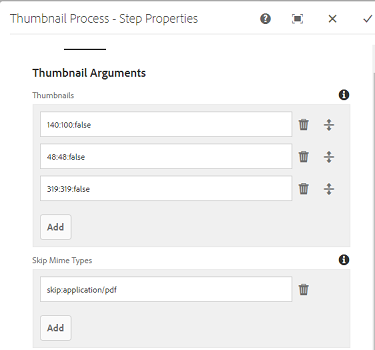
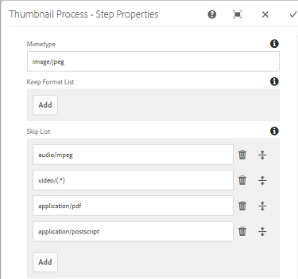
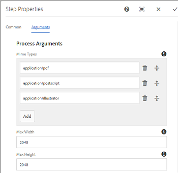
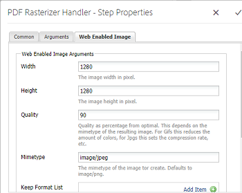
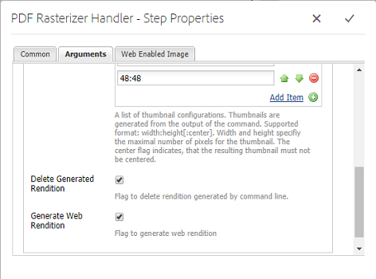
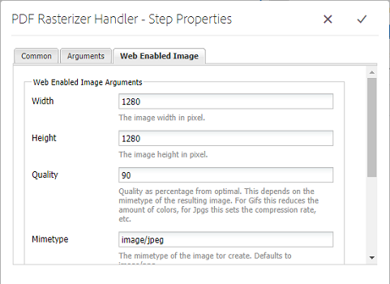

# Usar PDF Rasterizer {#using-pdf-rasterizer}

Cuando se cargan archivos PDF o AI de gran tamaño y gran cantidad de contenido en [!DNL Adobe Experience Manager Assets], es posible que la biblioteca predeterminada no genere un resultado preciso. La biblioteca PDF Rasterizer de Adobe puede generar un resultado más fiable y preciso en comparación con el resultado de una biblioteca predeterminada. Adobe recomienda utilizar la biblioteca PDF Rasterizer para los siguientes casos:

Adobe recomienda utilizar la biblioteca PDF Rasterizer para lo siguiente:

* Archivos AI o archivos PDF pesados y con gran cantidad de contenido.
* Archivos AI y archivos PDF con miniaturas que no se generan de forma predeterminada.
* Archivos AI con colores del Sistema de coincidencia de Pantone (PMS).

Las miniaturas y vistas previas generadas con PDF Rasterizer son de mejor calidad en comparación con la salida predeterminada y, por lo tanto, proporcionan una experiencia de visualización uniforme en todos los dispositivos. La biblioteca Rasterizer de Adobe PDF no admite ninguna conversión de espacio de color. Siempre se envía a RGB independientemente del espacio de color del archivo de origen.

1. Instale el paquete PDF Rasterizer en su implementación de [!DNL Adobe Experience Manager] desde [Distribución de software](https://experience.adobe.com/#/downloads/content/software-distribution/en/aem.html?package=/content/software-distribution/en/details.html/content/dam/aem/public/adobe/packages/cq650/product/assets/aem-assets-pdf-rasterizer-pkg-4.6.zip).

   >[!NOTE]
   >
   >La biblioteca Rasterizer de PDF solo está disponible para Windows y Linux®.

1. Acceda a la consola de flujo de trabajo [!DNL Assets] en `https://[aem_server]:[port]/workflow`. Abra el flujo de trabajo [!UICONTROL DAM Update Asset].

1. Para evitar la generación de miniaturas y representaciones web para archivos PDF y archivos AI mediante los métodos predeterminados, siga estos pasos:

   * Abra el paso **[!UICONTROL Procesar miniaturas]** y agregue `application/pdf` o `application/postscript` en el campo **[!UICONTROL Omitir tipos MIME]** en la pestaña **[!UICONTROL Miniaturas]** según sea necesario.

   

   * En la ficha **[!UICONTROL Imagen Web habilitada]**, agregue `application/pdf` o `application/postscript` bajo **[!UICONTROL Lista de omisión]** según sus necesidades.

   

1. Abra el paso **[!UICONTROL Rasterizar representación de vista previa de imágenes de PDF/AI]** y quite el tipo MIME para el que desea omitir la generación predeterminada de representaciones de imágenes de vista previa. Por ejemplo, quite el tipo MIME `application/pdf`, `application/postscript` o `application/illustrator` de la lista **[!UICONTROL Tipos MIME]**.

   

1. Arrastre el paso **[!UICONTROL Controlador de rasterizador de PDF]** desde el panel lateral hasta debajo del paso **[!UICONTROL Procesar miniaturas]**.
1. Configure los siguientes argumentos para el paso **[!UICONTROL Controlador de rasterizador de PDF]**:

   * Tipos MIME: `application/pdf` o `application/postscript`
   * Comandos: `PDFRasterizer -d -s 1280 -t PNG -i ${file}`
   * Añadir tamaños de miniatura: 319:319, 140:100, 48:48. Añada la configuración de miniaturas personalizada, si es necesario.

   Los argumentos de la línea de comandos para el comando `PDFRasterizer` pueden incluir lo siguiente:

   * `-d`: marca para habilitar la representación suave de texto, ilustraciones vectoriales e imágenes. Crea imágenes de mejor calidad. Sin embargo, si se incluye este parámetro, el comando se ejecuta lentamente y aumenta el tamaño de las imágenes.

   * `-s`: dimensión de imagen máxima (altura o anchura). Se convierte a ppp en cada página. Si las páginas tienen un tamaño diferente, cada página puede escalarse potencialmente en una cantidad diferente. El valor predeterminado es el tamaño de página real.

   * `-t`: tipo de imagen de salida. Los tipos válidos son JPEG, PNG, GIF y BMP. El valor predeterminado es JPEG.

   * `-i`: ruta de acceso para PDF de entrada. Es un parámetro obligatorio.

   * `-h`: Ayuda

1. Para eliminar representaciones intermedias, seleccione **[!UICONTROL Eliminar representación generada]**.
1. Para permitir que PDF Rasterizer genere representaciones web, seleccione **[!UICONTROL Generar representación web]**.

   

1. Especifique la configuración en la ficha **[!UICONTROL Imagen Web]**.

   

1. Guarde el flujo de trabajo.
1. Para permitir que PDF Rasterizer procese páginas de PDF con bibliotecas de PDF, abra el modelo **[!UICONTROL DAM Process Subset]** desde la consola [!UICONTROL Workflow].
1. En el panel lateral, arrastre el paso Controlador de rasterizador de PDF al paso **[!UICONTROL Crear representación de imagen habilitada para web]**.
1. Configure los siguientes argumentos para el paso **[!UICONTROL Controlador de rasterizador de PDF]**:

   * Tipos MIME: `application/pdf` o `application/postscript`
   * Comandos: `PDFRasterizer -d -s 1280 -t PNG -i ${file}`
   * Agregar tamaños de miniatura: `319:319`, `140:100`, `48:48`. Añada la configuración de miniaturas personalizada según sea necesario.

   Los argumentos de la línea de comandos para el comando `PDFRasterizer` pueden incluir lo siguiente:

   * `-d`: marca para habilitar la representación suave de texto, ilustraciones vectoriales e imágenes. Crea imágenes de mejor calidad. Sin embargo, si se incluye este parámetro, el comando se ejecuta lentamente y aumenta el tamaño de las imágenes.

   * `-s`: dimensión de imagen máxima (altura o anchura). Se convierte a ppp en cada página. Si las páginas tienen un tamaño diferente, cada página puede escalarse potencialmente en una cantidad diferente. El valor predeterminado es el tamaño de página real.

   * `-t`: tipo de imagen de salida. Los tipos válidos son JPEG, PNG, GIF y BMP. El valor predeterminado es JPEG.

   * `-i`: ruta de acceso para PDF de entrada. Es un parámetro obligatorio.

   * `-h`: Ayuda

1. Para eliminar representaciones intermedias, seleccione **[!UICONTROL Eliminar representación generada]**.
1. Para permitir que PDF Rasterizer genere representaciones web, seleccione **[!UICONTROL Generar representación web]**.

   

1. Especifique la configuración en la ficha **[!UICONTROL Imagen Web]**.

   

1. Guarde el flujo de trabajo.
1. Cargar un archivo PDF o un archivo AI a [!DNL Experience Manager Assets]. PDF Rasterizer genera las miniaturas y representaciones web del archivo.
