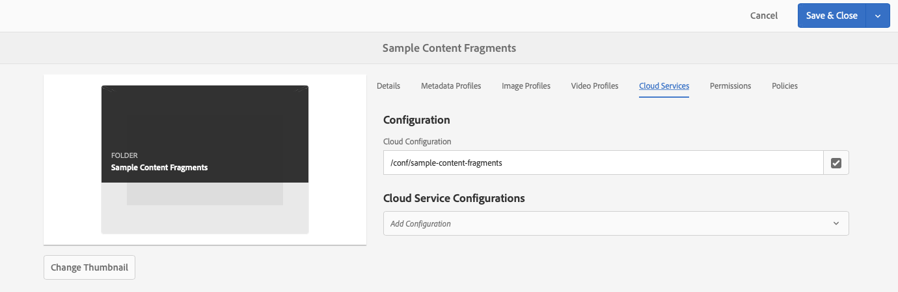

# Fragmentos de contenido: explorador de configuración{#content-fragments-configuration-browser}

Obtenga información sobre cómo habilitar determinadas funcionalidades de fragmentos de contenido en el explorador de configuración para utilizar las potentes funciones de entrega sin encabezado de Adobe Experience Manager (AEM).

## Habilitación de la funcionalidad de fragmento de contenido para la instancia {#enable-content-fragment-functionality-instance}

Antes de usar fragmentos de contenido, usa el **Explorador de configuración** para habilitar lo siguiente:

* **Modelos de fragmentos de contenido**: obligatorio
* **Consultas persistentes de GraphQL**: opcional

>[!CAUTION]
>
>Si no habilita **Modelos de fragmentos de contenido**:
>
>* la opción **Crear** no estará disponible para crear modelos.
>* no puede [seleccionar la configuración de Sites para crear el extremo relacionado](/help/sites-developing/headless/graphql-api/graphql-endpoint.md#enabling-graphql-endpoint).

Para habilitar la funcionalidad de fragmento de contenido, debe hacer lo siguiente:

* Habilitar el uso de la funcionalidad de fragmento de contenido mediante el explorador de configuración
* Aplicar la configuración a la carpeta de Assets

### Habilitación de la funcionalidad de fragmento de contenido en el Explorador de configuración {#enable-content-fragment-functionality-in-configuration-browser}

Para [usar ciertas funciones de fragmentos de contenido](#creating-a-content-fragment-model), **debe** habilitarlas primero mediante el **Explorador de configuración**:

>[!NOTE]
>
>Para obtener más información, vea [Explorador de configuración:](/help/sites-administering/configurations.md#using-configuration-browser).

1. Vaya a **Herramientas**, **General**, luego abra el **Explorador de configuración**.

1. Use **Crear** para abrir el cuadro de diálogo, donde:

   1. Especifique un **Título**.
   1. Para habilitar su uso, seleccione
      * **Modelos de fragmentos de contenido**
      * **Consultas persistentes de GraphQL**

      

1. Seleccione **Crear** para guardar la definición.

<!-- 1. Select the location appropriate to your website. -->

### Aplicación de la configuración a la carpeta Recursos {#apply-the-configuration-to-your-assets-folder}

Cuando la configuración **global** está habilitada para la funcionalidad de fragmento de contenido, se aplica a cualquier carpeta de Assets.

Para utilizar otras configuraciones (es decir, excluyendo global) con una carpeta de Assets comparable, debe definir la conexión. Para ello, seleccione la **configuración** adecuada en la pestaña **Cloud Services** de las **Propiedades de carpeta** de la carpeta correspondiente.

