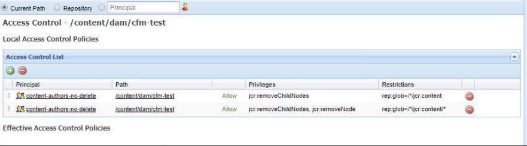

# Fragmentos de contenido: Eliminar consideraciones {#content-fragments-delete-considerations}

Revise estas consideraciones importantes antes de definir las políticas de eliminación de fragmentos de contenido en AEM. Los fragmentos de contenido son una potente herramienta para ofrecer contenido sin encabezado, y las implicaciones de eliminarlos deben examinarse detenidamente.

## Permisos: Eliminar o no eliminar {#permissions-delete-or-not-delete}

La capacidad para eliminar contenido es potente, pero potencialmente sensible, y muchas industrias necesitan restringir y controlar cómo se distribuyen estos privilegios.

En relación con los permisos de eliminación, los fragmentos de contenido deben considerarse en dos niveles:

1. **El fragmento de contenido como una sola entidad.**

   * **Caso de uso**: un usuario que necesita editar/actualizar un fragmento de contenido: **y eliminar un fragmento completo**.
   * **Permisos**: el permiso [Eliminar](/help/sites-administering/security.md#actions) se puede [asignar mediante Administración de usuarios o grupos](/help/sites-administering/security.md#managing-permissions).

2. **Las diversas subentidades que conforman un fragmento de contenido; por ejemplo, variaciones, subnodos.**

   La operación básica del editor de fragmentos de contenido requiere que se puedan eliminar estos subelementos transitorios. Por ejemplo, al manipular variaciones; también al editar metadatos o administrar contenido asociado.

   * **Caso de uso**: un usuario que necesita editar/actualizar un fragmento de contenido: **sin permitir eliminar un fragmento completo**.
   * **Permisos**: consulte [Permisos necesarios para la funcionalidad del editor únicamente](#permissions-required-for-editor-functionality-only).

>[!NOTE]
>
>Cuando un usuario no tiene permisos de [Delete](/help/sites-administering/security.md#actions), el editor de fragmentos de contenido funciona en modo de *solo lectura*.

>[!NOTE]
>
>Consulte también [Cómo auditar las operaciones de administración de usuarios en AEM](/help/sites-administering/audit-user-management-operations.md).

## Permisos necesarios para la funcionalidad del editor únicamente {#permissions-required-for-editor-functionality-only}

Para los usuarios que necesiten editar o actualizar un fragmento de contenido, **sin permitirles eliminar un fragmento completo**, se deben asignar permisos específicos, ya que la operación básica del editor de fragmentos de contenido requiere que se puedan eliminar subelementos transitorios.

Por ejemplo, al manipular variaciones, al editar metadatos o al administrar contenido asociado.

>[!NOTE]
>
>Los permisos de eliminación, necesarios para editar o actualizar un fragmento de contenido, se incluyen en el permiso de eliminación [asignado mediante Administración de usuarios o grupos](/help/sites-administering/security.md#managing-permissions).

Los permisos necesarios para editar o actualizar un fragmento deben aplicarse al nodo que contiene el fragmento de contenido o a un nodo principal adecuado (en cualquier nivel de `/content/dam`). Cuando se asigna a un nodo principal de este tipo, los permisos se aplican a todos los nodos dentro de esa rama.

Por ejemplo, una carpeta que contendrá todos los fragmentos de contenido, como:

* `/content/dam/contentfragments`

>[!CAUTION]
>
>Configuración de permisos en `/content/dam` también es posible, ya que todos los fragmentos de contenido se almacenan aquí.
>
>Sin embargo, esta acción aplica los mismos permisos de eliminación a *todos* otros tipos de recursos también.

Los permisos previos para permitir que un usuario o grupo específico edite o actualice un fragmento de contenido son los siguientes:

>[!NOTE]
>
>Esta lista muestra todos los privilegios necesarios, no solo los de eliminación.

* Para los nodos o carpetas del fragmento de contenido:

  * `jcr:addChildNodes`, `jcr:modifyProperties`

* Para el nodo `jcr:content` de todos los fragmentos de contenido:

  * `jcr:addChildNodes`, `jcr:modifyProperties` y `jcr:removeChildNodes`

* Para todos los nodos siguientes `jcr:content` de todos los fragmentos de contenido:

  * `jcr:addChildNodes`, `jcr:modifyProperties` y `jcr:removeChildNodes`, `jcr:removeNode`

Estos privilegios de `remove` deben ser [administrados mediante Listas de control de acceso, dentro de CRXDE Lite](/help/sites-administering/user-group-ac-admin.md#access-right-management).

Los privilegios `add` y `modify` también se pueden administrar en CRXDE Lite o mediante la consola Administración de usuarios.

Por ejemplo, la definición de los privilegios de `remove` para un grupo `content-authors-no-delete`:

