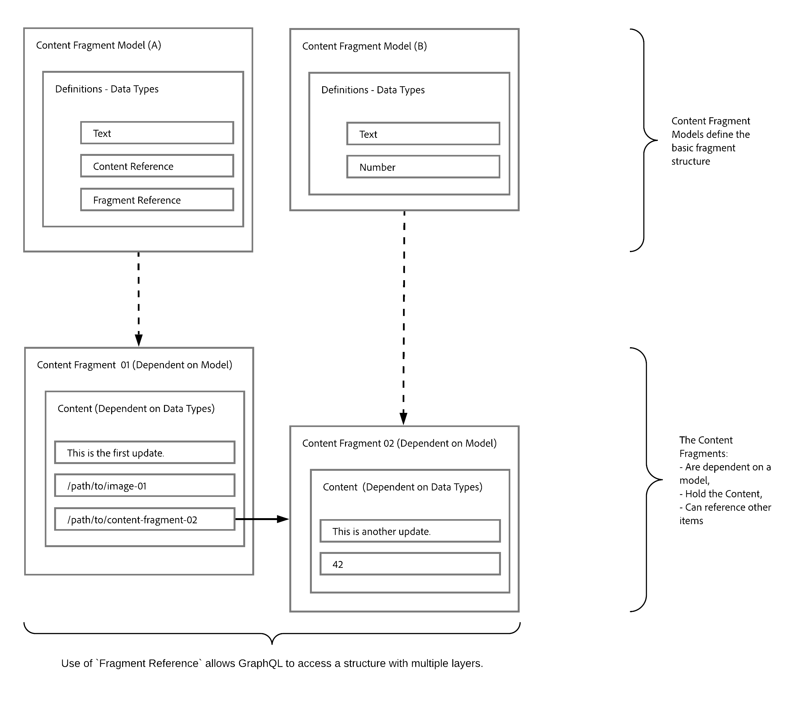

# Entrega de contenido sin encabezado mediante fragmentos de contenido con GraphQL {#headless-content-delivery-using-content-fragments-with-graphQL}

Con Adobe Experience Manager (AEM), puede utilizar fragmentos de contenido, junto con la API de GraphQL de AEM (una implementación personalizada, basada en GraphQL estándar), para ofrecer contenido estructurado sin encabezado para su uso en aplicaciones. La capacidad de personalizar una sola consulta de API le permite recuperar y entregar el contenido específico que desea o necesita procesar (como respuesta a la consulta de API única).

<!--
>[!NOTE]
>
>See [Headless and AEM](/help/implementing/developing/headless/introduction.md) for an introduction to Headless Development for AEM Sites.
-->

>[!NOTE]
>
>GraphQL se utiliza actualmente en dos escenarios (independientes) en Adobe Experience Manager (AEM):
>
>* [AEM Commerce consume datos de una plataforma de Commerce a través de GraphQL](/help/commerce/cif/integrating/magento.md).
>* [Los fragmentos de contenido de AEM trabajan junto con la API de GraphQL de AEM (una implementación personalizada, basada en GraphQL estándar) para ofrecer contenido estructurado para su uso en aplicaciones](/help/sites-developing/headless/graphql-api/graphql-api-content-fragments.md).

## CMS sin encabezado {#headless-cms}

Un sistema de administración de contenido sin encabezado (CMS) es lo siguiente:

* &quot;*Un sistema de administración de contenido sin encabezado, o CMS sin encabezado, es un sistema de administración de contenido (CMS) de back-end creado desde cero como repositorio de contenido que hace que el contenido sea accesible a través de una API para su visualización en cualquier dispositivo.*

  Consulte [Wikipedia](https://en.wikipedia.org/wiki/Headless_content_management_system).

En cuanto a la creación de fragmentos de contenido en AEM, esto significa lo siguiente:

* Puede utilizar fragmentos de contenido para crear contenido que no vaya a publicarse directamente (1:1) en páginas con formato.

* El contenido de los fragmentos de contenido se estructurará de forma predeterminada según los modelos de fragmento de contenido. Esto simplifica el acceso para las aplicaciones, que procesarán aún más el contenido.

## GraphQL: Información general {#graphql-overview}

GraphQL es lo siguiente:

* “*...un idioma de consulta para API y un tiempo de ejecución para cumplir esas consultas con los datos existentes*”.

  Consulte [GraphQL.org](https://graphql.org)

La [API de AEM GraphQL](#aem-graphql-api) le permite realizar consultas (complejas) en sus [fragmentos de contenido](/help/assets/content-fragments/content-fragments.md); y cada consulta se realiza según un tipo de modelo específico. Las aplicaciones pueden utilizar el contenido devuelto.

## API de AEM GraphQL {#aem-graphql-api}

Para Adobe Experience Platform, se ha desarrollado una implementación personalizada de la API estándar de GraphQL. Consulte [AEM API de GraphQL para su uso con fragmentos de contenido](/help/sites-developing/headless/graphql-api/graphql-api-content-fragments.md) para obtener más información.

La implementación de la API de AEM GraphQL se basa en las [Bibliotecas Java de GraphQL](https://graphql.org/code/#java).

## Fragmentos de contenido para su uso con la API de AEM GraphQL {#content-fragments-use-with-aem-graphql-api}

Los [Fragmentos de contenido](#content-fragments) se pueden usar como base para GraphQL para consultas AEM como:

* Permiten diseñar, crear, depurar y publicar contenido independiente de las páginas.
* Los [Modelos de fragmento de contenido](#content-fragments-models) proporcionan la estructura necesaria mediante tipos de datos definidos.
* La [Referencia de fragmento](#fragment-references), disponible al definir un modelo, se puede utilizar para definir capas de estructura adicionales.

### Fragmentos de contenido {#content-fragments}

Fragmentos de contenido:

* Incluyen contenido estructurado.

* Se basan en un [Modelo de fragmento de contenido](#content-fragments-models), que predefine la estructura del fragmento resultante.

### Modelos de fragmento de contenido {#content-fragments-models}

Estos [Modelos de fragmentos de contenido](/help/assets/content-fragments/content-fragments-models.md):

* Se utilizan para generar los [Esquemas](https://graphql.org/learn/schema/) una vez **Habilitados**.

* Proporcionan los tipos de datos y campos requeridos para GraphQL. Se aseguran de que la aplicación solo solicita lo que es posible y recibe lo que se espera.

* El tipo de datos **[Referencias de fragmento](#fragment-references)** se puede utilizar en el modelo para hacer referencia a otro fragmento de contenido y, por lo tanto, introducir niveles de estructura adicionales.

### Referencias a fragmento {#fragment-references}

La **[Referencia de fragmento](/help/assets/content-fragments/content-fragments-models.md#fragment-reference-nested-fragments)**:

* Es de particular interés en conjunto con GraphQL.

* Es un tipo de datos específico que se puede utilizar al definir un modelo de fragmento de contenido.

* Hace referencia a otro fragmento, según un modelo de fragmento de contenido específico.

* Permite recuperar datos estructurados.

  * Cuando se define como **multifuente**, el fragmento principal puede hacer referencia (recuperar) a varios subfragmentos.

### Previsualización de JSON {#json-preview}

Para ayudar a diseñar y desarrollar los modelos de fragmento de contenido, puede obtener una previsualización [Salida JSON](/help/assets/content-fragments/content-fragments-json-preview.md).

## Formación para utilizar GraphQL con AEM: contenido y consultas de muestra {#learn-graphql-with-aem-sample-content-queries}

Consulte [Aprender a utilizar GraphQL con AEM: contenido de muestra y consultas](/help/sites-developing/headless/graphql-api/content-fragments-graphql-samples.md) para obtener una introducción al uso de la API de AEM GraphQL.

## Tutorial: Introducción a AEM Headless y GraphQL

¿Busca un tutorial práctico? Consulte el tutorial completo [Introducción a AEM Headless y GraphQL](https://experienceleague.adobe.com/docs/experience-manager-learn/getting-started-with-aem-headless/graphql/overview.html?lang=es), que ilustra cómo crear y exponer contenido mediante las API de GraphQL de AEM y consumido por una aplicación externa, en un escenario de CMS sin encabezado.
