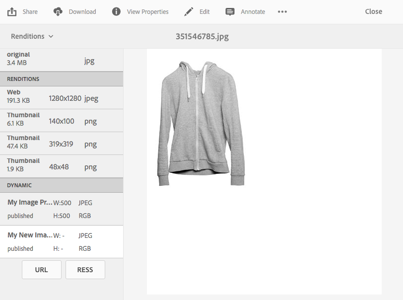

# Aplicar ajustes preestablecidos de imagen de Dynamic Media {#applying-image-presets}

Los ajustes preestablecidos de imagen permiten que los recursos entreguen dinámicamente imágenes en diferentes tamaños, en diferentes formatos o con otras propiedades de imagen que se generan dinámicamente. Puede elegir un ajuste preestablecido al exportar imágenes. El ajuste preestablecido redistribuye las imágenes según las especificaciones especificadas por el administrador.

Además, puede elegir un ajuste preestablecido de imagen que sea interactivo (designado por el botón **[!UICONTROL RESS]** después de seleccionarlo).

En esta sección se describe cómo utilizar los ajustes preestablecidos de imagen. [Los administradores pueden crear y configurar ajustes preestablecidos de imagen](managing-image-presets.md).

>[!NOTE]
>
>Las imágenes inteligentes funcionan con los ajustes preestablecidos de imagen existentes y utilizan inteligencia en el último milisegundo de entrega para reducir aún más el tamaño del archivo de imagen en función de la velocidad de conexión del explorador o de la red. Consulte [Imágenes inteligentes](imaging-faq.md) para obtener más información.

Puede aplicar un ajuste preestablecido de imagen a una imagen cada vez que la previsualice.

>[!NOTE]
>
>En el modo Dynamic Media - Scene7, los ajustes preestablecidos de imagen solo son compatibles con los recursos de imagen.

**Para aplicar ajustes preestablecidos de imagen de Dynamic Media:**

1. Abra el recurso y, en el carril izquierdo, seleccione el menú desplegable y luego seleccione **[!UICONTROL Representaciones]**.

   >[!NOTE]
   >
   >* Las representaciones estáticas aparecen en la mitad superior del panel. Las representaciones dinámicas aparecen en la mitad inferior. Solo con las representaciones dinámicas, puede utilizar la dirección URL para mostrar la imagen. El botón **[!UICONTROL URL]** solo aparece si selecciona una representación dinámica. El botón **[!UICONTROL RESS]** solo aparece si selecciona un ajuste preestablecido de imagen interactivo.
   >
   >* El sistema muestra numerosas representaciones cuando selecciona **[!UICONTROL Representaciones]** en la vista de detalles de un recurso. Puede aumentar el número de ajustes preestablecidos vistos. Ver [Aumentar el número de ajustes preestablecidos de imagen que se muestran](managing-image-presets.md#increasing-or-decreasing-the-number-of-image-presets-that-display).

   

1. Realice una de las siguientes acciones:

   * Seleccione una representación dinámica para poder previsualizar el ajuste preestablecido de imagen.
   * Para mostrar la ventana emergente, selecciona **[!UICONTROL URL]**, **[!UICONTROL Incrustar]** o **[!UICONTROL RESS]**.

   >[!NOTE]
   >
   >Si el recurso *y* el ajuste preestablecido de imagen aún no se han publicado, el botón **[!UICONTROL URL]** (o los botones **[!UICONTROL URL]** y **[!UICONTROL RESS]**, si corresponde) no estarán disponibles.
   >
   >Tenga en cuenta también que los ajustes preestablecidos de imagen se publican automáticamente en un servidor de Dynamic Media.
