# Recursos relacionados {#related-assets}

[!DNL Adobe Experience Manager Assets] le permite relacionar recursos manualmente según las necesidades de su organización mediante la función de recursos relacionados. Por ejemplo, puede relacionar un archivo de licencia con un recurso o una imagen o un vídeo sobre un tema similar. Puede relacionar recursos que comparten ciertos atributos comunes. También puede utilizar la función para crear relaciones de origen/derivadas entre recursos. Por ejemplo, si tiene un archivo PDF generado a partir de un archivo INDD, puede relacionar el archivo PDF con su archivo INDD de origen.

Con esta función, tiene la flexibilidad de compartir un archivo PDF de baja resolución o un archivo JPG con proveedores o agencias y hacer que el archivo INDD de alta resolución solo esté disponible bajo petición.

>[!NOTE]
>
>Solo los usuarios con permisos de edición en los recursos pueden relacionarlos y desrelacionarlos.

## Relacionar recursos {#relating-assets}

1. Desde la interfaz [!DNL Experience Manager], abra la página **[!UICONTROL Propiedades]** de un recurso que desee relacionar.

   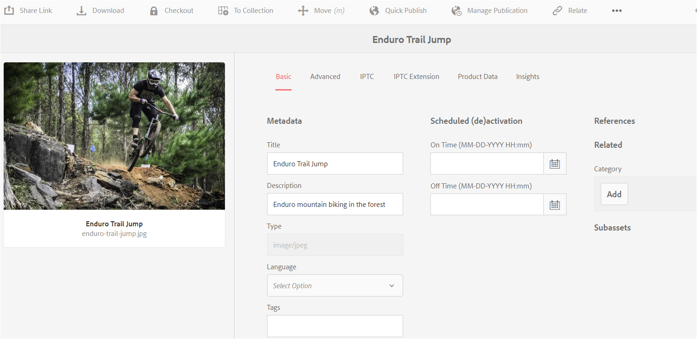

   *Figura: [!DNL Assets] [!UICONTROL Propiedades] página para relacionar recursos.*

   También puede seleccionar el recurso en la vista de lista.

   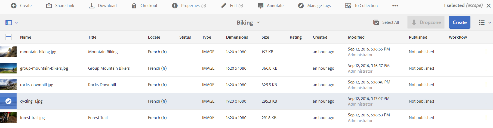

   También puede seleccionar el recurso de una colección.

   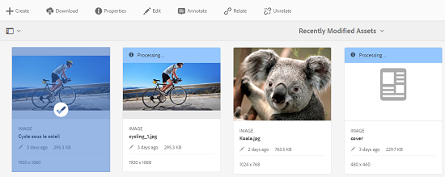

1. Para relacionar otro recurso con el que seleccionó, haga clic en **[!UICONTROL Relacionar]**  en la barra de herramientas.
1. Realice una de las siguientes acciones:

   * Para relacionar el archivo de origen del recurso, seleccione **[!UICONTROL Source]** en la lista.
   * Para relacionar un archivo derivado, seleccione **[!UICONTROL Derivado]** de la lista.
   * Para crear una relación bidireccional entre los recursos, seleccione **[!UICONTROL Otros]** en la lista.

1. En la pantalla **[!UICONTROL Seleccionar recurso]**, vaya a la ubicación del recurso que desea relacionar y selecciónelo.

   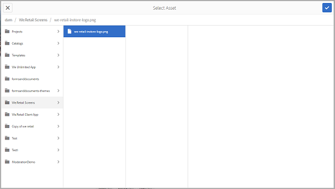

1. Haga clic en **[!UICONTROL Confirmar]**.
1. Haga clic en **[!UICONTROL Aceptar]** para cerrar el cuadro de diálogo. Según la relación que haya elegido en el paso 3, el recurso relacionado se enumerará en una categoría adecuada de la sección **[!UICONTROL Relacionado]**. Por ejemplo, si el recurso que ha relacionado es el archivo de origen del recurso actual, aparece en **[!UICONTROL Origen]**.

   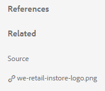

1. Para anular la relación de un recurso, haga clic en **[!UICONTROL Anular la relación de]**  en la barra de herramientas.

1. Seleccione los recursos que desea anular la relación del cuadro de diálogo **[!UICONTROL Quitar relaciones]** y haga clic en **[!UICONTROL Anular la relación]**.

   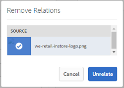

1. Haga clic en **[!UICONTROL Aceptar]** para cerrar el cuadro de diálogo. Los recursos para los que quitó relaciones se eliminarán de la lista de recursos relacionados en la sección **[!UICONTROL Relacionados]**.

## Traducción de recursos relacionados {#translating-related-assets}

La creación de relaciones de origen/derivadas entre recursos mediante la función de recursos relacionados también es útil en los flujos de trabajo de traducción. Cuando ejecuta un flujo de trabajo de traducción en un recurso derivado, [!DNL Experience Manager Assets] recupera automáticamente cualquier recurso al que haga referencia el archivo de origen y lo incluye para su traducción. De este modo, el recurso al que hace referencia el recurso de origen se traduce junto con los recursos de origen y derivados. Por ejemplo, considere un escenario en el que la copia en inglés incluya un recurso derivado y su archivo de origen como se muestra.

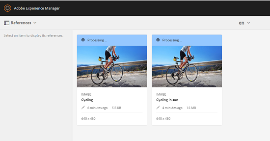

Si el archivo de origen está relacionado con otro recurso, [!DNL Experience Manager Assets] recupera el recurso al que se hace referencia y lo incluye para su traducción.

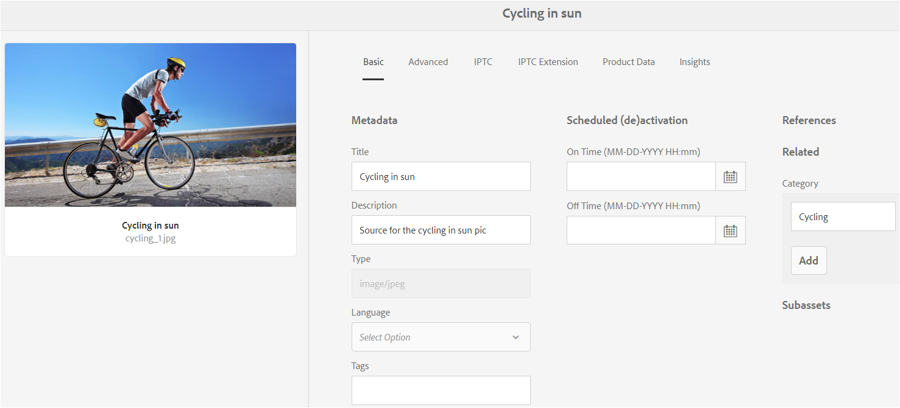

*Figura: recurso de Source de los recursos relacionados que se incluirán en la traducción.*

1. Traduzca los recursos de la carpeta de origen a un idioma de destino siguiendo los pasos de [Crear un proyecto de traducción](translation-projects.md#create-a-new-translation-project). Por ejemplo, en este caso, traduzca sus recursos al francés.

1. En la página [!UICONTROL Proyectos], abra la carpeta de traducción.

1. Haga clic en el mosaico del proyecto para abrir la página de detalles.

   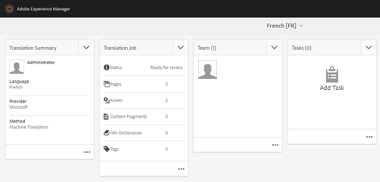

1. Haga clic en los puntos suspensivos debajo de la tarjeta Trabajo de traducción para ver el estado de la traducción.

   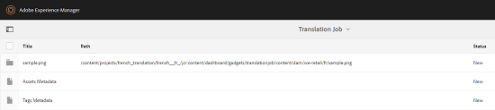

1. Seleccione el recurso y, a continuación, haga clic en **[!UICONTROL Mostrar en Assets]** en la barra de herramientas para ver el estado de traducción del recurso.

   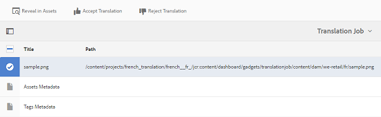

1. Para comprobar si se han traducido los recursos relacionados con el origen, haga clic en el recurso de origen.

1. Seleccione el recurso relacionado con el origen y, a continuación, haga clic en **[!UICONTROL Mostrar en Assets]**. Se muestra el recurso relacionado traducido.
