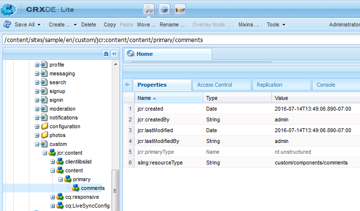
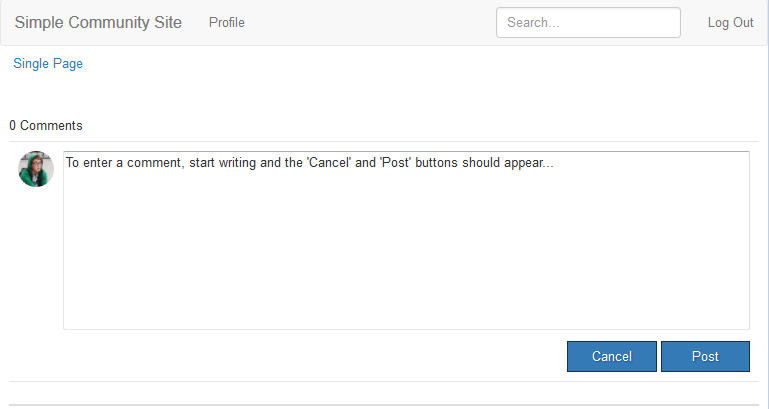
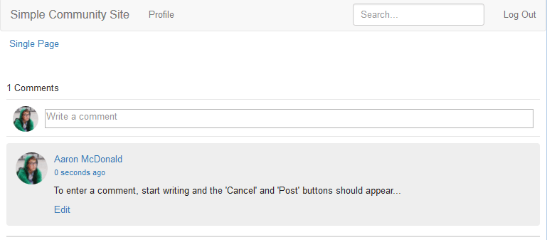

# Agregar comentario a página de muestra  {#add-comment-to-sample-page}

Ahora que los componentes del sistema de comentarios personalizado están en el directorio de la aplicación (/apps), es posible utilizar el componente ampliado. La instancia del sistema de comentarios de un sitio web que se va a ver afectado debe establecer su resourceType para que sea el sistema de comentarios personalizado e incluir todas las bibliotecas de cliente necesarias.

## Identificar Clientlibs Requeridos {#identify-required-clientlibs}

Las bibliotecas de cliente necesarias para el estilo y el funcionamiento de los comentarios predeterminados también son necesarias para los comentarios ampliados.

La [Guía de componentes de la comunidad](/help/communities/components-guide.md) identifica las bibliotecas de cliente necesarias. Vaya a la Guía de componentes y vea el componente Comentarios, por ejemplo:

[https://localhost:4502/content/community-components/en/comments.html](https://localhost:4502/content/community-components/en/comments.html)

Tenga en cuenta las tres bibliotecas de cliente necesarias para que los comentarios se representen y funcionen correctamente. Se deben incluir donde se hace referencia a los Comentarios extendidos y a la biblioteca de cliente de [Comentarios extendidos](/help/communities/extend-create-components.md#create-a-client-library-folder) ( `apps.custom.comments`).

### Agregar comentarios personalizados a una página {#add-custom-comments-to-a-page}

Como solo puede haber un sistema de comentarios por página, es más sencillo crear una página de muestra como se describe en el tutorial breve [crear una página de muestra](/help/communities/create-sample-page.md).

Una vez creado, introduzca el modo de diseño y active el grupo de componentes personalizados para permitir que se agregue el componente `Alt Comments` a la página.

Para que Comment aparezca y funcione correctamente, las bibliotecas de cliente para Comments deben agregarse a la lista clientlibs de la página (consulte [Clientlibs para componentes de Communities](/help/communities/clientlibs.md)).

#### Comentarios de Clientlibs en la página de muestra {#comments-clientlibs-on-sample-page}

#### Autor: comentar de forma alternativa en la página de muestra {#author-alt-comment-on-sample-page}

#### Autor: Nodo de comentarios de página de muestra {#author-sample-page-comments-node}

Puede comprobar el resourceType en CRXDE si ve las propiedades del nodo de comentarios de la página de muestra en `/content/sites/sample/en/jcr:content/content/primary/comments`.

#### Publicar página de muestra {#publish-sample-page}

Una vez agregado el componente personalizado a la página, también es necesario [volver a publicar la página](/help/communities/sites-console.md#publishing-the-site).

#### Publicar: comentar de forma alternativa en la página de muestra {#publish-alt-comment-on-sample-page}

Después de publicar la aplicación personalizada y la página de muestra, es posible introducir un comentario. Cuando se inicia sesión, ya sea con un [usuario de demostración](/help/communities/tutorials.md#demo-users) o administrador, es posible publicar un comentario.

Aquí está aaron.mcdonald@mailinator.com publicando un comentario:

Ahora que parece que el componente ampliado funciona correctamente con la apariencia predeterminada, es hora de modificar la apariencia.
