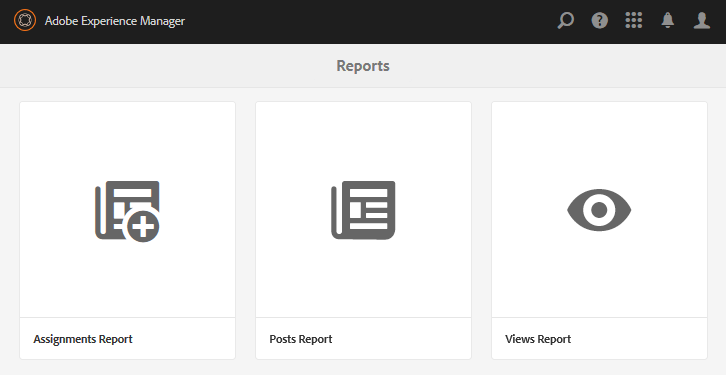
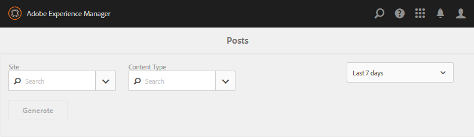

# Consola Informes {#reports-console}

## Información general {#overview}

Para AEM Communities, hay varios informes a los que se puede acceder de varias formas desde el entorno de creación.

En general, los distintos informes son:

* [Informe de vistas](#views-report)

  Proporciona un gráfico de vistas del contenido realizadas por los miembros de la comunidad y los visitantes del sitio para cualquier sitio de la comunidad.

* [Informe de entradas](#posts-report)

  Proporciona un gráfico de varios tipos de publicaciones realizadas por los miembros de la comunidad en cualquier sitio de la comunidad.

Los informes tabulares se pueden exportar en formato .csv para su posterior procesamiento.

## Consolas de informes {#reporting-consoles}

### Informes de sitios de la comunidad {#reports-for-community-sites}

* Desde la navegación global: **[!UICONTROL Navegación]** > **[!UICONTROL Comunidades]** > **[!UICONTROL Informes]**

* Elija entre:

  * **[!UICONTROL Informe de asignaciones]**

    * Genere un informe para el sitio, el usuario o el grupo y la asignación de la comunidad seleccionados.

  * **[!UICONTROL Informe de entradas]**

    * Genere un informe para el sitio de la comunidad, el tipo de contenido y el período de tiempo seleccionados.

  * **[!UICONTROL Informe de vistas]**

    * genere un informe para el sitio de la comunidad, el tipo de contenido y el período de tiempo seleccionados.

## Informe de vistas {#views-report}

La consola Vistas permite que las funciones de la comunidad generen informes en las vistas de página durante un período de tiempo determinado.

Seleccione los criterios del informe:

* **[!UICONTROL Sitio]**

  Seleccione un sitio de la comunidad.

* **[!UICONTROL Tipo de contenido]**

  Puede elegir Todo el contenido o seleccionar una de las funciones que están presentes en el sitio.

* **[!UICONTROL Periodo de tiempo]**

  Seleccione una de las siguientes opciones:

  * Últimos 7 días
  * Últimos 30 días
  * Últimos 90 días
  * Año pasado

Seleccione **[!UICONTROL Generar]** para crear el informe.

## Informe de anuncios {#posts-report}

La consola Publicaciones permite generar informes sobre el número de publicaciones en las funciones de la comunidad durante un período de tiempo determinado.

Seleccione los criterios del informe:

* **[!UICONTROL Sitio]**

  Seleccione un sitio de la comunidad.

* **[!UICONTROL Tipo de contenido]**

  Puede elegir Todo el contenido o seleccionar una de las funciones que están presentes en el sitio.

* **[!UICONTROL Periodo de tiempo]**

  Seleccione una de las siguientes opciones:

  * Últimos 7 días
  * Últimos 30 días
  * Últimos 90 días
  * Año pasado

Seleccione **[!UICONTROL Generar]** para crear el informe.

## Resolución de problemas {#troubleshooting}

### No hay sitios de la comunidad enumerados {#no-community-sites-listed}

Si no aparece ningún sitio de la comunidad, asegúrese de que Adobe Analytics se haya habilitado para un sitio. Si elige informes sobre las asignaciones, asegúrese de que la función de asignaciones se encuentra en la estructura del sitio de la comunidad.

### Los informes no se muestran en la instancia de autor de AEM {#reports-do-not-show-in-aem-author-instance}

Si los informes no se muestran en la instancia de autor de AEM, compruebe las personalizaciones, como la asignación de URL en la instancia de publicación. Si la asignación de URL solo se realiza en la instancia de publicación de AEM del sitio de comunidades, asegúrese de que se haya configurado lo mismo en la instancia de autor de AEM en la configuración de **Fábrica de componentes sociales de informe de tendencias del sitio**.

