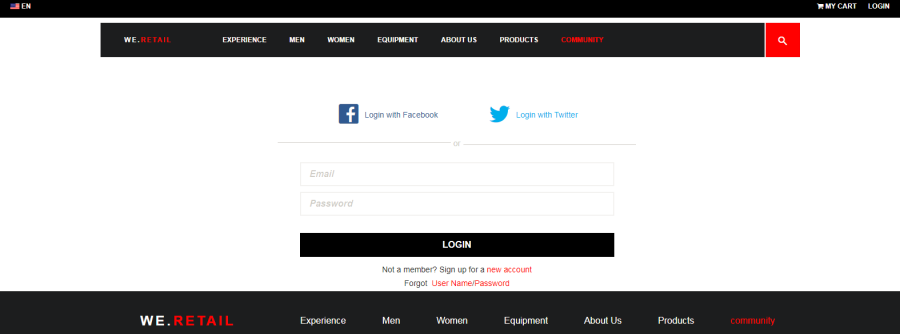
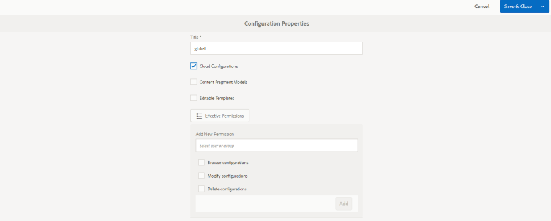
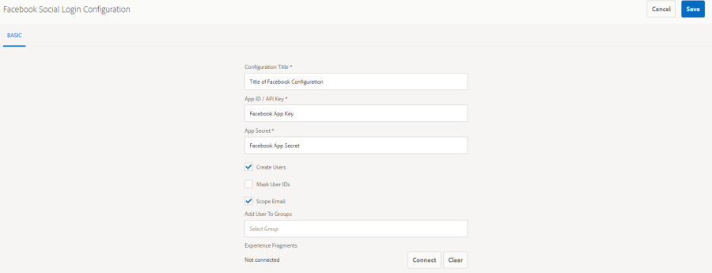
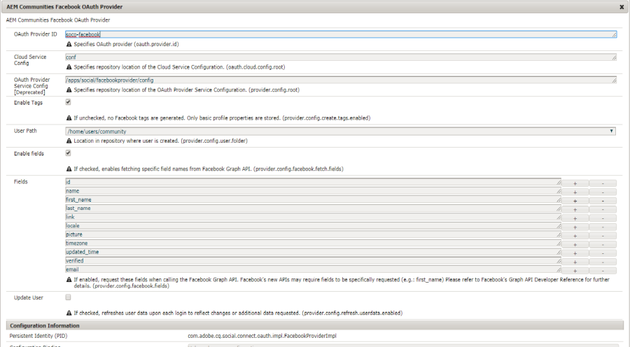
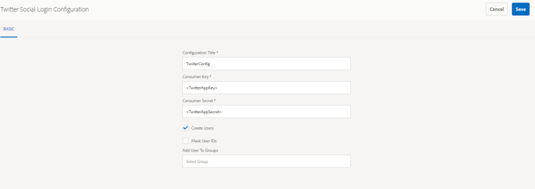
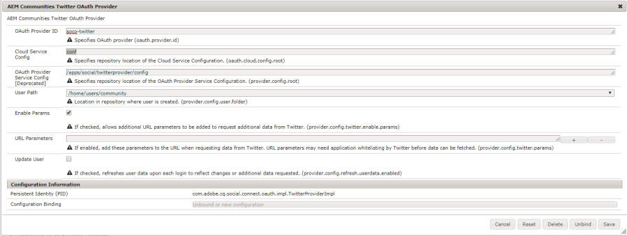
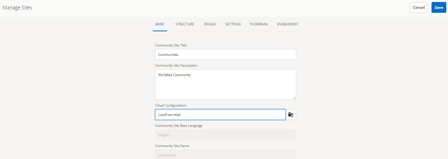
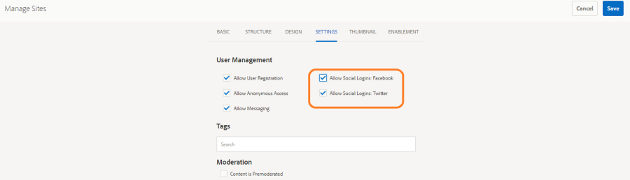
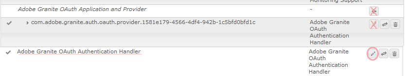
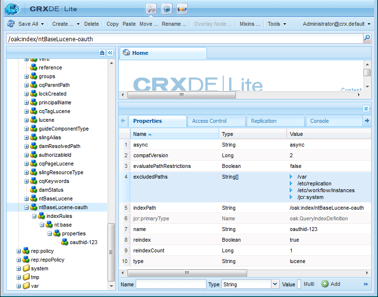

# Inicio de sesión social con Facebook y Twitter {#social-login-with-facebook-and-twitter}

El inicio de sesión social es la capacidad de presentar a un visitante del sitio la opción de iniciar sesión con su cuenta de Facebook o Twitter. Por lo tanto, incluye datos permitidos de Facebook o Twitter en su perfil de miembro de AEM.

## Información general de inicio de sesión social {#social-login-overview}

Para incluir el inicio de sesión en redes sociales, es *obligatorio* crear aplicaciones personalizadas de Facebook y Twitter.

Aunque el ejemplo de We-Retail proporciona aplicaciones de ejemplo de Facebook y Twitter, así como servicios en la nube, no están disponibles en un [sitio web de producción](../../help/sites-administering/production-ready.md).

Los pasos necesarios son:

1. [Habilitar la autenticación OAuth](#adobe-granite-oauth-authentication-handler) en todas las instancias de publicación de AEM.

   Sin OAuth habilitado, no se puede iniciar sesión.

1. **Crear** una aplicación social y un servicio en la nube.

   * Para admitir el inicio de sesión con Facebook:

     * Crear una [aplicación de Facebook](#create-a-facebook-app).
     * Crear y publicar un [servicio en la nube de Facebook Connect](#create-a-facebook-connect-cloud-service).

   * Para admitir el inicio de sesión con Twitter:

     * Crear una [aplicación de Twitter](#create-a-twitter-app).
     * Crear y publicar un [servicio en la nube de Twitter Connect](#create-a-twitter-connect-cloud-service).

1. [**Habilitar** inicio de sesión social](#enable-social-login) para un sitio de la comunidad.

Hay dos conceptos básicos:

1. **Ámbito** (permisos) especifica los datos que la aplicación puede solicitar.

   * Las instancias de Facebook y Twitter [Adobe Granite OAuth Application y Provider](#adobe-granite-oauth-application-and-provider) incluyen de forma predeterminada los permisos básicos de la aplicación en su ámbito.

1. **Campos** (parámetros) especifica los datos reales solicitados mediante parámetros de URL.

   * Estos campos están especificados en [AEM Communities Facebook OAuth Provider](#aem-communities-facebook-oauth-provider) y [AEM Communities Twitter OAuth Provider](#aem-communities-twitter-oauth-provider).
   * Los campos predeterminados son suficientes para la mayoría de los casos de uso, pero se pueden modificar.

## Inicio de sesión en Facebook {#facebook-login}

### Versión de API de Facebook {#facebook-api-version}

El inicio de sesión social y la muestra de Facebook we-retail se desarrollaron cuando la API de Facebook Graph era la versión 1.0.
A partir de AEM 6.4 GA y AEM 6.3 SP1, el inicio de sesión social se actualizó para funcionar con la nueva versión de Facebook Graph API 2.5.

>[!NOTE]
>
>Para versiones de AEM anteriores, si se enfrenta a una excepción en los registros **No se puede extraer un token de este**, actualice al CFP más reciente para esa versión de AEM.

Para obtener información sobre la versión de la API de Facebook Graph, consulte [registro de cambios de la API de Facebook](https://developers.facebook.com/docs/apps/changelog).

### Creación de una aplicación de Facebook {#create-a-facebook-app}

Se necesita una aplicación de Facebook configurada correctamente para habilitar el inicio de sesión social en Facebook.

Para crear una aplicación de Facebook, siga las instrucciones de Facebook en [https://developers.facebook.com/apps/](https://developers.facebook.com/apps/). Los cambios en sus instrucciones no se reflejan en la siguiente información.

En general, a partir de la API de Facebook v2.7:

* *Agregar nueva aplicación de Facebook*
  * Para *Platform*, elija Sitio web:
    * Para *URL del sitio*, ingrese `  https://<server>:<port>.`
    * Para *Nombre para mostrar*, escriba un título para utilizarlo como Título del servicio de conexión a Facebook.
    * Para *Categoría*, se recomienda elegir *Aplicaciones para Páginas*, pero puede ser cualquier cosa.
    * *Agregar producto: Inicio de sesión en Facebook*
    * Para *URI de redireccionamiento de OAuth válidos*, escriba `  https://<server>:<port>.`

>[!NOTE]
>
>Para el desarrollo, http://localhost:4503 funcionará.

Una vez creada la aplicación, busca la configuración de **[!UICONTROL App ID]** y **[!UICONTROL App Secret]**. Se requiere esta información para configurar el [servicio de nube de Facebook](#createafacebookcloudservice).

### Creación de un Cloud Service de Facebook Connect {#create-a-facebook-connect-cloud-service}

La instancia [Aplicación y proveedor de Adobe Granite OAuth](#adobe-granite-oauth-application-and-provider), creada al crear una configuración de servicio en la nube, identifica la aplicación de Facebook y los grupos de miembros a los que se agregan los nuevos usuarios.

1. En la instancia de autor de AEM, inicie sesión con privilegios de administrador.
1. En la navegación global, seleccione **[!UICONTROL Herramientas]** > **[!UICONTROL Cloud Services]** > **[!UICONTROL Configuración de inicio de sesión en Facebook Social]**.
1. Seleccione la configuración **[!UICONTROL ruta de acceso de contexto]**.

   **[!UICONTROL La ruta de acceso de contexto]** debe ser la misma que la ruta de acceso de configuración de nube que seleccionó al crear o editar un sitio de la comunidad.

1. Compruebe si la ruta de contexto está habilitada para crear servicios en la nube debajo de ella.
1. Vaya a **[!UICONTROL Herramientas]** > **[!UICONTROL General]** > **[!UICONTROL Explorador de configuración]**. Seleccione el contexto y edite las propiedades. Habilite Configuraciones en la nube si aún no está habilitado.

   

   * Consulte la documentación del [Explorador de configuración](/help/sites-administering/configurations.md) para obtener más información.

1. **Crear/Editar** configuración del servicio de nube de Facebook.

   

   * **[!UICONTROL Título]** (*Requerido*) Escriba un título para mostrar que identifique la aplicación de Facebook. Use el mismo nombre introducido como *Nombre para mostrar* para la aplicación de Facebook.
   * **[!UICONTROL ID de aplicación/clave API]** (*Requerido*) Escriba el ***ID de aplicación*** para la aplicación de Facebook. Esto identifica la instancia [Aplicación y proveedor de Adobe Granite OAuth](https://helpx.adobe.com/experience-manager/6-3/communities/using/social-login.html#AdobeGraniteOAuthApplicationandProvider) creada a partir del cuadro de diálogo.
   * **[!UICONTROL Secreto de la aplicación]** (*Requerido*) Escribe el ***Secreto de la aplicación*** para la aplicación de Facebook.
   * **[!UICONTROL Crear usuarios]** Si se selecciona, al iniciar sesión con una cuenta de Facebook se creará una entrada de usuario de AEM y se agregará como miembro al grupo de usuarios seleccionado.  La opción predeterminada está activada (recomendado).
   * **[!UICONTROL Enmascarar ID de usuario]**: dejar sin seleccionar.
   * **[!UICONTROL Correo electrónico del ámbito]**: el ID de correo electrónico del usuario debe recuperarse de Facebook.
   * **[!UICONTROL Agregar a grupos de usuarios]** seleccione Agregar grupo de usuarios para elegir uno o más [grupos de miembros](https://helpx.adobe.com/experience-manager/6-3/communities/using/users.html) para el sitio de la comunidad al que se agregarán los usuarios.

   >[!NOTE]
   >
   >Los grupos se pueden agregar o eliminar en cualquier momento. Sin embargo, las suscripciones de los usuarios existentes no se ven afectadas. La pertenencia automática solo se aplica a los nuevos usuarios que se crean después de esta actualización de campo. Para los sitios en los que los usuarios anónimos están deshabilitados, elija agregar usuarios al grupo de miembros de la comunidad correspondiente destinado a ese sitio de comunidad cerrado.

   * Seleccione **[!UICONTROL GUARDAR]**.
   * **[!UICONTROL Publicar]**.

El resultado es una instancia de [Adobe Granite OAuth Application and Provider](https://helpx.adobe.com/experience-manager/6-3/communities/using/social-login.html#adobe-granite-oauth-application-and-provider) que no requiere ninguna modificación adicional a menos que se agregue un ámbito adicional (permisos). El ámbito predeterminado son los permisos estándar para el inicio de sesión en Facebook. Si desea un ámbito adicional, es necesario editar la configuración de OSGI directamente. Si hay modificaciones realizadas directamente a través del sistema o la consola, evite editar las configuraciones del servicio en la nube desde la interfaz de usuario táctil para evitar sobrescribirlas.

### Proveedor de OAuth de AEM Communities Facebook {#aem-communities-facebook-oauth-provider}

El proveedor de AEM Communities amplía la instancia [Aplicación y proveedor de Adobe Granite OAuth](#adobe-granite-oauth-application-and-provider).

Se debe editar este proveedor para:

* Permitir actualizaciones de usuario
* Agregar campos adicionales [dentro del ámbito](#adobe-granite-oauth-application-and-provider)

  * No todos los campos permitidos de forma predeterminada se incluyen de forma predeterminada.

Si es necesario editar, en cada instancia de publicación de AEM:

1. Iniciar sesión con privilegios de administrador.
1. Vaya a la [consola web](../../help/sites-deploying/configuring-osgi.md). Por ejemplo, http://localhost:4503/system/console/configMgr.
1. Busque el proveedor de OAuth de AEM Communities Facebook.
1. Seleccione el icono de lápiz que desea abrir para editarlo.

   

   * **[!UICONTROL ID de proveedor de OAuth]**

     (*Requerido*) El valor predeterminado es *soco -facebook*. No editar.

   * **[!UICONTROL Configuración de Cloud Service]**

     El valor predeterminado es `/etc/  cloudservices /  facebookconnect`. No editar.

   * **[!UICONTROL Configuración del servicio de proveedor de OAuth]**

     El valor predeterminado es `/apps/social/facebookprovider/config/`. No editar.

   * **[!UICONTROL Habilitar etiquetas]**

     No editar.

   * **[!UICONTROL Ruta de usuario]**

     Ubicación en el repositorio donde se almacenan los datos de usuario. En un sitio de la comunidad, para garantizar permisos para que los miembros vean el perfil de los demás, la ruta debe ser la predeterminada */home/users/community*.

   * **[!UICONTROL Habilitar campos]**

     Si se selecciona, los campos enumerados se especifican en la solicitud a Facebook para la autenticación y la información del usuario. La opción predeterminada no está seleccionada.

   * **[!UICONTROL Campos]**

     Cuando los campos están activados, se incluyen los siguientes campos al llamar a la API de Facebook Graph. Los campos deben permitirse dentro del ámbito definido en la configuración del servicio en la nube. Los campos adicionales pueden requerir la aprobación por parte de Facebook. Consulte la sección Permisos de inicio de sesión de Facebook de la documentación de Facebook. Los campos predeterminados agregados como parámetros son los siguientes:

     * id
     * name
     * first_name
     * last_name
     * vínculo
     * locale
     * retratar
     * timezone
     * updated_time
     * verificado
     * email

   Si se agrega o cambia algún campo, actualice la configuración del controlador de sincronización predeterminada correspondiente para corregir la asignación.

   * **[!UICONTROL Actualizar usuario]**

     Si se selecciona, actualiza los datos de usuario en el repositorio en cada inicio de sesión para reflejar los cambios de perfil o los datos adicionales solicitados. La opción predeterminada no está seleccionada.

#### Próximos pasos {#next-steps}

Los siguientes pasos son los mismos tanto para Facebook como para Twitter:

* [Publicar las configuraciones del servicio en la nube](#publishcloudservices)
* [Habilitar para un sitio de la comunidad](#enable-social-login)

## Inicio de sesión de Twitter {#twitter-login}

### Crear una aplicación de Twitter {#create-a-twitter-app}

Se requiere una aplicación de Twitter configurada para habilitar el inicio de sesión social en Twitter.

Siga las instrucciones más recientes para crear una aplicación de Twitter en [https://apps.twitter.com](https://apps.twitter.com/).

En general:

1. Escriba un *Nombre* que identificará su aplicación de Twitter para los usuarios de su sitio web.
1. Escriba una *descripción*.
1. Para *sitio web* - ingrese `https://<server>`.
1. Para *URL de devolución de llamada* - ingrese `https://server`.

   >[!NOTE]
   >
   >No es necesario especificar el puerto.
   >
   >Para el desarrollo, https://127.0.0.1/ funcionará.

1. Una vez creada la aplicación, busque la **[!UICONTROL clave de consumidor (API)]** y el **[!UICONTROL secreto de consumidor (API)]**. Se necesitará esta información para configurar el [servicio en la nube de Twitter](#createatwittercloudservice).

#### Permisos {#permissions}

En la sección de permisos de la administración de aplicaciones de Twitter:

* **[!UICONTROL Acceso]**: Seleccione `Read only`.

  * Otras opciones no son compatibles

* **[!UICONTROL Permisos adicionales]**: opcionalmente, elija `Request email addresses from users`.

  * Si no se selecciona, el perfil de usuario de AEM no incluirá su dirección de correo electrónico.
  * Las instrucciones de Twitter indican pasos adicionales a seguir.

La única solicitud de REST para el inicio de sesión social es *[obtener cuenta/verificar credenciales](https://dev.twitter.com/rest/reference/get/account/verify_credentials)*.

### Creación de un Cloud Service de Twitter Connect {#create-a-twitter-connect-cloud-service}

La instancia [Aplicación y proveedor de Adobe Granite OAuth](#adobe-granite-oauth-application-and-provider), creada al crear una configuración de servicio en la nube, identifica la aplicación de Twitter y los grupos de miembros a los que se agregan los nuevos usuarios.

1. En la instancia de autor, inicie sesión con privilegios de administrador.
1. En la navegación global, seleccione **[!UICONTROL Herramientas]** > **[!UICONTROL Cloud Services]** > **[!UICONTROL Configuración de inicio de sesión en Twitter Social]**.
1. Elija la configuración de **[!UICONTROL ruta de acceso de contexto]**.

   La ruta de contexto debe ser la misma que la ruta de configuración de nube seleccionada al crear o editar un sitio de la comunidad.

1. Compruebe si la ruta de contexto está habilitada para crear servicios en la nube debajo de ella.
1. Vaya a **[!UICONTROL Herramientas]** > **[!UICONTROL General]** > **[!UICONTROL Explorador de configuración]**. Seleccione el contexto y edite las propiedades. Habilite Configuraciones en la nube si aún no está habilitado.

   

   * Consulte la documentación del [Explorador de configuración](/help/sites-administering/configurations.md) para obtener más información.

1. Cree o edite la configuración del servicio en la nube de Twitter.

   

   * **[!UICONTROL Título]**

     (*Obligatorio*) Escriba un título para mostrar que identifique la aplicación de Twitter. Use el mismo nombre introducido como *Nombre para mostrar* para la aplicación de Twitter.

   * **[!UICONTROL Clave de consumidor]**

     (*Obligatorio*) Escriba la **clave de consumidor (API)** para la aplicación de Twitter. Esto identifica la instancia [Aplicación y proveedor de Adobe Granite OAuth](https://helpx.adobe.com/experience-manager/6-3/communities/using/social-login.html#AdobeGraniteOAuthApplicationandProvider) creada a partir del cuadro de diálogo.

   * **[!UICONTROL Secreto del consumidor]**

     (*Obligatorio*) Escriba el ***Secreto de la API del consumidor*** para la aplicación de Twitter.

   * **[!UICONTROL Crear usuarios]**

     Si se selecciona, al iniciar sesión con una cuenta de Twitter, se creará una entrada de usuario de AEM y se agregará como miembro al grupo de usuarios seleccionado. La opción predeterminada está activada (recomendado).

   * **[!UICONTROL Enmascarar ID de usuario]**

     Dejar sin seleccionar.

   * **[!UICONTROL Agregar a grupos de usuarios]**

     Seleccione Agregar grupo de usuarios para elegir uno o más [grupos de miembros](https://helpx.adobe.com/experience-manager/6-3/communities/using/users.html) para el sitio de la comunidad al que se agregarán los usuarios.

   >[!NOTE]
   >
   >Los grupos se pueden agregar o eliminar en cualquier momento. Sin embargo, las suscripciones de los usuarios existentes no se ven afectadas. La pertenencia automática solo se aplica a los nuevos usuarios que se crean después de esta actualización de campo. En los sitios en los que los usuarios anónimos están deshabilitados, agregue usuarios al grupo de miembros de la comunidad correspondiente destinado a ese sitio de comunidad cerrado.
   >

1. Seleccione **[!UICONTROL GUARDAR]** y **[!UICONTROL Publicar]**.

El resultado es una instancia de [Adobe Granite OAuth Application and Provider](https://helpx.adobe.com/experience-manager/6-3/communities/using/social-login.html#adobe-granite-oauth-application-and-provider) que no requiere ninguna modificación adicional. El ámbito predeterminado son los permisos estándar para el inicio de sesión en Twitter.

### Proveedor de OAuth de AEM Communities Twitter {#aem-communities-twitter-oauth-provider}

La configuración de AEM Communities amplía la instancia [Aplicación y proveedor de Adobe Granite OAuth](#adobe-granite-oauth-application-and-provider). Se debe editar este proveedor para permitir las actualizaciones del usuario.

Si es necesario editar, en cada instancia de publicación de AEM:

1. Iniciar sesión con privilegios de administrador.
1. Vaya a la [consola web](../../help/sites-deploying/configuring-osgi.md).

   Por ejemplo, http://localhost:4503/system/console/configMgr.

1. Busque el proveedor de OAuth de AEM Communities Twitter.
1. Seleccione el icono de lápiz que desea abrir para editarlo.

   

   * **[!UICONTROL ID de proveedor de OAuth]**

   (*Requerido*) El valor predeterminado es *soco -twitter*. No editar.

   * **[!UICONTROL Configuración de Cloud Service]**

     El valor predeterminado es *conf.* No editar.

   * **[!UICONTROL Configuración del servicio de proveedor de OAuth]**

     El valor predeterminado es `/apps/social/twitterprovider/config/`. No editar.

   * **[!UICONTROL Ruta de usuario]**

     Ubicación en el repositorio donde se almacenan los datos de usuario. En un sitio de la comunidad, para garantizar permisos para que los miembros vean el perfil de los demás, la ruta de acceso debe ser la predeterminada `/home/users/community`.

   * **[!UICONTROL Activar parámetros]** - no editar
   * **[!UICONTROL Parámetros de URL]** - no editar
   * **[!UICONTROL Actualizar usuario]**

     Si se selecciona, actualiza los datos de usuario en el repositorio en cada inicio de sesión para reflejar los cambios de perfil o los datos adicionales solicitados. La opción predeterminada no está seleccionada.

#### Próximos pasos {#next-steps-1}

Los siguientes pasos son los mismos tanto para Facebook como para Twitter:

* [Publicar las configuraciones del servicio en la nube](#publishcloudservices)
* [Habilitar para un sitio de la comunidad](#enable-social-login)

## Habilitar inicio de sesión social {#enable-social-login}

### Consola de AEM Communities Sites {#aem-communities-sites-console}

Una vez configurado un servicio en la nube, puede habilitarse para la configuración de inicio de sesión social correspondiente en un sitio de la comunidad mediante el subpanel [Administración de usuarios](https://helpx.adobe.com/experience-manager/6-3/communities/using/sites-console.html#USERMANAGEMENT) Configuración durante la creación del sitio de la comunidad [o [administración](https://helpx.adobe.com/experience-manager/6-3/communities/using/sites-console.html#ModifyingSiteProperties).](https://helpx.adobe.com/experience-manager/6-3/communities/using/sites-console.html#SiteCreation)

1. Elija el contexto de configuración del sitio en el que guardó las configuraciones de inicio de sesión social.

1. En la pestaña General, establezca las configuraciones de nube.

   

1. En la pestaña Configuración, habilite **[!UICONTROL Inicios de sesión en medios sociales]** y Guardar.

   

## Probar inicio de sesión social {#test-social-login}

* Asegúrese de que [Controlador de autenticación OAuth de Adobe Granite](#adobe-granite-oauth-authentication-handler) esté habilitado en todas las instancias de publicación.
* Asegúrese de que se han publicado los servicios en la nube.
* Asegúrese de que se ha publicado el sitio de la comunidad.
* Inicie el sitio publicado en un explorador.
Por ejemplo, http://localhost:4503/content/sites/engage/en.html
* Seleccione **[!UICONTROL Iniciar Sesión En]**.
* Seleccione **[!UICONTROL Iniciar sesión con Facebook]** o **[!UICONTROL Iniciar sesión con Twitter]**.
* Si aún no ha iniciado sesión en Facebook o Twitter, inicie sesión con las credenciales adecuadas.
* Puede ser necesario conceder el permiso según el cuadro de diálogo que muestre la aplicación de Facebook o Twitter.
* Tenga en cuenta que la barra de herramientas situada en la parte superior de la página se actualiza para reflejar el inicio de sesión correcto.
* Seleccione **[!UICONTROL Perfil]**: la página Perfil muestra la imagen de avatar, el nombre y los apellidos del usuario. También muestra la información del perfil de Facebook o Twitter según los campos o parámetros permitidos.

## Configuraciones de OAuth de AEM Platform {#aem-platform-oauth-configurations}

### Controlador de autenticación OAuth de Adobe Granite {#adobe-granite-oauth-authentication-handler}

`Adobe Granite OAuth Authentication Handler` no está habilitado de manera predeterminada y ***debe estar habilitado en todas las instancias de publicación de AEM.***

Para habilitar el controlador de autenticación en la publicación, simplemente abra la configuración OSGi y guárdela:

* Iniciar sesión con privilegios de administrador.
* Vaya a la [consola web](../../help/sites-deploying/configuring-osgi.md).
Por ejemplo, http://localhost:4503/system/console/configMgr
* Busque `Adobe Granite OAuth Authentication Handler`.
* Seleccione para abrir la configuración y editarla.
* Seleccione **[!UICONTROL Guardar]**.

>[!CAUTION]
>
>Tenga cuidado de no confundir el controlador de autenticación con una instancia de Facebook o Twitter de *Aplicación y proveedor de Adobe Granite OAuth*.

### Proveedor y aplicación de Adobe Granite OAuth {#adobe-granite-oauth-application-and-provider}

Cuando se crea un servicio en la nube para Facebook o Twitter, se crea una instancia de `Adobe Granite OAuth Authentication Handler`.

Para localizar la instancia creada para una aplicación de Facebook o Twitter:

1. Iniciar sesión con privilegios de administrador.
1. Vaya a la [consola web](../../help/sites-deploying/configuring-osgi.md).

   Por ejemplo, http://localhost:4503/system/console/configMgr.

1. Busque la aplicación y el proveedor de Adobe Granite OAuth.

   * Busque la instancia donde **[!UICONTROL ID de cliente]** coincide con **[!UICONTROL ID de aplicación]**.

     

     Salvo las siguientes propiedades, deje las demás propiedades de la configuración sin modificar:

   * **[!UICONTROL Id. de configuración]**

     (*Requerido*) Los identificadores de configuración de OAuth deben ser únicos. Se genera automáticamente cuando se crea el servicio en la nube.

   * **[!UICONTROL ID de cliente]**

     (*Obligatorio*) El identificador de aplicación proporcionado cuando se creó el servicio en la nube.

   * **[!UICONTROL Secreto de cliente]**

     (*Obligatorio*) El secreto de aplicación proporcionado cuando se creó el servicio en la nube.

   * **[!UICONTROL Ámbito]**

     (*Opcional*) Se puede solicitar al proveedor un ámbito adicional para lo que se permite. El ámbito predeterminado cubre los permisos necesarios para proporcionar autenticación social y datos de perfil.

   * **[!UICONTROL Id. de proveedor]**

     (*Obligatorio*) El identificador de proveedor para AEM Communities se establece cuando se creó el servicio en la nube. No editar. Para Facebook Connect, el valor es *soco -facebook*. Para Twitter Connect, el valor es *soco -twitter*.

   * **[!UICONTROL Grupos]**

     (*Recomendado*) Uno o más grupos de miembros a los que se agregan los usuarios creados. Para AEM Communities, se recomienda enumerar el grupo de miembros del sitio de la comunidad.

   * **[!UICONTROL URL de devolución de llamada]**

     (*Opcional*) URL configurada con los proveedores de OAuth para redirigir al cliente de vuelta. Utilice una URL relativa para utilizar el host de la solicitud original. Dejar vacío para utilizar la URL solicitada originalmente en su lugar. El sufijo &quot;/callback/j_security_check&quot; se anexa automáticamente a esta URL

   >[!NOTE]
   >
   >El dominio para la llamada de retorno debe estar registrado con el proveedor (Facebook o Twitter).

Para cada configuración del controlador de autenticación OAuth, hay dos configuraciones adicionales creadas en la instancia:

* Controlador de sincronización predeterminado de Apache Jackrabbit Oak (org.apache.jackrabbit.oak.spi.security.authentication.external.impl.DefaultSyncHandler): no se requieren ediciones, pero puede ver las asignaciones de campos de usuario y cómo se asignan los campos de Facebook a un nodo de perfil de usuario de CQ. Observe también que &quot;Nombre del controlador de sincronización&quot; coincide con el ID de configuración de la configuración del proveedor de OAuth.
* Módulo de inicio de sesión externo de Apache Jackrabbit Oak (org.apache.jackrabbit.oak.spi.security.authentication.external.impl.ExternalLoginModuleFactory): no se requieren ediciones en este entorno, pero es posible que observe que &quot;Nombre del proveedor de identidad&quot; y &quot;Nombre del controlador de sincronización&quot; son iguales y apuntan a las configuraciones correspondientes de OAuth y del controlador de sincronización, respectivamente.

Para obtener más información, consulte [Autenticación con el módulo de inicio de sesión externo de Apache Oak](https://jackrabbit.apache.org/oak/docs/security/authentication/externalloginmodule.html).

## Rendimiento de recorrido de usuario de OAuth {#oauth-user-traversal-performance}

En el caso de los sitios de la comunidad en los que se registran cientos de miles de usuarios con sus inicios de sesión en Facebook o Twitter, el rendimiento de recorrido de la consulta realizada cuando un visitante del sitio utiliza sus inicios de sesión en redes sociales se puede mejorar añadiendo el siguiente índice de Oak.

Si se ven advertencias transversales en los registros, se recomienda añadir este índice.

En una instancia de autor, ha iniciado sesión con privilegios administrativos:

1. En la navegación global: seleccione **Herramientas, [CRX/DE Lite](../../help/sites-developing/developing-with-crxde-lite.md).**
1. Cree un índice denominado ntBaseLucene-oauth a partir de una copia de ntBaseLucene:

   * En el nodo `/oak:index`
   * Seleccionar nodo `ntBaseLucene`
   * Seleccionar **[!UICONTROL copia]**
   * Seleccionar `/oak:index`
   * Seleccionar **[!UICONTROL Pegar]**
   * Cambiar nombre de copia de ntBaseLucene a `ntBaseLucene-oauth`

1. Modifique las propiedades del nodo ntBaseLucene-oauth:

   * **[!UICONTROL rutaDeAccesoDeÍndice]**: `/oak:index/ntBaseLucene-oauth`
   * **[!UICONTROL nombre]**: `oauthid-123****`
   * **[!UICONTROL reindex]**: `true`
   * **[!UICONTROL reindexCount]**: `1`

1. En el nodo /oak:index/ntBaseLucene-oauth/indexRules/nt:base/properties:

   * Elimine todos los nodos secundarios, excepto cqTags.
   * Cambiar nombre de cqTags a `oauthid-123****`
   * Modifique las propiedades del nodo `oauthid-123****`

     * **[!UICONTROL nombre]**: `oauthid-123****`

   * Seleccione **[!UICONTROL Guardar todo]**.

* Para el **nombre** `oauthid-123`, reemplaza *123* por la ***ID de la aplicación*** de Facebook o la clave ***de la API del consumidor*** de Twitter que es el valor de la **ID del cliente** en la configuración de la [Aplicación y proveedor de Adobe Granite OAuth](social-login.md#adobe-granite-oauth-application-and-provider).

  

Para obtener información y herramientas adicionales, consulte [Consultas e indexación de Oak](../../help/sites-deploying/queries-and-indexing.md).

## Configuración de Dispatcher {#dispatcher-configuration}

Consulte [Configuración de Dispatcher para comunidades](dispatcher.md).
