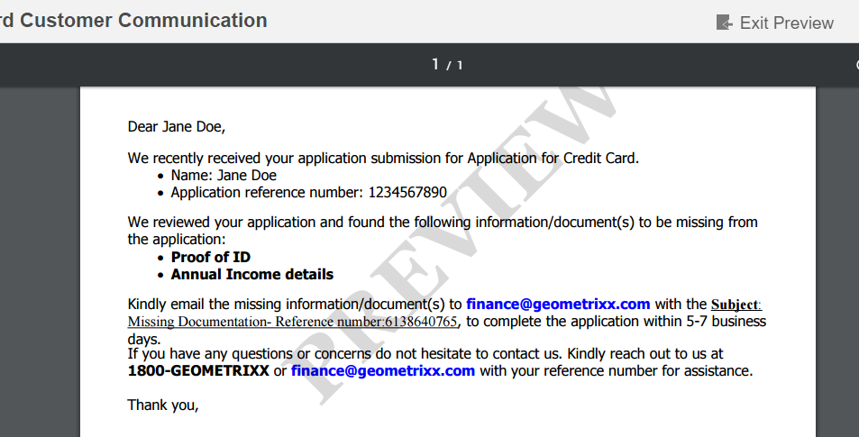

# Marca de agua personalizada en la vista previa del PDF de cartas{#custom-watermark-in-letter-pdf-preview}

## Información general {#overview}

En la interfaz de usuario Crear correspondencia, los usuarios del agente previsualizan la correspondencia en la forma final en la que se envía al posprocesamiento, por ejemplo, para correo electrónico o impresión.

Para evitar el uso no autorizado de estos datos, las organizaciones pueden imponer una marca de agua en la vista previa PDF. La marca de agua predeterminada es “PREVIEW” que aparece en el PDF.

Para habilitar la marca de agua en la vista previa PDF, seleccione la opción **[!UICONTROL Aplicar marca de agua]** Durante vista previa en **[!UICONTROL Configuraciones de Administración de correspondencia]** en https://&#39;[server]:[port]&#39;/system/console/configMgr.



Puede seguir los siguientes pasos para personalizar el texto y el aspecto de la marca de agua:

## Personalizar la marca de agua en la vista previa PDF en la IU Crear correspondencia {#customizewatermark-}

1. Vaya a `https://'[server]:[port]'/[ContextPath]/crx/de` e inicie sesión como administrador.
1. En la carpeta de aplicaciones, cree una carpeta denominada **[!UICONTROL previewwatermark]** con una ruta/estructura similar a la carpeta previewwatermark de la vista previa en la carpeta libs:

   1. Haga clic con el botón derecho en la carpeta **previewwatermark** en la siguiente ruta y seleccione **Nodo de superposición**:

      `/libs/fd/cm/configFiles/previewwatermark`

   1. Asegúrese de que el cuadro de diálogo Nodo de superposición tenga los siguientes valores:

      **Ruta:** /libs/fd/cm/configFiles/previewwatermark

      **Ubicación de superposición:** /apps/

      **Coincidir tipos de nodo:** Comprobado

      >[!NOTE]
      >
      >No realice cambios en la rama /libs. Cualquier cambio que realice podría perderse, ya que esta rama puede cambiar siempre que haga lo siguiente:
      >
      >    
      >    
      >    * Actualice en su instancia
      >    * Aplique una corrección
      >    * Instale un paquete de características
      >    
      >

   1. Haga clic en **Aceptar** y luego en **Guardar todo**. La carpeta **[!UICONTROL previewwatermark]** se crea en la ruta de acceso especificada.

1. Copie y pegue el archivo ddx de la carpeta &quot;/libs/fd/cm/configFiles/previewwatermark&quot; en la carpeta &quot;/apps/fd/cm/configFiles/previewwatermark&quot; y haga clic en **[!UICONTROL Guardar todo]**.
1. Realice los cambios deseados en el archivo ddx en /apps/fd/cm/configFiles/previewwatermark/.

   ```xml
   <DDX xmlns="https://ns.adobe.com/DDX/1.0/">
    <PDF result="output.pdf">
     <PDF source="input.pdf"/>
           <Watermark opacity="15%" rotation="45">
            <StyledText>
                     <p font-family="Georgia" font-size="70pt" color="black" font-weight="bold">
                         PREVIEW
                    </p>
            </StyledText>
           </Watermark>
    </PDF>
   </DDX>
   ```

   Para obtener información sobre cómo personalizar el aspecto, el texto y la alineación de la marca de agua, consulte Agregar y eliminar marcas de agua y fondos en el documento [Servicio Assembler y referencia DDX](https://help.adobe.com/es_ES/livecycle/11.0/ddxRef.pdf).

   >[!NOTE]
   >
   >En el archivo dx, las referencias a resultado y origen deben permanecer sin cambios a output.pdf y input.pdf. El nombre del ddx del archivo tampoco debe cambiarse.

1. Haga clic en **Guardar todo**.
