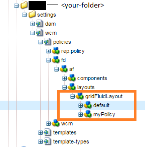

# Visualizar componentes basados en la plantilla utilizada{#displaying-components-based-on-the-template-used}

Cuando un autor de formularios crea un formulario adaptable mediante una [plantilla](../../forms/using/template-editor.md), el autor del formulario puede ver y utilizar componentes específicos basados en la política de plantillas. Puede especificar una política de contenido de plantilla que le permita elegir un grupo de componentes que el autor del formulario verá en el momento de crear el formulario.

## Modificar la política de contenido de una plantilla {#changing-the-content-policy-of-a-template}

Al crear una plantilla, se crea en `/conf` en el repositorio de contenido. En función de las carpetas creadas en el directorio `/conf`, la ruta a la plantilla es: `/conf/<your-folder>/settings/wcm/templates/<your-template>`.

Realice los siguientes pasos para mostrar los componentes de la barra lateral en función de la política de contenido de una plantilla:

1. Abra CRXDE Lite.\
   URL: `https://<server>:<port>/crx/de/index.jsp`
1. En CRXDE, vaya a la carpeta en la que se crea la plantilla.

   Por ejemplo: `/conf/<your-folder>/`

1. En CRXDE, navegue hasta: `/conf/<your-folder>/settings/wcm/policies/fd/af/layouts/gridFluidLayout/`

   Para seleccionar un grupo de componentes, se requiere una nueva directiva de contenido. Para crear una directiva, copie y pegue la directiva predeterminada y cambie su nombre.

   La ruta a la directiva de contenido predeterminada es la siguiente: `/conf/<your-folder>/settings/wcm/policies/fd/af/layouts/gridFluidLayout/default`

   En la carpeta `gridFluidLayout`, copie y pegue la directiva predeterminada y renómbrela. Por ejemplo, `myPolicy`.

   

1. Seleccione la nueva directiva que haya creado y, a continuación, seleccione la propiedad **componentes** del panel derecho con la letra `string[]`.

   Cuando seleccione y abra la propiedad de componentes, verá el cuadro de diálogo Editar componentes. El cuadro de diálogo Editar componentes permite agregar o quitar grupos de componentes mediante los botones **+** y **-**. Puede agregar un grupo de componentes que incluya los que desea que utilicen los autores.

   

   Después de agregar un grupo de componentes, haga clic en **Aceptar** para actualizar la lista y, a continuación, haga clic en **Guardar todo** encima de la barra de direcciones CRXDE y actualice.

1. En la plantilla, cambie la directiva de contenido de predeterminada a la nueva directiva que ha creado. ( `myPolicy` en este ejemplo).

   Para cambiar la directiva, en CRXDE, navegue hasta `/conf/<your-folder>/settings/wcm/templates/<your-template>/policies/jcr:content/guideContainer/rootPanel/items`.

   En la propiedad `cq:policy`, cambie `default` al nombre nuevo de la directiva ( `myPolicy`).

   

   Cuando cree un formulario mediante la plantilla, podrá ver los componentes agregados en la barra lateral.
