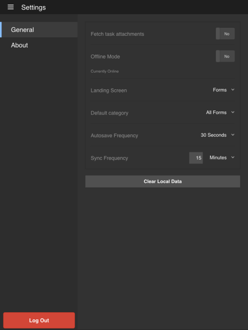

# Pantalla principal{#home-screen}

>[!NOTE]
>
>La aplicación de AEM Forms está actualmente en desuso. Si tiene alguna pregunta o ayuda, comuníquese con [aemformsapp-android@adobe.com](mailto:aemformsapp-android@adobe.com).

Al iniciar sesión en la aplicación AEM Forms, se le redirige a la pantalla Inicio.

## Pantalla Inicio predeterminada {#default-home-screen}

De forma predeterminada, la pantalla Inicio muestra todos los formularios, incluidos los puntos de inicio y las tareas (si el servidor conectado está habilitado para AEM Forms Workflow), junto con las miniaturas asociadas. Puede especificar las miniaturas en AEM Forms Server.

La siguiente figura muestra anotaciones con llamadas a los componentes esenciales en la pantalla Inicio predeterminada.

<!--
Click to enlarge

-->

1. **Botón de menú**: selecciona el botón **Menú** para ir a Tareas, Forms, Bandeja de salida y Configuración. Si la aplicación AEM Forms está conectada a un servidor de AEM Forms JEE, puede ver la opción Tareas. La opción Tareas también almacena los borradores creados a partir de las tareas de un proceso. En los servidores OSGi de AEM Forms, la opción Tareas está oculta. La Bandeja de salida almacena los formularios y los borradores guardados antes de sincronizarse con el servidor. Todos los formularios y borradores guardados en la Bandeja de salida se cargan en el servidor de AEM Forms cuando la aplicación está [sincronizada con el servidor](../../forms/using/sync-app.md). Para obtener información sobre la configuración, consulte [Actualización de la configuración general](../../forms/using/update-general-settings.md).
1. **Tarea o formulario**: seleccione la tarea o el formulario de la lista con los que desea trabajar.
1. **Puntos suspensivos horizontales**: indican que hay acciones disponibles en el formulario. Al pulsar los puntos suspensivos, se muestran las acciones y la descripción que ha proporcionado el autor. Las opciones **Eliminar borrador** y **Completar** están visibles al seleccionar los puntos suspensivos.
1. **Icono de actualización**: Seleccione el icono de actualización para sincronizar su aplicación con el servidor de AEM Forms.

### Personalización de la pantalla Inicio {#customizing-the-home-screen}

Puede cambiar la pantalla Inicio predeterminada de la aplicación desde la **[Configuración general](../../forms/using/update-general-settings.md)** de la aplicación o desde la pestaña **Preferencia** de HTML Workspace.

Los cambios realizados en la configuración de la pantalla Inicio de la aplicación afectan a la pantalla Inicio del usuario que ha iniciado sesión o del usuario que utiliza el dispositivo móvil actual.

Sin embargo, los cambios realizados en HTML Workspace afectan a todos los usuarios de la aplicación de AEM Forms que han iniciado sesión en el servidor de AEM Forms.
