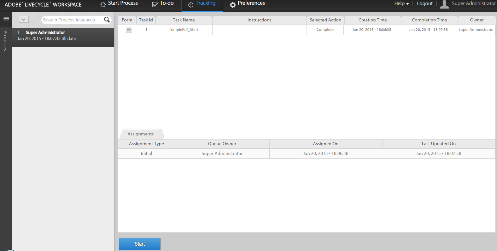
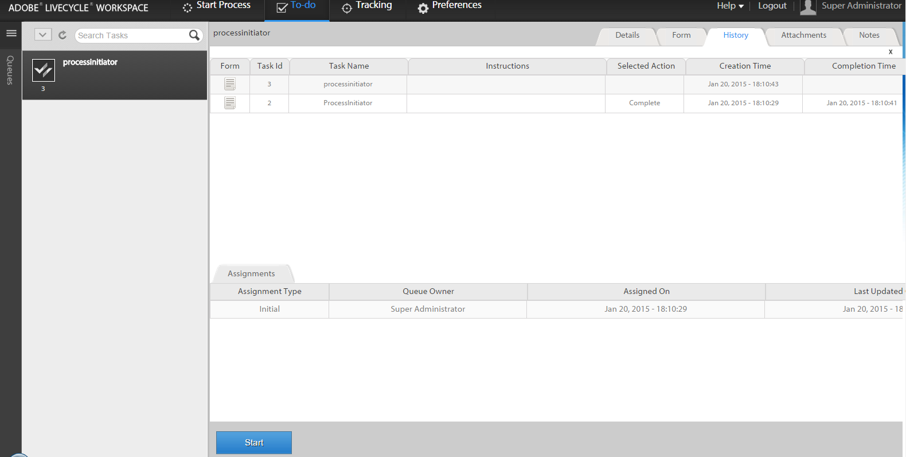

# Iniciar un nuevo proceso con datos de proceso existentes en AEM Forms Workspace{#initiating-a-new-process-with-existing-process-data-in-aem-forms-workspace}

Puede iniciar un nuevo proceso utilizando los datos de un proceso existente. La necesidad de iniciar un nuevo proceso a partir de los datos de proceso existentes surge cuando tenemos que usar el mismo formulario con frecuencia con pocos cambios en el contenido, como en el caso de los formularios de las vacaciones retribuidas. Esta función ahorra tiempo y esfuerzo a los usuarios, especialmente cuando el formulario del proceso es muy extenso.

A continuación se indican los pasos para iniciar un nuevo proceso a partir de los datos de proceso existentes:

1. Realice alguna de las siguientes acciones:

   * En Seguimiento, haga clic en la instancia de proceso cuyos datos desee utilizar. En la vista Historial de procesos del panel derecho, haga clic en la fila de tareas que corresponda al punto de inicio.
   * En Seguimiento, seleccione una plantilla de búsqueda para mostrar una lista de instancias de proceso. Seleccione la instancia cuyos datos desee utilizar.
   * En la pestaña **[!UICONTROL Tareas pendientes]**, seleccione la tarea. Haga clic en la pestaña **[!UICONTROL Historial]** y seleccione la tarea que inició la instancia de proceso.

    

1. En la barra de herramientas Acciones de tarea, haga clic en **[!UICONTROL Inicio]**. Se muestra un formulario adaptable para la nueva instancia de proceso con datos rellenados previamente.

1. Actualice los datos según sea necesario y haga clic en **[!UICONTROL Completar]** o en el botón apropiado del formulario.
