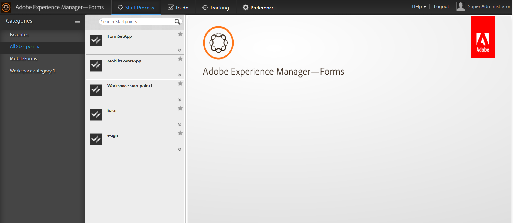

# Introducción a AEM Forms Workspace{#introduction-to-aem-forms-workspace}

El flujo de trabajo de Forms aumenta la eficacia organizativa al automatizar y dar visibilidad a los procesos empresariales relacionados con los formularios y los documentos esenciales. Con el módulo Process Management, puede crear flujos de trabajo de extremo a extremo optimizados, incluidas personas, sistemas, contenido y reglas empresariales, y a los que puede acceder en línea o sin conexión.El flujo de trabajo de Forms incluye AEM Forms Workspace. AEM Forms Workspace agrega nuevas capacidades para ampliar e integrar el espacio de trabajo y hacerlo más fácil de usar.

AEM Forms Workspace es compatible con más dispositivos y factores de formulario. Permite la administración de tareas en clientes sin Flash® Player ni Adobe® Reader®. Facilita la representación de formularios HTML y PDF.

**Capacidades clave**:

* Haga participar a los participantes en los procesos desde cualquier parte con formularios PDF dinámicos, interfaces móviles y aplicaciones web.
* Integre fácilmente los componentes de Workspace con las aplicaciones web. Como AEM Forms Workspace es un software basado en componentes, se puede personalizar y reutilizar de forma sencilla.
* Amplíe los procesos empresariales a los trabajadores móviles en línea y sin conexión con la aplicación AEM Forms Workspace.
* Vea informes para monitorizar los trabajos pendientes, las colas de trabajo y los indicadores clave de rendimiento (KPI). Puede utilizar las API para extraer datos para un análisis posterior mediante herramientas de informes de terceros.
