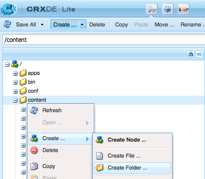
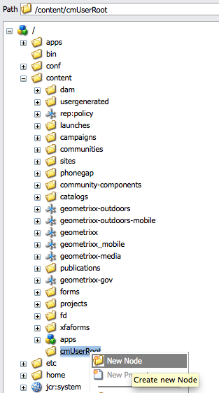
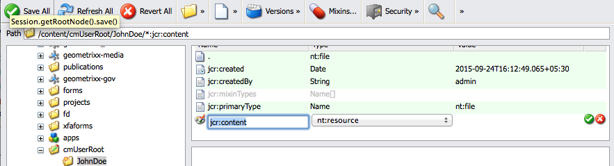
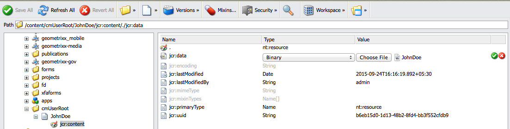
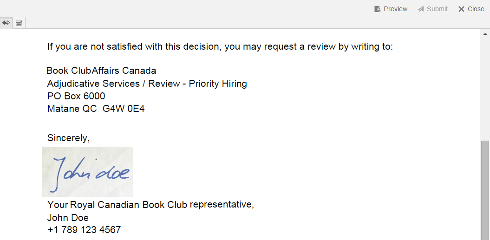

# Administrar imágenes de firma del agente{#manage-agent-signature-images}

## Información general {#overview}

En Administración de correspondencia, puede utilizar una imagen para representar la firma del agente en cartas. Después de configurar la imagen de firma del agente, mientras crea una carta, puede procesar esta imagen en la carta como la firma del agente remitente.

El DDE agentSignatureImage es un DDE calculado que representa la imagen de firma del agente. La expresión de este DDE calculado utiliza una nueva función personalizada expuesta por el bloque de creación del Administrador de expresiones. Esta función personalizada toma agentID y agentFolder como parámetros de entrada y obtiene el contenido de la imagen en función de estos parámetros. El diccionario de datos del sistema SystemContext proporciona a las cartas de Administración de correspondencia acceso a la información en el contexto actual del sistema. El contexto del sistema incluye información sobre el usuario que ha iniciado sesión en ese momento y los parámetros de configuración activos.

Puede añadir imágenes en la carpeta cmuserroot. En [Propiedades de configuración de Administración de correspondencia](/help/forms/using/cm-configuration-properties.md), puede cambiar la carpeta desde la que se obtiene la imagen de firma del agente con la propiedad CM User Root.

El valor de agentFolder DDE se toma del parámetro de configuración CMUserRoot para las propiedades de configuración de Administración de correspondencia. De forma predeterminada, este parámetro de configuración apunta a /content/cmUserRoot en el repositorio CRX. Puede cambiar el valor de la configuración de CMUserRoot en las propiedades de configuración.
También puede anular la función personalizada predeterminada para definir su propia lógica para recuperar la imagen de firma del usuario.

## Adición de la imagen de firma del agente {#adding-agent-signature-image}

1. Asegúrese de que la imagen de firma del agente tiene el mismo nombre que el nombre de usuario de AEM del usuario. (No se necesita extensión para el nombre del archivo de imagen).
1. En CRX, cree una carpeta con el nombre `cmUserRoot` en la carpeta de contenido.

   1. Vaya a `https://'[server]:[port]'/crx/de`. Si es necesario, inicie sesión como administrador.

   1. Haga clic con el botón derecho en la carpeta **contenido** y seleccione **Crear** > **Crear carpeta**.

      

   1. En el cuadro de diálogo Crear carpeta, introduzca el nombre de la carpeta como `cmUserRoot`. Haga clic en **Guardar todo**.

      >[!NOTE]
      >
      >cmUserRoot es la ubicación predeterminada en la que AEM busca la imagen de firma del agente. No obstante, puede cambiarla editando la propiedad CM User Root en [Propiedades de configuración de Administración de correspondencia](/help/forms/using/cm-configuration-properties.md).

1. En el Explorador de contenido, vaya a la carpeta cmUserRoot y agréguele la imagen de firma del agente.

   1. Vaya a `https://'[server]:[port]'/crx/explorer/index.jsp`. Inicie sesión como administrador, si es necesario.
   1. Haga clic en **Explorador de contenido**. El Explorador de contenido se abre en una nueva ventana.
   1. En el Explorador de contenido, vaya a la carpeta cmUserRoot y selecciónela. Haga clic con el botón derecho en la carpeta **cmUserRoot** y seleccione **Nuevo nodo**.

      

      Realice las siguientes entradas en la fila para el nuevo nodo y, a continuación, haga clic en la marca de verificación verde.

      **Nombre:** JohnDoe (o el nombre del archivo de firma del agente)

      **Tipo:** nt:file

      En la carpeta `cmUserRoot`, se crea una carpeta nueva denominada `JohnDoe` (o el nombre que haya introducido en el paso anterior).

   1. Haga clic en la carpeta nueva que ha creado (en este caso, `JohnDoe`). El Explorador de contenido muestra el contenido de la carpeta atenuado.

   1. Haga doble clic en la propiedad **jcr:content**, establezca su tipo como **nt:resource** y, a continuación, haga clic en la marca de verificación verde para guardar la entrada.

      Si la propiedad no está presente, cree primero una propiedad denominada jcr:content.

      

      Entre las subpropiedades de jcr:content se encuentra jcr:data, que está atenuado. Haga doble clic en jcr:data. La propiedad se vuelve editable y aparece el botón Elegir archivo en la entrada. Haga clic en **Elegir archivo** y seleccione el archivo de imagen que desee utilizar como logotipo. No es necesario que el archivo de imagen tenga una extensión.

      

   Haga clic en **Guardar todo**.

1. Asegúrese de que el XDP o el diseño que utiliza en la carta tenga un campo de imagen en la parte inferior izquierda (u en otro lugar apropiado del diseño donde desee representar la firma) para representar la imagen de firma.
1. Al crear la correspondencia, seleccione un campo de imagen para la imagen de firma en la pestaña Datos mediante los siguientes pasos:

   1. Seleccione Sistema en el menú emergente Tipo de vínculo del panel derecho.

   1. Seleccione el DDE agentSignatureImage en la lista del el panel Elemento de datos para SystemContext DD.

   1. Guarde la carta.

1. Cuando se representa la carta, puede ver la firma en la vista previa de la carta en el campo de imagen según el diseño.

   
