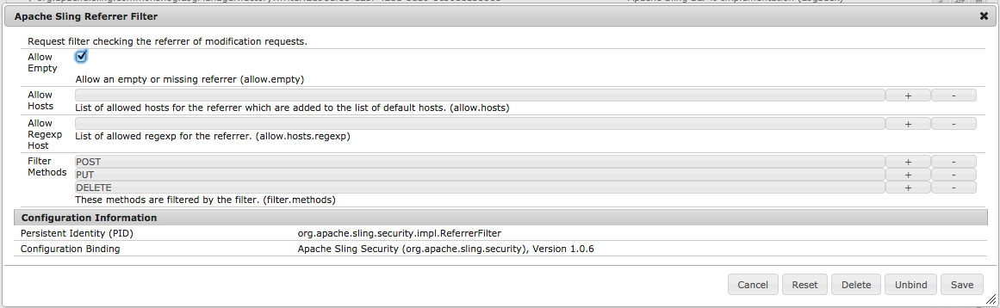

# Configuración del filtro de referente para permitir vacío{#setting-your-referrer-filter-to-allow-empty}

{{ue-over-mobile}}

Para permitir que el visualizador de aplicaciones móviles de Adobe Experience Manager (AEM) vea aplicaciones en su instancia de autor, debe establecer el filtro de referente de HTML en &quot;permitir vacío&quot;.

Si no tiene intención de utilizar el Visor de aplicaciones para revisar las aplicaciones en los estados de desarrollo y ensayo, no es necesario cambiar la configuración predeterminada del filtro de referente.

En la instancia de autor de AEM que está ejecutando, vaya a: [http://localhost:4502/system/console/configMgr](http://localhost:4502/system/console/configMgr) y busque &quot;Filtro de referente de Apache Sling&quot;. Haga clic para editar el filtro de remitente del reenvío y marque la casilla de verificación &quot;permitir vacío&quot; (ver la siguiente imagen). A continuación, pulse el botón Guardar y cierre la página del explorador.

