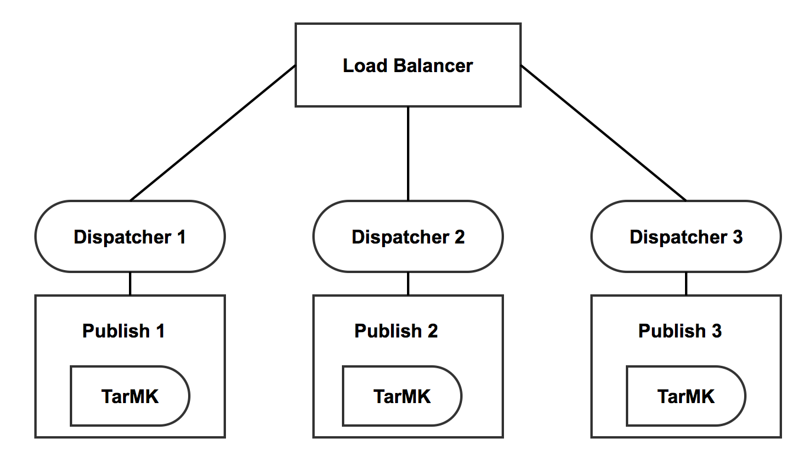
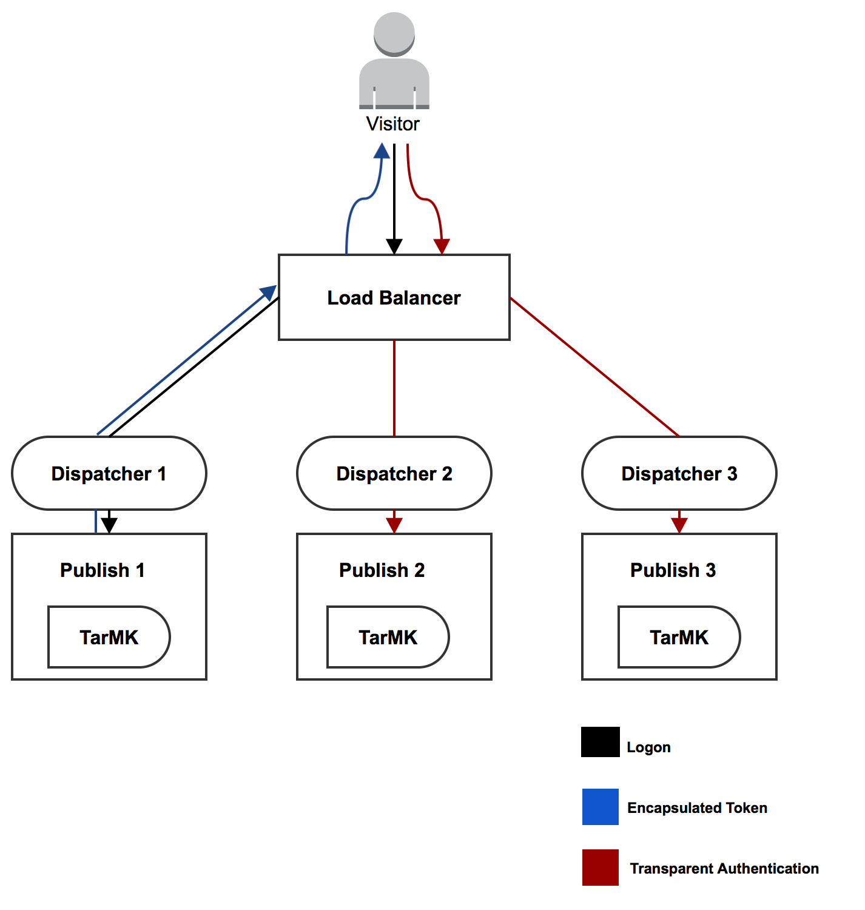

# Compatibilidad con tokens encapsulados{#encapsulated-token-support}

## Introducción {#introduction}

De forma predeterminada, AEM utiliza el Controlador de autenticación de token para autenticar cada solicitud. Sin embargo, para servir solicitudes de autenticación, el Controlador de autenticación de token requiere acceso al repositorio para cada solicitud. Esto sucede porque las cookies se utilizan para mantener el estado de autenticación. Lógicamente, el estado debe persistir en el repositorio para validar las solicitudes posteriores. De hecho, esto significa que el mecanismo de autenticación es de estado.

Esto es de especial importancia para la escalabilidad horizontal. En una configuración de varias instancias como la granja de servidores de publicación que se muestra a continuación, el equilibrio de carga no se puede lograr de una manera óptima. Con la autenticación con estado, el estado de autenticación persistente solo estará disponible en la instancia en la que el usuario se autentique por primera vez.

Tomemos el siguiente escenario como ejemplo:

Un usuario puede autenticarse en la instancia de publicación uno, pero si una solicitud posterior se dirige a la instancia de publicación dos, esa instancia no tiene ese estado de autenticación persistente, ya que ese estado se mantuvo en el repositorio de publicación uno y publicación dos tiene su propio repositorio.

La solución para esto es configurar conexiones fijas en el nivel del equilibrador de carga. Con conexiones fijas, siempre se dirigía al usuario a la misma instancia de publicación. Como consecuencia, el equilibrio de carga verdaderamente óptimo no es posible.

En caso de que una instancia de publicación deje de estar disponible, todos los usuarios autenticados en esa instancia perderán su sesión. Esto se debe a que se necesita acceso al repositorio para validar la cookie de autenticación.

## Autenticación sin estado con el token encapsulado {#stateless-authentication-with-the-encapsulated-token}

La solución para la escalabilidad horizontal es la autenticación sin estado con el uso de la nueva compatibilidad con tokens encapsulados en AEM.

El token encapsulado es un fragmento de criptografía que permite a AEM crear y validar de forma segura la información de autenticación sin conexión, sin acceder al repositorio. De este modo, se puede realizar una solicitud de autenticación en todas las instancias de publicación sin necesidad de conexiones fijas. También tiene la ventaja de mejorar el rendimiento de la autenticación porque no es necesario acceder al repositorio de para cada solicitud de autenticación.

Puede ver cómo funciona esto en una implementación distribuida geográficamente con autores MongoMK e instancias de publicación TarMK a continuación:

>[!NOTE]
>
>El token encapsulado trata sobre la autenticación. Garantiza que la cookie se pueda validar sin tener que acceder al repositorio. Sin embargo, sigue siendo necesario que el usuario exista en todas las instancias y que se pueda acceder a la información almacenada bajo ese usuario en cada instancia.
>
>Por ejemplo, si se crea un nuevo usuario en la instancia de publicación número uno, debido al modo en que funciona el token encapsulado, se autenticará correctamente en la instancia de publicación número dos. Si el usuario no existe en la segunda instancia de publicación, la solicitud sigue sin tener éxito.
>

## Configuración del token encapsulado {#configuring-the-encapsulated-token}

>[!NOTE]
>Todos los controladores de autenticación que sincronizan usuarios y dependen de la autenticación de tokens (como SAML y OAuth) solo funcionarán con tokens encapsulados si:
>
>* Las sesiones duraderas están habilitadas, o
>
>* Los usuarios ya se han creado en AEM cuando se inicia la sincronización. Esto significa que no se admitirán tokens encapsulados en situaciones en las que los controladores **creen** usuarios durante el proceso de sincronización.

Hay algunas cosas que debe tener en cuenta al configurar el token encapsulado:

1. Debido a la criptografía implicada, todas las instancias deben tener la misma clave HMAC. A partir de AEM 6.3, el material clave ya no se almacena en el repositorio, sino en el sistema de archivos real. Con esto en mente, la mejor manera de replicar las claves es copiarlas del sistema de archivos de la instancia de origen a la de la instancia de destino a la que desee replicar las claves. Consulte más información en &quot;Duplicación de la clave HMAC&quot; a continuación.
1. El token encapsulado debe estar habilitado. Esto se puede hacer a través de la consola web.

### Duplicación de la clave HMAC {#replicating-the-hmac-key}

Para replicar la clave en todas las instancias, debe:

1. Acceda a la instancia de AEM, normalmente una instancia de autor, que contiene el material clave que se va a copiar;
1. Busque el paquete `com.adobe.granite.crypto.file` en el sistema de archivos local. Por ejemplo, en esta ruta:

   * `<author-aem-install-dir>/crx-quickstart/launchpad/felix/bundle25`

   El archivo `bundle.info` dentro de cada carpeta identificará el nombre del paquete.

1. Navegue hasta la carpeta de datos. Por ejemplo:

   * `<author-aem-install-dir>/crx-quickstart/launchpad/felix/bundle25/data`

1. Copie los archivos HMAC y maestro.
1. A continuación, vaya a la instancia de destino a la que desee duplicar la clave HMAC y vaya a la carpeta de datos. Por ejemplo:

   * `<publish-aem-install-dir>/crx-quickstart/launchpad/felix/bundle25/data`

1. Pegue los dos archivos que ha copiado anteriormente.
1. [Actualice el paquete de cifrado](/help/communities/deploy-communities.md#refresh-the-granite-crypto-bundle) si la instancia de destino ya se está ejecutando.

1. Repita los pasos anteriores para todas las instancias en las que desee replicar la clave.

#### Activación del token encapsulado {#enabling-the-encapsulated-token}

Una vez replicada la clave HMAC, puede habilitar el token encapsulado a través de la consola web:

1. Dirija su explorador a `https://serveraddress:port/system/console/configMgr`
1. Busque una entrada llamada **Controlador de autenticación de token de Granite de Adobe** y haga clic en ella.
1. En la siguiente ventana, marque la casilla **Habilitar compatibilidad con tokens encapsulados** y presione **Guardar**.
