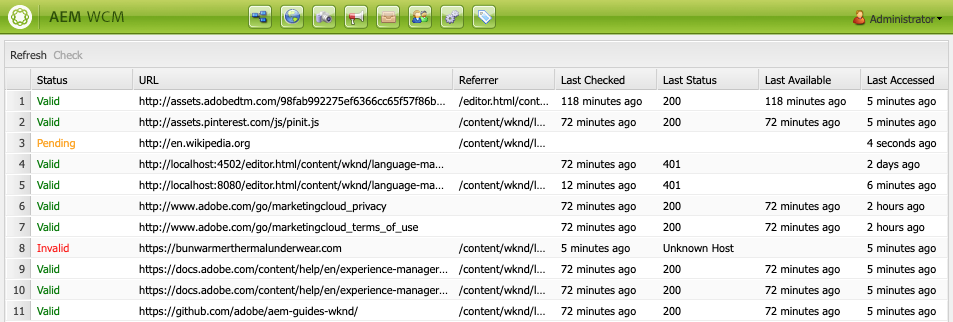

# El comprobador de vínculos {#the-link-checker}

Los autores de contenido no deberían tener que preocuparse por validar cada vínculo que incluyen en sus páginas de contenido.

El Verificador de vínculos se ejecuta automáticamente para ayudar a los autores de contenido con sus vínculos, incluidos los siguientes:

* Validación de vínculos a medida que se añaden al contenido
* Mostrar una lista de todos los vínculos externos del contenido
* Realización de transformaciones de vínculos

El Verificador de vínculos tiene varias [opciones de configuración](#configuring), como definir la validación interna, permitir que ciertos vínculos o patrones de vínculos se omitan de la validación y reescribir las reglas de reescritura de vínculos.

El Verificador de vínculos valida [vínculos internos](#internal) y [vínculos externos.](#external)

>[!NOTE]
>
>Dado que el Verificador de vínculos comprueba los vínculos de todas las páginas de contenido, puede afectar al rendimiento de los repositorios grandes. En estos casos, es posible que tenga que [configurar la frecuencia con la que se ejecuta el Verificador de vínculos](#configuring) o [deshabilitarlo.](#disabling)

## Comprobación de vínculos internos {#internal}

Los vínculos internos son vínculos a otro contenido del repositorio de AEM. Los vínculos internos se pueden agregar utilizando el selector de rutas en RTE o utilizando un componente personalizado. Por ejemplo:

* Su página `/content/wknd/us/en/adventures/ski-touring.html`
* Contiene un vínculo a `/content/wknd/us/en/adventures/extreme-ironing.html` en un [componente Texto.](https://experienceleague.adobe.com/docs/experience-manager-core-components/using/components/text.html)

Los vínculos internos se validan en cuanto el autor de contenido añade un vínculo interno a una página. Si el vínculo deja de ser válido:

* Se elimina del editor. El texto del vínculo permanece, pero el vínculo en sí se elimina.
* Se muestra como un vínculo roto en la interfaz de creación.

## Comprobación de vínculos externos {#external}

Los vínculos externos son vínculos a contenido fuera del repositorio de AEM. Se pueden añadir vínculos externos mediante RTE o mediante un componente personalizado. Por ejemplo:

* Su página `/content/wknd/us/en/adventures/ski-touring.html`
* Contiene un vínculo a `https://bunwarmerthermalunderwear.com` en un [componente Texto.](https://experienceleague.adobe.com/docs/experience-manager-core-components/using/components/text.html)

Los vínculos externos se validan para la sintaxis y comprobando su disponibilidad. Esta comprobación se realiza de forma asíncrona en un entorno interno configurable. Si el Verificador de vínculos encuentra un vínculo externo no válido:

* Se elimina del editor. El texto del vínculo permanece, pero el vínculo en sí se elimina.
* Se muestra como un vínculo roto en la interfaz de creación.

Además, la interfaz [Comprobador de vínculos externos](#external-link-checker) proporciona una descripción general de todos los vínculos externos de las páginas de contenido.

### Uso del Comprobador de vínculos externos {#external-link-checker}

Para utilizar el Comprobador de vínculos externos:

1. Usando **Navegación**, seleccione **Herramientas** y luego **Sitios**.
1. Seleccione **Comprobador de vínculos externos** y se mostrará una lista de todos los vínculos externos.

Se muestra la siguiente información:

* **Estado** - El estado de validación del vínculo que puede ser uno de los siguientes:
  * **Válido**: el verificador de vínculos puede acceder al vínculo externo
  * **Pendiente**: el vínculo externo se agregó al contenido del sitio, pero el Verificador de vínculos aún no lo ha validado
  * **No válido** - El verificador de vínculos no puede acceder al vínculo externo
* **URL**: el vínculo externo
* **Referente**: la página de contenido que contiene el vínculo externo
  * Esto solo se rellena [si está configurado.](#configuring)
* **Última comprobación** - La última vez que el Verificador de vínculos validó el vínculo externo
  * La frecuencia con la que se comprueban los vínculos [&#x200B; es configurable.](#configuring)
* **Último estado**: el último código de estado de HTML devuelto cuando el vínculo comprobado comprobó por última vez el vínculo externo
* **Última disponibilidad** - Tiempo desde la última vez que el vínculo estuvo disponible para el Verificador de vínculos
* **Último acceso**: tiempo transcurrido desde que se accedió por última vez a la página con el vínculo externo en la interfaz de creación

Puede manipular el contenido de la ventana mediante los dos botones situados en la parte superior de la lista de vínculos:

* **Actualizar** - Para actualizar el contenido de la lista
* **Comprobar** - Para comprobar un vínculo externo individual seleccionado en la lista

### Funcionamiento del Comprobador de vínculos externos {#how-it-works}

Aunque es fácil de usar, el Verificador de vínculos externos depende de varios servicios y comprender cómo funcionan te ayuda a comprender cómo [configurar el Verificador de vínculos](#configuring) para satisfacer tus necesidades.

1. Cada vez que un autor de contenido guarda un vínculo a una página, se activa un controlador de eventos.
1. El controlador de eventos recorre todo el contenido de `/content`, busca vínculos nuevos o actualizados y los agrega a una caché para el Verificador de vínculos.
1. A continuación, el **servicio Day CQ Link Checker** se ejecuta de forma regular para comprobar si las entradas de la caché contienen sintaxis válida.
1. Los vínculos validados por sintaxis aparecerán en la ventana [Comprobador de vínculos externos](#external-link-checker). Sin embargo, estarán en estado **Pendiente**.
1. A continuación, **la tarea Day CQ Link Checker Task** se ejecuta de forma regular para validar los vínculos mediante una llamada GET.
1. La **tarea Day CQ Link Checker** actualiza las entradas de la ventana External Link Checker con los resultados de las llamadas GET.

## Configuración del Verificador de vínculos {#configuring}

El Verificador de vínculos está disponible de forma predeterminada en AEM. Sin embargo, hay varias configuraciones de OSGi que se pueden modificar para cambiar su comportamiento:

* **Servicio Day CQ Link Checker Info Storage**: este servicio define el tamaño de la caché del Verificador de vínculos en el repositorio.
* **Servicio Day CQ Link Checker**: este servicio realiza una comprobación asincrónica de la sintaxis de los vínculos externos. Puede definir el periodo de comprobación y qué tipos de vínculos omite el verificador, entre otras opciones.
* **Tarea del verificador de vínculos CQ de día**: este servicio realiza la validación GET de vínculos externos. Permite definir por separado los intervalos para comprobar los vínculos buenos y malos, entre otras opciones.
* **Day CQ Link Checker Transformer**: permite convertir vínculos según un conjunto de reglas definido por el usuario.

Consulte el documento [Configuración de OSGi](/help/sites-deploying/osgi-configuration-settings.md) para obtener más información sobre cómo cambiar la configuración de OSGi.

## Desactivación del Verificador de vínculos {#disabling}

Puede optar por desactivar el Verificador de vínculos por completo. Para ello:

1. Abra la consola OSGi.
1. Editar el **transformador Day CQ Link Checker**
1. Marque las opciones que desee desactivar:
   * **Deshabilitar comprobación** - para deshabilitar la validación de vínculos
   * **Deshabilitar la reescritura** - para deshabilitar las transformaciones de vínculos

>[!NOTE]
>
>Si deshabilita la comprobación de vínculos después de empezar a crear el contenido, es posible que siga viendo las entradas en la ventana [Comprobador de vínculos externos](#external-link-checker), pero ya no se actualizarán.
