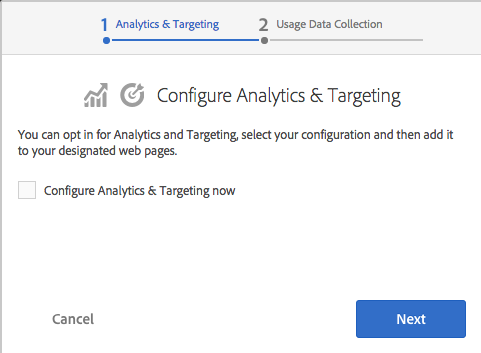

# Integración con Adobe Experience Cloud{#integrating-with-the-adobe-marketing-cloud}

[Adobe Experience Cloud](https://business.adobe.com/es/products/marketing-cloud/main.html) incluye potentes productos de optimización de sitios web y análisis web que ofrecen datos y perspectivas procesables en tiempo real para impulsar iniciativas en línea exitosas. Ofrece una plataforma integrada y abierta para la optimización comercial en línea. La nube consiste en aplicaciones integradas para recopilar y liberar el poder de insight del cliente para optimizar los esfuerzos de adquisición, conversión y retención de clientes y la creación y distribución de contenido.

Con Adobe Experience Manager (AEM), puede integrarse fácilmente con los siguientes productos de Adobe Experience Cloud:

* Adobe Analytics proporciona a los especialistas en marketing información práctica en tiempo real sobre las estrategias en línea y las iniciativas de marketing.
* Adobe Target ofrece a los especialistas en marketing la capacidad de mejorar continuamente la relevancia de su contenido en línea para sus clientes, lo que resulta en una mayor conversión.
* Adobe Dynamic Media Classic automatiza la administración de medios, optimiza la publicación web y mejora las experiencias web, todo en un entorno alojado.
* Adobe Dynamic Tag Management ofrece a los especialistas en marketing herramientas intuitivas para administrar de forma rápida y sencilla un número ilimitado de etiquetas de Adobe y de terceros.
<!-- Search&Promote is end of life as of September 1, 2022 * Adobe Search&Promote gives marketers the ability to control and optimize the search results on their sites. -->
* Adobe Campaign permite administrar el contenido de las entregas por correo electrónico directamente en Adobe Experience Manager.

Además, puede [integrar AEM con Creative Cloud](/help/assets/aem-cc-integration-best-practices.md) y con [servicios de terceros](/help/sites-administering/third-party-services.md).

## Integración con Adobe Analytics {#integrating-with-adobe-analytics}

[Adobe Analytics](https://business.adobe.com/es/products/analytics/adobe-analytics.html) es la solución líder del sector que brinda a los especialistas en mercadotecnia digital un lugar para medir, analizar y optimizar los datos integrados de todas las iniciativas en línea en múltiples canales de mercadotecnia. Proporciona a los especialistas en marketing inteligencia de análisis web en tiempo real y procesable acerca de las estrategias digitales y las iniciativas de marketing. Adobe Analytics ayuda a los expertos en marketing a identificar rápidamente las rutas más rentables de un sitio web, dividir el tráfico en segmentos para detectar los visitantes web de mayor valor, determinar dónde abandonan el sitio los visitantes e identificar las métricas de éxito esenciales para las campañas de marketing en línea.

Puede utilizar Adobe Analytics para analizar los datos de sus sitios.

Al integrar con Adobe Analytics, puede hacer lo siguiente:

* Habilite el seguimiento de usuarios de Analytics.
* Asigne los modos de ejecución (por ejemplo, autor, publicación) a diferentes grupos de informes.
* Envíe variables de Client Context como variables de conversión o propiedades de tráfico.
* Utilice asignaciones de variables predefinidas.
* Configure secciones completas del sitio a la vez.
* Rastrear eventos definidos a medida.

Para obtener información sobre cómo integrar AEM con Analytics, consulte [Integración con Adobe Analytics](/help/sites-administering/adobeanalytics.md).

También puede usar el [Asistente de inclusión](/help/sites-administering/opt-in.md) para realizar fácilmente la integración.

## Integración con Adobe Target {#integrating-with-adobe-target}

Los especialistas en marketing utilizan [Adobe Target](https://business.adobe.com/es/products/target/adobe-target.html?lang=es) para diseñar y ejecutar pruebas en línea, crear segmentos de audiencia sobre la marcha (basados en el comportamiento) y automatizar la segmentación de contenido y experiencias en línea.

Los consumidores en línea de hoy en día tienen necesidades en constante evolución y esperan contenido relevante, incluso personalizado, de la amplia variedad de sitios y fuentes de contenido que pueden elegir. Para atraer a una audiencia en línea, es fundamental que los especialistas en marketing en línea identifiquen rápidamente qué ofertas y contenido son relevantes y atractivos para sus audiencias. Armados con este conocimiento, los especialistas en marketing necesitan la capacidad de evolucionar continuamente sus sitios y dirigir el contenido adecuado a diferentes audiencias.

[Integración con Adobe Target](/help/sites-administering/target.md) explica cómo integrar su sitio con Target.

También puede usar el [Asistente de inclusión](/help/sites-administering/opt-in.md) para realizar fácilmente la integración.

## Inclusión en Analytics y Target {#opting-in-to-analytics-and-target}

AEM proporciona un procedimiento de inclusión sencillo para integrarlo con Adobe Analytics y Adobe Target. Cuando inicia sesión como administrador y visita la consola Proyectos, aparece un asistente de inclusión.

Opte por la integración con Analytics o Target para permitir el uso de las funcionalidades de seguimiento y análisis de páginas y de personalización. Cuando decida adherirse, proporcione la información de su cuenta de usuario y especifique las páginas de las que se realiza un seguimiento.

Para obtener más información, consulte [Inclusión en Adobe Analytics y Adobe Target.](/help/sites-administering/opt-in.md)

## Integración con Adobe Dynamic Media Classic {#integrating-with-scene}

Adobe Dynamic Media Classic es una solución alojada para publicar, administrar, mejorar y ofrecer recursos de marketing dinámico y comercialización visual enriquecida en web, móvil, correo electrónico, medios sociales, pantallas conectadas a Internet e impresión.

En Adobe Experience Manager, puede publicar recursos digitales directamente desde Adobe Experience Manager a Dynamic Media Classic y recursos digitales desde Dynamic Media Classic a Adobe Experience Manager.

Además, puede ver los recursos de Adobe Experience Manager publicados en Dynamic Media Classic en varios visores, como Zoom básico y Vídeo.

Para obtener más información sobre cómo Adobe Experience Manager se integra con Dynamic Media Classic, consulte la [Documentación sobre la integración con Dynamic Media Classic](/help/sites-administering/scene7.md).

## Integración con la administración dinámica de etiquetas de Adobe {#integrating-with-adobe-dynamic-tag-management}

[Adobe Dynamic Tag Management](https://business.adobe.com/es/products/experience-platform/adobe-experience-platform.html) proporciona a los especialistas en mercadotecnia herramientas intuitivas para administrar rápida y fácilmente un número ilimitado de etiquetas de Adobe y de terceros. Dispone de más control y flexibilidad para optimizar prácticamente cualquier elemento en línea, al tiempo que reduce la dependencia de los recursos de TI.

[Integre Adobe Dynamic Tag Management](/help/sites-administering/dtm.md) con AEM para que pueda usar sus propiedades web de Dynamic Tag Management para rastrear sitios de AEM.

## Integración con Adobe Audience Manager {#integrating-with-adobe-audience-manager}

La integración de Audience Manager se ha eliminado en AEM 6.3.

<!-- Search&Promote is end of life as of September 1, 2022 ## Integrating with Search&Promote {#integrating-with-search-promote} -->

<!-- Search&Promote is end of life as of September 1, 2022 Adobe Search&Promote enables marketers to optimizehow visitors browse, find, compare, and select relevant products and content on web and mobile sites. Businesses can easily promote priority items based on business objectives and visitor intent, and automate merchandising and promotions activity via KPI-based triggers or metrics. -->

<!-- Search&Promote is end of life as of September 1, 2022 Adobe Search&Promote is a reliable and scalable hosted site search application, capable of scaling to millions of pages or products, for heavily visited online businesses ranging from retail to news sites. It offers unprecedented levels of marketer control and metrics-based relevance. -->

<!-- Search&Promote is end of life as of September 1, 2022 For information about integrating AEM and Search&Promote, see [Integrating with Adobe Search&Promote](/help/sites-administering/search-and-promote.md). -->

## Integración con Adobe Campaign {#integrating-with-adobe-campaign}

[Adobe Campaign](https://business.adobe.com/es/products/campaign/adobe-campaign.html) le permite administrar el contenido de las entregas por correo electrónico directamente en Adobe Experience Manager.

Para obtener información sobre cómo se integra AEM con Adobe Campaign, consulte [Integración con Adobe Campaign](/help/sites-administering/campaignstandard.md).