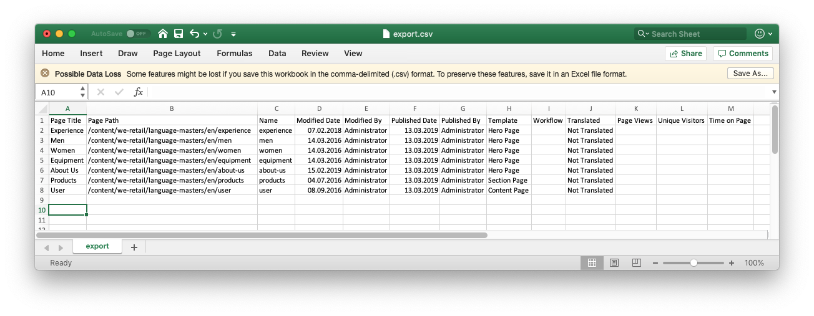

# Exportar a CSV{#export-to-csv}

**Al crear un informe de CSV** puede exportar información sobre las páginas a un archivo CSV en el sistema local.

* El archivo descargado se llama `export.csv`.
* El contenido depende de las propiedades que seleccione.
* Puede definir la ruta de la exportación, así como la profundidad.

>[!NOTE]
>
>Se utiliza la función de descarga (y el destino predeterminado) de su navegador.

El asistente **Crear exportación de CSV** le permite seleccionar:

* Propiedades para exportar
  * Metadatos
    * Nombre
    * Modificado
    * Publicado
    * Plantilla
    * Flujo de trabajo
  * Traducción
    * Traducido
  * Análisis
    * Vistas de la página
    * Visitantes únicos
    * Tiempo empleado en la página
* Profundidad
  * Ruta principal
  * Solo elementos secundarios directos
  * Niveles adicionales de tareas secundarias
  * Niveles

El archivo `export.csv` resultante se puede abrir en Excel o en cualquier otra aplicación compatible.

La opción Crear **informe CSV** está disponible al examinar la consola **Sitios** (en la vista de lista): es una opción del menú desplegable **Crear**:

Para crear una exportación de CSV:

1. Abra la consola **Sites** y vaya a la ubicación requerida si es necesario.
1. Para abrir el asistente, en la barra de herramientas seleccione **Crear** y, a continuación, **Informe de CSV**:

   

1. Seleccione las propiedades necesarias para exportar.
1. Seleccione **Crear**.
