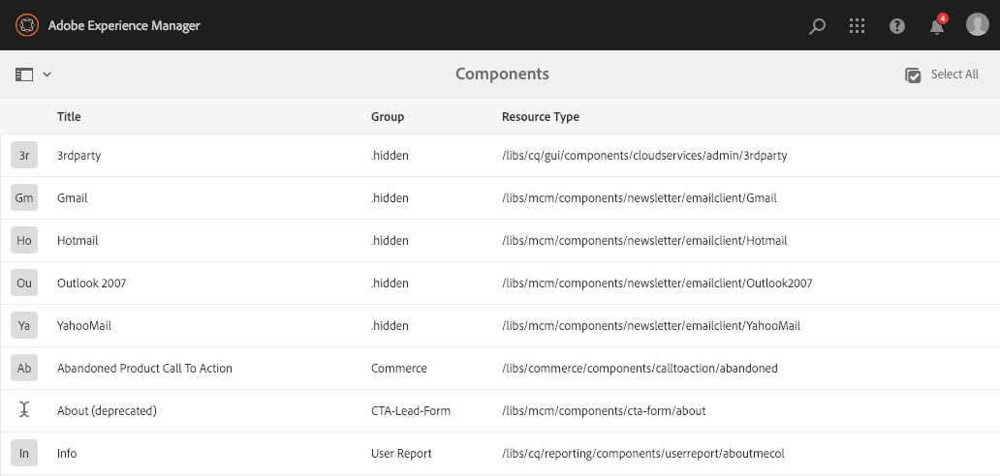
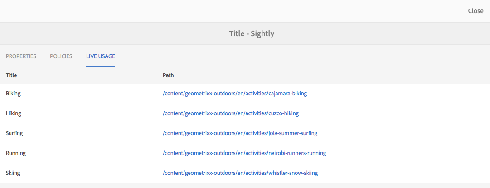

# Consola Componentes{#components-console}

La consola Componentes permite examinar todos los componentes definidos para la instancia y ver información clave de cada componente.

Se puede acceder a él desde **Herramientas >** **General >** **Componentes**. En la consola, están disponibles la vista de tarjeta y la vista de lista. Como no hay una estructura de árbol para los componentes, la vista de columna no está disponible.

>[!NOTE]
>
>La consola Componentes muestra todos los componentes del sistema. El [navegador de componentes](/help/sites-authoring/author-environment-tools.md#components-browser) muestra los componentes disponibles para los autores y oculta cualquier grupo de componentes que comience con un punto ( `.`).

## Búsqueda {#searching}

Con el icono **Solo contenido** (parte superior izquierda) podrá abrir el panel **Buscar** para buscar o para filtrar los componentes:

### Detalles de los componentes {#component-details}

Para ver los detalles de un componente específico, haga clic en el recurso requerido. Hay tres pestañas que proporcionan:

* **Propiedades**

  

  En la pestaña Propiedades puede:

  * Consulte las propiedades generales del componente.
  * Ver cómo se ha definido el icono [o la abreviatura](/help/sites-developing/components-basics.md#component-icon-in-touch-ui) para el componente.

    * Al hacer clic en el origen del icono, se le dirigirá a ese componente.

  * Ver **Tipo de recurso** y **Supertipo de recurso** (si están definidos) para el componente.

    * Al hacer clic en el supertipo de recurso, accederá a ese componente.

  >[!NOTE]
  >
  >Debido a que `/apps` no se puede editar en el tiempo de ejecución, la consola Componentes es de solo lectura.

* **Políticas**

  

* **Uso de Live**

  

  >[!CAUTION]
  >
  >Dada la naturaleza de la información recopilada para esta vista, puede tardar un rato en recopilarse o mostrarse.

* **Documentación**

  Si el desarrollador ha proporcionado [documentación para el componente](/help/sites-developing/developing-components.md#documenting-your-component), aparecerá en la ficha **Documentación**. Si no hay documentación disponible, no se mostrará la ficha **Documentación**.

  
