# Marketing por correo electrónico{#e-mail-marketing}

>[!NOTE]
>
>Adobe no planea mejorar aún más el seguimiento por correo electrónico de los envíos abiertos/rechazados (no entregables) por el servicio SMTP de AEM.
>Se recomienda usar [Adobe Campaign y la integración con AEM](/help/sites-administering/campaign.md).

El marketing por correo electrónico (por ejemplo, los boletines informativos) es una parte importante de cualquier campaña de marketing, ya que los utiliza para insertar contenido en los posibles clientes. En AEM, puede crear boletines a partir del contenido existente de AEM y agregar contenido nuevo, específico para los boletines.

Una vez creados, puede enviar boletines informativos al grupo específico de usuarios inmediatamente o en otra hora programada (mediante un flujo de trabajo). Además, los usuarios pueden suscribirse a los boletines en el formato que elijan.

Además, AEM le permite administrar la funcionalidad de la newsletter, lo que incluye el mantenimiento de los temas, el archivado de los boletines informativos y la visualización de las estadísticas de la newsletter.

>[!NOTE]
>
>En Geometrixx, la plantilla de la newsletter abre automáticamente el editor de correo electrónico. Puede utilizar el editor de correo electrónico en otras plantillas en las que desee enviar correos electrónicos, por ejemplo, invitaciones. El editor de correo electrónico se muestra cada vez que se hereda una página de **mcm/components/newsletter/page**.

En este documento se describen los conceptos básicos para crear boletines informativos en AEM. Para obtener información más detallada sobre cómo trabajar con el marketing por correo electrónico, consulte los siguientes documentos:

* [Creación de una página de destino de newsletter efectiva](/help/sites-classic-ui-authoring/classic-personalization-campaigns-email-landingpage.md)
* [Administración de suscripciones](/help/sites-classic-ui-authoring/classic-personalization-campaigns-email-subscriptions.md)
* [Publicación de un correo electrónico para proveedores de servicios de correo electrónico](/help/sites-classic-ui-authoring/classic-personalization-campaigns-email-newsletters.md)
* [Seguimiento de correos electrónicos rechazados](/help/sites-classic-ui-authoring/classic-personalization-campaigns-email-tracking-bounces.md)

>[!NOTE]
>
>Si actualiza los proveedores de correo electrónico, realiza una prueba de vuelo o envía una newsletter, estas operaciones fallan si la newsletter no se publica primero en la instancia de publicación o si la instancia de publicación no está disponible. Asegúrese de publicar la newsletter y de que la instancia de publicación esté activa y en ejecución.

## Creación de una experiencia de newsletter {#creating-a-newsletter-experience}

>[!NOTE]
>
>Las notificaciones por correo electrónico deben configurarse mediante la configuración de osgi. Consulte [Configuración de la notificación por correo electrónico.](/help/sites-administering/notification.md)

1. Seleccione la nueva campaña en el panel izquierdo o haga doble clic en ella en el panel derecho.

1. Seleccione la vista de lista con el icono:

   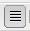

1. Haga clic en **Nuevo...**

   Puede especificar **Title**, **Name** y el tipo de experiencia que se creará; en este caso, Newsletter.

   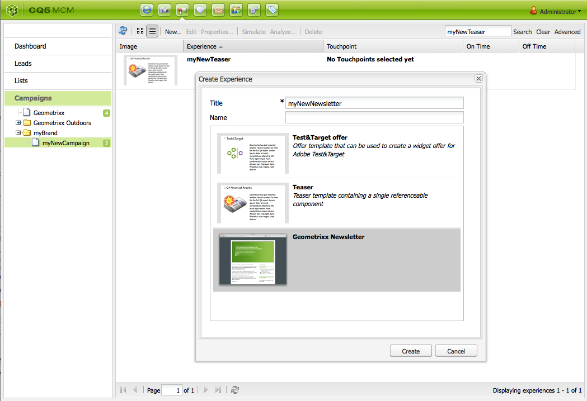

1. Haga clic en **Crear**.

1. Se abre inmediatamente un nuevo cuadro de diálogo. Aquí puede introducir las propiedades de la newsletter.

   La **lista de destinatarios predeterminada** es un campo obligatorio, ya que forma el punto de contacto para la newsletter (consulte [Uso de listas](/help/sites-classic-ui-authoring/classic-personalization-campaigns.md#workingwithlists) para obtener más información sobre las listas).

   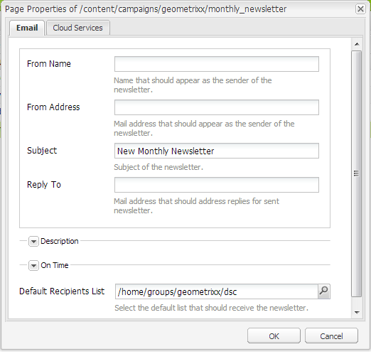

   * **De nombre**
     Nombre que debe aparecer como remitente de la newsletter.

   * **Dirección De**
     Dirección de correo que debe aparecer como remitente de la newsletter.

   * **Asunto**
     Asunto de la newsletter.

   * **Responder a**
     Dirección de correo que enviará las respuestas de la newsletter enviada.

   * **Descripción**
     Descripción de la newsletter.

   * **A tiempo**
     El tiempo de activación para enviar la newsletter.

   * **Lista de destinatarios predeterminada**
     Lista predeterminada que debe recibir la newsletter.

   Se pueden actualizar en una etapa posterior desde el cuadro de diálogo **Propiedades...**.

1. Haga clic en **Aceptar** para guardar.

## Añadir contenido a los boletines {#adding-content-to-newsletters}

Puede añadir contenido a la newsletter, incluido el contenido dinámico, como lo haría en cualquier componente de AEM. En Geometrixx, la plantilla Newsletter tiene ciertos componentes disponibles para añadir y modificar contenido en los boletines.

1. En el MCM, haga clic en la ficha **Campañas** y haga doble clic en el boletín al que desee agregar contenido o editarlo. Se abre la newsletter.

1. Si los componentes no están visibles, vaya a la vista Diseño y habilite los componentes necesarios (por ejemplo, los componentes Newsletter) antes de empezar a editar.
1. Introduzca texto, imágenes u otros componentes nuevos según corresponda. En el ejemplo de Geometrixx, hay 4 componentes disponibles: texto, imagen, encabezado y 2 columnas. La newsletter puede tener más o menos componentes en función de cómo la configure.

   >[!NOTE]
   >
   >Los boletines se personalizan mediante variables. En la newsletter de Geometrixx, las variables están disponibles en el componente Texto. Los valores de las variables se heredan de la información del perfil de usuario.

   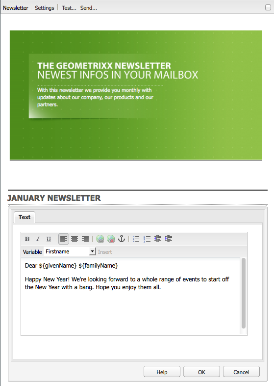

1. Para insertar variables, selecciónelas en la lista y haga clic en **Insertar**. Las variables se rellenan desde el perfil.

## Personalización de boletines {#personalizing-newsletters}

Los boletines se personalizan insertando variables predefinidas en el componente Texto de los boletines en Geometrixx. Los valores de las variables se heredan de la información del perfil de usuario.

También puede simular cómo se personaliza un boletín utilizando el contexto de cliente y cargando un perfil.

Para personalizar un boletín informativo y simular el aspecto que tendrá:

1. En el MCM, abra el boletín para el que desee personalizar la configuración.

1. Abra el componente Texto que desee personalizar.

1. Coloque el cursor donde desee que aparezca la variable, seleccione una variable de la lista desplegable y haga clic en **Insertar**. Haga esto para tantas variables como sea necesario y haga clic en **Aceptar**.

   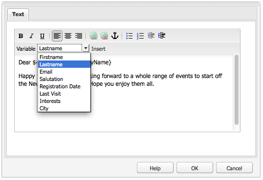

1. Para simular el aspecto que tendrá la variable cuando se envíe, presione CTRL+ALT+c para abrir el contexto de cliente y seleccione **Cargar**. Seleccione el usuario de la lista cuyo perfil desee cargar y haga clic en **Aceptar**.

   La información del perfil que ha cargado ha rellenado las variables.

   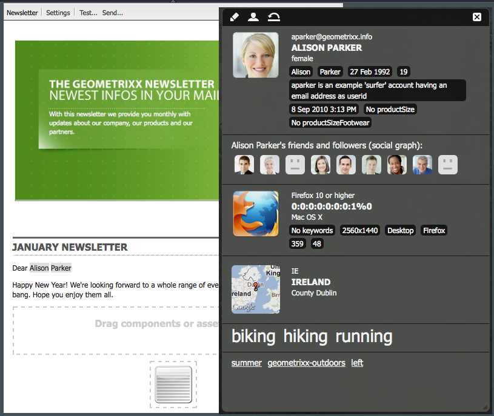

## Prueba de boletines en diferentes clientes de correo electrónico {#testing-newsletters-in-different-e-mail-clients}

>[!NOTE]
>
>Antes de enviar boletines informativos, compruebe la configuración de OSGi para el Day CQ Link Externalizer en `https://localhost:4502/system/console/configMgr`.
>
>De forma predeterminada, el valor del parámetro es `localhost:4502` y la operación no puede completarse si se cambia el puerto de la instancia en ejecución.

Cambiar entre clientes de correo electrónico comunes para ver el aspecto que tendrá la newsletter para los posibles clientes. De forma predeterminada, la newsletter se abre sin seleccionar ninguno de los clientes de correo electrónico.

Actualmente, puede ver los boletines en los siguientes clientes de correo electrónico:

* Yahoo mail
* Gmail
* Hotmail
* Thunderbird
* Microsoft Outlook 2007
* Correo electrónico de Apple

Para cambiar entre clientes, haga clic en el icono correspondiente para ver la newsletter en ese cliente de correo electrónico:

1. En el MCM, abra el boletín para el que desee personalizar la configuración.

1. Haga clic en un cliente de correo electrónico en la barra superior para ver el aspecto que tendría la newsletter en ese cliente.

   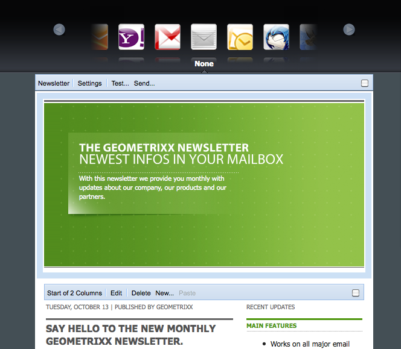

1. Repita este paso para cualquier cliente de correo electrónico adicional que desee ver.

   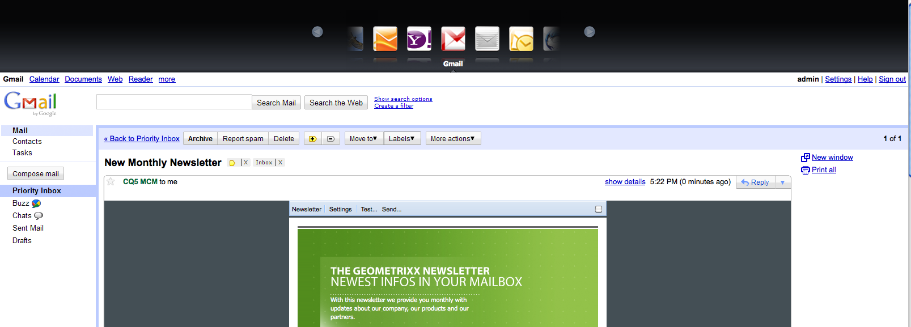

## Personalizar configuración de newsletter {#customizing-newsletter-settings}

Aunque solo los usuarios autorizados pueden enviar una newsletter, debe personalizar lo siguiente:

* La línea de asunto, para que los usuarios quieran abrir su correo electrónico y también para asegurarse de que el boletín informativo no termine marcado como correo no deseado.
* La dirección De, por ejemplo, `noreply@geometrixx.com`, para que los usuarios reciban correo electrónico de una dirección especificada.

Para personalizar la configuración de la newsletter:

1. En el MCM, abra el boletín para el que desee personalizar la configuración.

   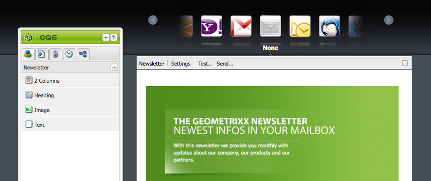

1. En la parte superior de la newsletter, haz clic en **Configuración**.

   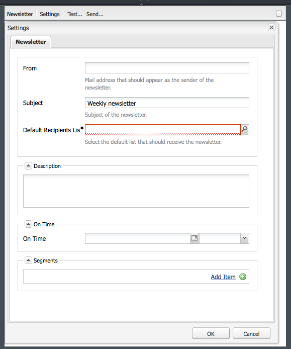
1. Escriba la dirección de correo electrónico **De**

1. Modifique el **Asunto** del correo electrónico, si es necesario.

1. Seleccione una **lista de destinatarios predeterminada** en la lista desplegable.

1. Haga clic en **OK**.

   Al probar o enviar la newsletter, los destinatarios recibirán correos electrónicos con la dirección de correo electrónico y el asunto especificados.

## Boletines de prueba de vuelo {#flight-testing-newsletters}

Aunque las pruebas de vuelo no son obligatorias, antes de enviar una newsletter, es posible que desee probarla para asegurarse de que tenga el aspecto que desea.

Las pruebas de vuelo le permiten hacer lo siguiente:

* Observe la newsletter en [todos los clientes previstos](#testing-newsletters-in-different-e-mail-clients).
* Compruebe que el servidor de correo está configurado correctamente.
* Determine si el correo electrónico se marca como correo no deseado. (Asegúrese de incluirse en la lista de destinatarios).

>[!NOTE]
>
>Si actualiza los proveedores de correo electrónico, realiza una prueba de vuelo o envía una newsletter, estas operaciones fallan si la newsletter no se publica primero en la instancia de publicación o si la instancia de publicación no está disponible. Asegúrese de publicar la newsletter y de que la instancia de publicación esté activa y en ejecución.

Para enviar boletines de prueba:

1. En el MCM, abra la newsletter que desea probar y enviar.

1. En la parte superior de la newsletter, haz clic en **Probar** antes de enviar.

   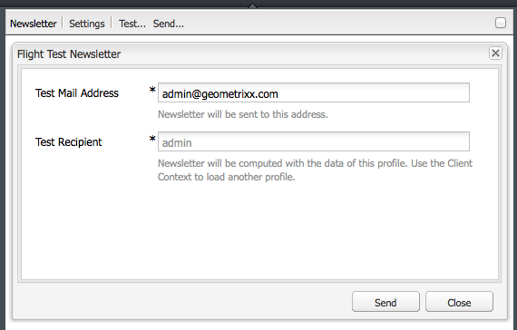

1. Escriba la dirección de correo electrónico de prueba a la que desea enviar la newsletter y haga clic en **Enviar**. Si desea cambiar el perfil, se carga otro perfil en el contexto del cliente. Para ello, presione CTRL+ALT+c y seleccione Cargar y cargar un perfil.

## Envío de boletines {#sending-newsletters}

>[!NOTE]
>
>Adobe no planea mejorar aún más el seguimiento por correo electrónico de los envíos abiertos/rechazados (no entregables) por el servicio SMTP de AEM.
>Se recomienda usar [Adobe Campaign y la integración con AEM](/help/sites-administering/campaign.md).

Puede enviar una newsletter desde la newsletter o desde la lista. Se describen ambos procedimientos.

>[!NOTE]
>
>Antes de enviar boletines informativos, compruebe la configuración de OSGi para el Day CQ Link Externalizer en `https://localhost:4502/system/console/configMgr`.
>
>De forma predeterminada, el valor del parámetro es `localhost:4502` y la operación no puede completarse si se cambia el puerto de la instancia en ejecución.

>[!NOTE]
>
>Si actualiza los proveedores de correo electrónico, realiza una prueba de vuelo o envía una newsletter, estas operaciones fallan si la newsletter no se publica primero en la instancia de publicación o si la instancia de publicación no está disponible. Asegúrese de publicar la newsletter y de que la instancia de publicación esté activa y en ejecución.

### Envío de boletines informativos desde una campaña {#sending-newsletters-from-a-campaign}

Para enviar una newsletter desde la campaña:

1. En el MCM, abra la newsletter que desee enviar.

   >[!NOTE]
   >
   >Antes de enviar, asegúrese de haber personalizado el asunto de la newsletter y la dirección de correo electrónico de origen [personalizando su configuración](#customizing-newsletter-settings).
   >
   >
   >[Se recomienda probar el vuelo](#flight-testing-newsletters) de la newsletter antes de enviarla.

1. En la parte superior de la newsletter, haz clic en **Enviar**. Se abre el asistente Newsletter.

1. En la lista de destinatarios, seleccione la lista en la que desea recibir la newsletter y haga clic en **Siguiente**.

   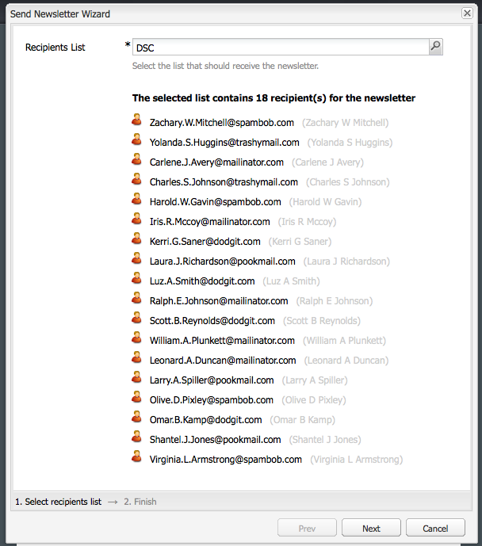

1. Se ha confirmado la instalación. Haga clic en **Enviar** para enviar la newsletter.

   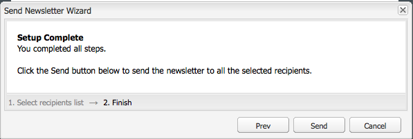

   >[!NOTE]
   >
   >Asegúrese de que es uno de los destinatarios para poder asegurarse de que se recibió la newsletter.

### Envío de boletines informativos desde una lista {#sending-newsletters-from-a-list}

Para enviar una newsletter desde una lista:

1. En el MCM, haga clic en **Listas** en el panel izquierdo.

   >[!NOTE]
   >
   >Antes de enviar, asegúrese de haber personalizado el asunto de la newsletter y la dirección de correo electrónico de origen [personalizando su configuración](#customizing-newsletter-settings). No puedes probar una newsletter si la envías desde la lista; puedes [probarla](#flight-testing-newsletters) si la envías desde la newsletter.

1. Seleccione la casilla de verificación situada junto a la lista de posibles clientes a los que desea enviar una newsletter.

1. En el menú **Herramientas**, seleccione **Enviar newsletter**. Se abre la ventana **Enviar newsletter**.

   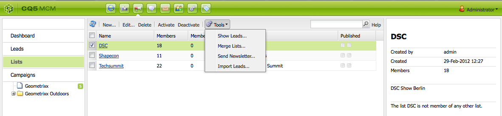

1. En el campo **Newsletter**, seleccione la newsletter que desee enviar y haga clic en **Siguiente**.

   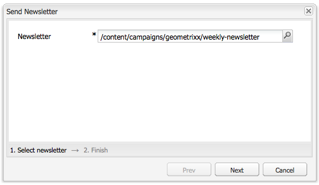

1. Se ha confirmado la instalación. Haga clic en **Enviar** para enviar la newsletter seleccionada a la lista especificada de posibles clientes.

   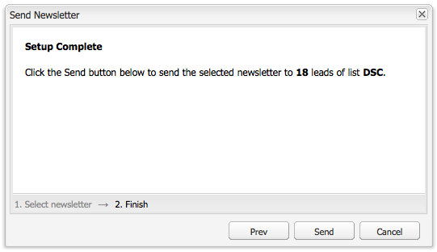

   La newsletter se envía a los destinatarios seleccionados.

## Suscripción a una newsletter {#subscribing-to-a-newsletter}

En esta sección se describe cómo suscribirse a un boletín informativo.

### Suscripción a una newsletter {#subscribing-to-a-newsletter-1}

Para suscribirse a una newsletter (con el sitio web de Geometrixx como ejemplo):

1. Haga clic en **Sitios web**, vaya a la **Barra de herramientas** de Geometrixx y ábrala.

   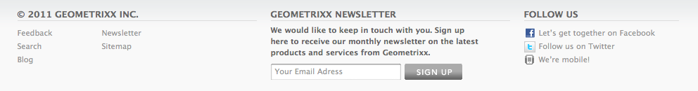

1. En el campo **Registrarse** de la newsletter de Geometrixx, escriba su dirección de correo electrónico y haga clic en **Registrarse**. Ahora está suscrito a la newsletter.
