# Páginas de destino{#landing-pages}

La función de páginas de aterrizaje permite importar rápida y fácilmente un diseño y contenido directamente a una página de AEM. Un desarrollador web puede preparar HTML y recursos adicionales que se pueden importar como una página completa o solo como parte de una página. La funcionalidad es útil para crear páginas de aterrizaje de marketing que solo estén activas durante un tiempo limitado y que necesiten crearse rápidamente.

Esta página describe lo siguiente:

* aspecto de las páginas de aterrizaje en AEM, incluidos los componentes disponibles
* cómo crear una página de aterrizaje y cómo importar un paquete de diseño
* cómo trabajar con páginas de aterrizaje en AEM
* configuración de páginas de aterrizaje móviles

La preparación del paquete de diseño para la importación se explica en [Ampliación y configuración del importador de diseños](/help/sites-administering/extending-the-design-importer-for-landingpages.md). La integración con Adobe Analytics se explica en [Integración de páginas de aterrizaje con Adobe Analytics.](/help/sites-administering/integrating-landing-pages-with-adobe-analytics.md)

>[!CAUTION]
>
>El importador de diseño, usado para importar páginas de aterrizaje [, ha quedado obsoleto con AEM 6.5](/help/release-notes/deprecated-removed-features.md#deprecated-features).

>[!CAUTION]
>
>Como el Importador de diseños requiere acceso a `/apps`, no funcionará en entornos de nube en contenedores donde `/apps` es inmutable.

## ¿Qué son las páginas de aterrizaje? {#what-are-landing-pages}

Las páginas de aterrizaje son sitios de una o varias páginas que son el &quot;punto final&quot; de una campaña de marketing, por ejemplo, con correo electrónico, anuncios/banners o medios sociales. Una página de aterrizaje puede servir para varios fines, pero todos tienen una cosa en común: el visitante debe cumplir una tarea y que define el éxito de una página de aterrizaje.

La función Páginas de destino de AEM permite a los especialistas en marketing trabajar con diseñadores web de agencias o equipos creativos internos para crear diseños de página que se puedan importar fácilmente en AEM y que los especialistas en marketing puedan editar y publicar bajo el mismo control que el resto de sitios con tecnología de AEM.

En AEM, puede crear páginas de aterrizaje realizando los siguientes pasos:

1. Cree una página en AEM que contenga el lienzo de páginas de aterrizaje. AEM se enviará con una muestra llamada **Página de importador**.

1. [Prepare HTML y los recursos.](/help/sites-administering/extending-the-design-importer-for-landingpages.md)
1. Empaquete los recursos en un archivo ZIP denominado aquí Paquete de diseño.
1. Importe el paquete de diseño en la página del importador.
1. Modifique y publique la página.

### Páginas de destino de escritorio {#desktop-landing-pages}

Una página de aterrizaje de ejemplo en AEM tiene el siguiente aspecto:

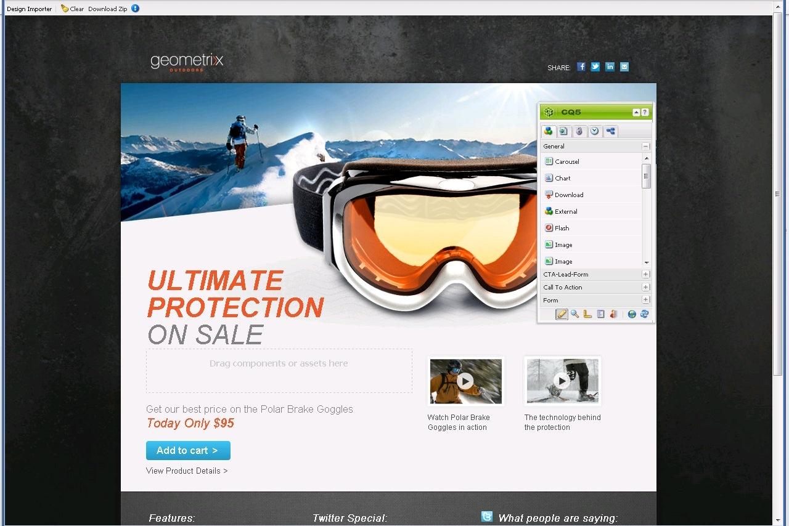

### Páginas de aterrizaje móviles {#mobile-landing-pages}

Una página de aterrizaje también puede tener una versión móvil de la página. Para tener una versión móvil independiente de la página de aterrizaje, el diseño de importación debe tener dos archivos html: *index.htm(l)* y *mobile.index.htm(l)*.

El procedimiento de importación de la página de aterrizaje es el mismo que el de una página de aterrizaje normal. El diseño de la página de aterrizaje tiene un archivo html adicional correspondiente a la página de aterrizaje móvil. Este archivo html también debe tener un lienzo `div` con `id=cqcanvas` igual que el HTML de la página de aterrizaje de escritorio y admite todos los componentes editables descritos para la página de aterrizaje de escritorio.

La página de aterrizaje móvil se crea como una página secundaria de la página de aterrizaje de escritorio. Para abrirla, vaya a la página de aterrizaje de Sitios web y abra la página secundaria.

>[!NOTE]
>
>La página de aterrizaje móvil se elimina o desactiva junto con la página de aterrizaje de escritorio si esta se elimina o desactiva.

## Componentes de página de aterrizaje {#landing-page-components}

Para que las partes de HTML que se importan puedan editarse en AEM, puede asignar contenido de las páginas de aterrizaje de HTML directamente a los componentes de AEM. El importador de diseños comprende los siguientes componentes de forma predeterminada:

* Texto, para cualquier texto
* Título, para contenido en etiquetas H1-6
* Imagen, para imágenes que deben hacerse intercambiables
* Llamadas a la acción:

  * Vínculo de pulsación
  * Vínculo gráfico

* Formulario de posible cliente de CTA para recopilar información del usuario
* Sistema de párrafos (Parsys), para permitir que se añada cualquier componente o se convierta el componente anterior

Además, es posible ampliar esto y admitir componentes personalizados. En esta sección se describen los componentes en detalle.

### Texto {#text}

El componente Texto permite introducir un bloque de texto mediante un editor de WYSIWYG. Consulte [Componente de texto](/help/sites-authoring/default-components.md#text) para obtener más información.

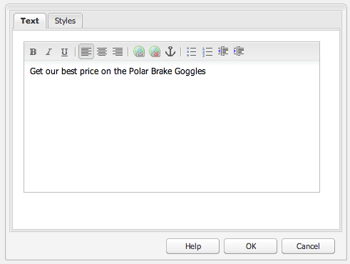

El siguiente es un ejemplo de un componente de texto en una página de aterrizaje:

#### Título {#title}

El componente Título permite mostrar un título y configurar el tamaño (h1-6). Consulte [Componente Título](/help/sites-authoring/default-components.md#title) para obtener más información.

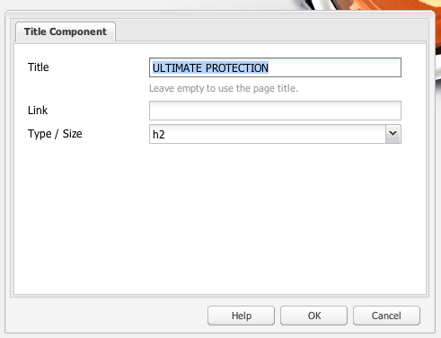

El siguiente es un ejemplo de un componente de título en una página de aterrizaje:

#### Imagen {#image}

El componente de imagen muestra una imagen que puede arrastrar y soltar desde el Buscador de contenido o hacer clic para cargar. Consulte [componente de imagen](/help/sites-authoring/default-components.md) para obtener más información.

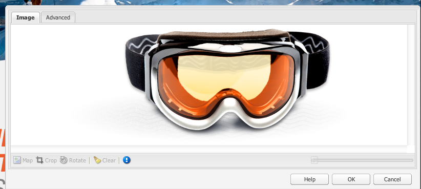

El siguiente es un ejemplo de un componente de imagen en una página de aterrizaje:

#### Call to action (CTA) {#call-to-action-cta}

Un diseño de página de aterrizaje puede tener varios vínculos, algunos de los cuales pueden denominarse &quot;Llamadas a la acción&quot;.

Call to action (CTA) se utiliza para que el visitante tome medidas inmediatas en la página de aterrizaje, como &quot;Suscribirse ahora&quot;, &quot;Ver este vídeo&quot;, &quot;Solo tiempo limitado&quot;, etc.

* Vínculo de pulsación: Permite añadir un vínculo de texto que, cuando se hace clic, lleva al visitante a una URL de destino.
* Vínculo gráfico: le permite añadir una imagen que, cuando se hace clic, lleva al visitante a una dirección URL de destino.

Ambos componentes de CTA tienen opciones similares. El vínculo Pulsación tiene opciones de texto enriquecido adicionales. Los componentes se describen en detalle en los párrafos siguientes.

#### Vínculo de pulsación {#click-through-link}

Este componente de CTA se puede utilizar para agregar un vínculo de texto en la página de aterrizaje. Se puede hacer clic en ese vínculo para llevar al usuario a la URL de destino especificada en las propiedades del componente. Forma parte del grupo &quot;Call to action&quot;.

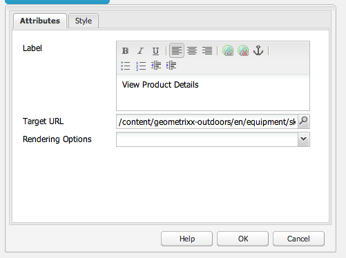

**Etiqueta**: el texto que ven los usuarios. Puede modificar el formato con el editor de texto enriquecido.

**URL de destino** Escriba el URI que desea que los usuarios visiten si hacen clic en el texto.

**Opciones de procesamiento** Describe las opciones de procesamiento. Puede seleccionar una de las siguientes opciones:

* Cargar página en una nueva ventana del navegador
* Cargar página en la ventana actual
* Cargar página en el marco principal
* Cancelar todos los marcos y cargar la página en una ventana completa del explorador

**CSS** En la ficha Estilo, escriba una ruta a la hoja de estilos CSS.

**ID** En la ficha Estilo, escriba un ID para que el componente lo identifique de forma exclusiva.

El siguiente es un ejemplo de vínculo de pulsación:

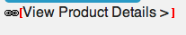

#### Vínculo gráfico {#graphical-link}

Este componente de CTA se puede utilizar para añadir cualquier imagen gráfica con vínculo en la página de aterrizaje. La imagen puede ser un botón simple o cualquier imagen gráfica como fondo. Al hacer clic en la imagen, el usuario se dirige a la URL de destino especificada en las propiedades del componente. Forma parte del grupo **Call to action**.

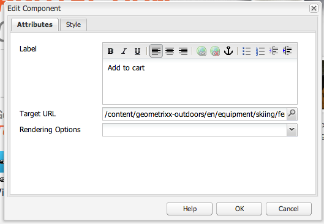

**Etiqueta**: el texto que los usuarios ven en el gráfico. Puede modificar el formato con el editor de texto enriquecido.

**URL de destino** Escriba el URI que desea que los usuarios visiten si hacen clic en la imagen.

**Opciones de procesamiento** Describe las opciones de procesamiento. Puede seleccionar una de las siguientes opciones:

* Cargar página en una nueva ventana del navegador
* Cargar página en la ventana actual
* Cargar página en el marco principal
* Cancelar todos los marcos y cargar la página en una ventana completa del explorador

**CSS** En la ficha Estilo, escriba una ruta a la hoja de estilos CSS.

**ID** En la ficha Estilo, escriba un ID para que el componente lo identifique de forma exclusiva.

A continuación se muestra un ejemplo de vínculo gráfico:

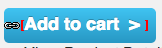

### Formulario de posible cliente de call to action (CTA) {#call-to-action-cta-lead-form}

Un formulario de posible cliente es un formulario que se utiliza para recopilar información del perfil de un visitante o posible cliente. Esta información se puede almacenar y utilizar más adelante para realizar un marketing eficaz basado en la información. Esta información generalmente incluye título, nombre, correo electrónico, fecha de nacimiento, dirección, interés, etc. Forma parte del grupo **Formulario de posibles clientes de CTA**.

Un ejemplo de formulario de posible cliente de CTA tiene este aspecto:

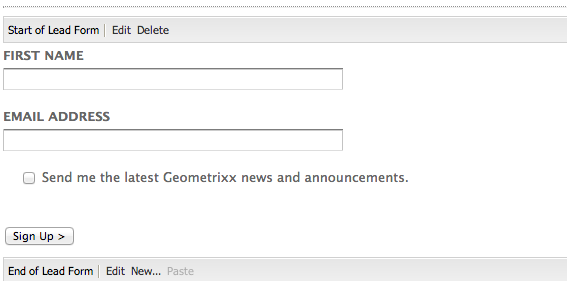

Los formularios de posibles clientes de CTA se crean a partir de varios componentes diferentes:

* **Formulario de cliente potencial**
El componente de formulario de posible cliente define el principio y el final de un nuevo formulario de posible cliente en una página. Otros componentes se pueden colocar entre estos elementos, como ID de correo electrónico, Nombre, etc.

* **Campos y elementos de formulario**
Los campos y elementos de formulario pueden incluir cuadros de texto, botones de opción, imágenes, etc. El usuario suele completar una acción en un campo de formulario, como escribir texto. Consulte elementos de formulario individuales para obtener más información.

* **Componentes de perfil**
Los componentes de perfil están relacionados con los perfiles de visitante utilizados para la colaboración social y otras áreas en las que se requiere la personalización del visitante.

El anterior muestra un formulario de ejemplo; se compone del componente **Formulario de posible cliente** (inicio y final), con **Nombre** y **ID de correo electrónico** campos utilizados para la entrada y un campo **Enviar**

Desde la barra de tareas, están disponibles los siguientes componentes para el formulario de posibles clientes de CTA:

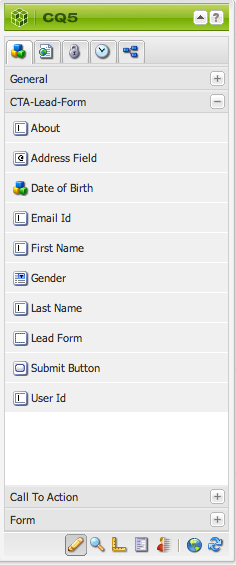

#### Configuración común a muchos componentes del formulario de posibles clientes {#settings-common-to-many-lead-form-components}

Aunque cada uno de los componentes del formulario de posibles clientes tiene un propósito diferente, muchos están compuestos por opciones y parámetros similares.

Al configurar cualquiera de los componentes del formulario, las siguientes pestañas están disponibles en el cuadro de diálogo:

* **Título y texto**
Aquí debe especificar la información básica, como el título del componente y el texto que lo acompaña. Si corresponde, también le permite definir otra información clave, como si el campo puede seleccionarse varias veces y los elementos disponibles para su selección.

* **Valores iniciales**
Permite especificar un valor predeterminado.

* **Restricciones**
Aquí puede especificar si un campo es obligatorio y si hay restricciones de posición en ese campo (por ejemplo, debe ser numérico, etc.).

* **Estilo**
Indica el tamaño y el estilo de los campos.

>[!NOTE]
>
>Los campos que vea varían según el componente individual.
>
>No todas las opciones están disponibles para todos los componentes del formulario de posibles clientes. Consulte Forms para obtener más información sobre estas [configuraciones comunes](/help/sites-authoring/default-components.md#formsgroup).

#### Componentes de formulario de posibles clientes {#lead-form-components}

En la siguiente sección se describen los componentes disponibles para los formularios de Call-to-action.

**Acerca de** permite que los usuarios agreguen información.

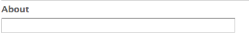

**Campo de dirección** Permite que los usuarios especifiquen información de dirección. Al configurar este componente, debe introducir el Nombre del elemento en el cuadro de diálogo. Element Name es el nombre del elemento de formulario. Esto indica en qué parte del repositorio se almacenan los datos.

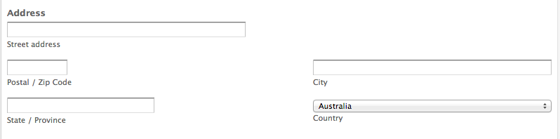

**Fecha de nacimiento** Los usuarios pueden escribir la información de la fecha de nacimiento.

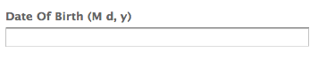

**ID de correo electrónico** permite que los usuarios especifiquen una dirección de correo electrónico (identificación).

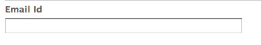

**Nombre** Proporciona un campo para que los usuarios especifiquen su nombre.

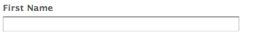

**Sexo** Los usuarios pueden seleccionar su sexo en una lista desplegable.

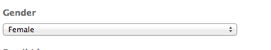

**Apellidos** Los usuarios pueden escribir información sobre apellidos.

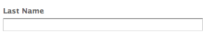

**Formulario de posible cliente** Agregue este componente para agregar un formulario de posible cliente a su página de aterrizaje. Un formulario de posible cliente contiene automáticamente un campo Inicio del formulario de posible cliente y Fin del formulario de posible cliente. Entre medias, se añaden los componentes del formulario de posibles clientes que se describen en esta sección.

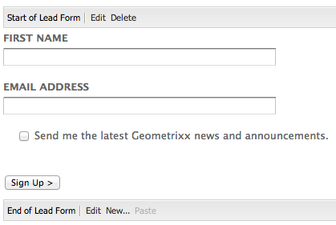

El componente Formulario de posible cliente define el inicio y el final de un formulario con los elementos **Inicio del formulario** y **Fin del formulario**. Siempre están emparejados para garantizar que el formulario esté definido correctamente.

Una vez agregado el formulario de posible cliente, puede configurar el inicio o el final del formulario haciendo clic en **Editar** en la barra correspondiente.

**Inicio del formulario de posibles clientes**

Hay dos fichas disponibles para la configuración **Formulario** y **Avanzado**:

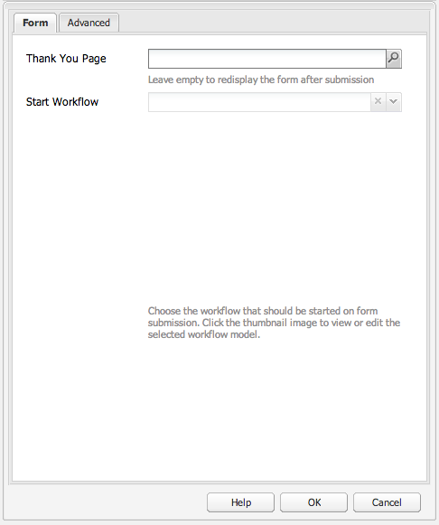

**Página de agradecimiento**: página a la que se hará referencia para agradecer a los visitantes por proporcionar sus datos. Si se deja en blanco, el formulario se vuelve a mostrar después del envío.

**Iniciar flujo de trabajo** Determina qué flujo de trabajo se activa una vez que se envía un formulario de posible cliente.

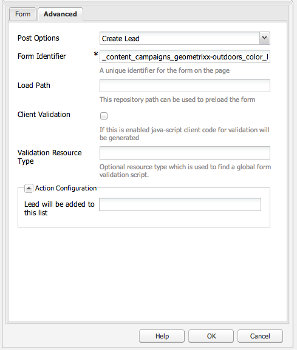

**Opciones de publicación** Las siguientes opciones de publicación están disponibles:

* Crear posible cliente
* Servicio de correo electrónico: crear suscriptor y agregar a la lista: utilícelo si utiliza un proveedor de servicios de correo electrónico como ExactTarget.
* Servicio de correo electrónico: enviar correo electrónico de respuesta automática: utilícelo si utiliza un proveedor de servicios de correo electrónico como ExactTarget.
* Servicio de correo electrónico: cancelar la suscripción de un usuario a la lista: utilícelo si utiliza un proveedor de servicios de correo electrónico como ExactTarget.
* Cancelar suscripción de usuario

**Identificador de formulario**: el identificador de formulario identifica de forma única el formulario de posible cliente. Utilice el identificador del formulario si tiene varios formularios en una sola página; asegúrese de que tengan identificadores diferentes.

**Ruta de carga** es la ruta a las propiedades del nodo que se usaron para cargar valores predefinidos en los campos del formulario de posibles clientes.

Es un campo opcional que especifica la ruta a un nodo del repositorio. Cuando este nodo tiene propiedades que coinciden con los nombres de campo, los campos adecuados del formulario se precargan con el valor de esas propiedades. Si no existe ninguna coincidencia, el campo contiene el valor predeterminado.

**Validación del cliente** Indica si se requiere la validación del cliente para este formulario (la validación del servidor siempre se produce). Esto se puede lograr junto con el componente Captcha de Forms.

**Tipo de recurso de validación** Define el tipo de recurso de validación del formulario si desea validar todo el formulario de posibles clientes (en lugar de campos individuales).

Si está validando el formulario completo, incluya también una de las siguientes opciones:

* Una secuencia de comandos para la validación del cliente:
  ` /apps/<myApp>/form/<myValidation>/formclientvalidation.jsp`

* Una secuencia de comandos para la validación en el servidor:
  ` /apps/<myApp>/form/<myValidation>/formservervalidation.jsp`

**Configuración de la acción** Dependiendo de la selección en Opciones de publicación, la Configuración de la acción cambia. Por ejemplo, al seleccionar Crear posible cliente, puede configurar a qué lista se agrega el posible cliente.

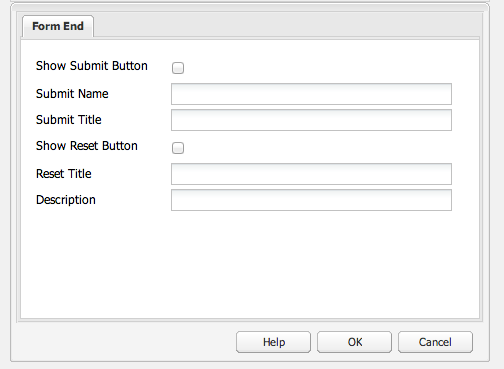

* **Mostrar botón Enviar**
Indica si se debe mostrar o no un botón Enviar.

* **Nombre de envío**
Un identificador si utiliza varios botones de envío en un formulario.

* **Enviar título**
Nombre que aparece en el botón, como Enviar o Enviar.

* **Mostrar botón Restablecer**
Active la casilla de verificación para que el botón Restablecer esté visible.

* **Restablecer título**
Nombre que aparece en el botón Restablecer.

* **Descripción**
Información que aparece debajo del botón.

## Creación de una página de aterrizaje {#creating-a-landing-page}

Al crear una página de aterrizaje, debe realizar tres pasos:

1. Cree una página de importador.
1. [Prepare HTML para la importación.](/help/sites-administering/extending-the-design-importer-for-landingpages.md)
1. Importe el paquete de diseño.

### Uso del importador de diseños {#use-of-the-design-importer}

Dado que la importación de páginas implica la preparación de HTML, la verificación y la prueba de las páginas, la importación de páginas de aterrizaje está pensada como una tarea de administración. Como administrador, los usuarios que realizan la importación necesitan permisos de lectura, escritura, creación y eliminación en `/apps`. Si el usuario no tiene estos permisos, la importación fallará.

>[!NOTE]
>
>Dado que el importador de diseño está diseñado como herramienta de administración que requiere permisos de lectura, escritura, creación y eliminación en `/apps`, Adobe no recomienda el uso del importador de diseño en producción.

Adobe recomienda utilizar el importador de diseño en una instancia de ensayo. En una instancia de ensayo, la importación puede probarla y validarla un desarrollador que luego sea responsable de implementar el código en la instancia de producción.

### Creación de una página de importador {#creating-an-importer-page}

Para poder importar el diseño de la página de aterrizaje, debe crear una página de importador, por ejemplo, en una campaña. La plantilla Página del importador permite importar la página de aterrizaje completa de HTML. La página contiene un cuadro desplegable en el que se puede importar el paquete de diseño de la página de aterrizaje arrastrando y soltando.

>[!NOTE]
>
>De manera predeterminada, una página de importador solo se puede crear en campañas, pero también se puede superponer esta plantilla para crear una página de aterrizaje en `/content/mysite`.

Para crear una página de aterrizaje:

1. Vaya a la consola **Sitios web**.
1. Seleccione la campaña en el panel izquierdo.
1. Haga clic en **Nuevo** para abrir la ventana **Crear página**.
1. Seleccione la plantilla **Página de importador**, agregue un título y, opcionalmente, un nombre, y haga clic en **Crear**.

   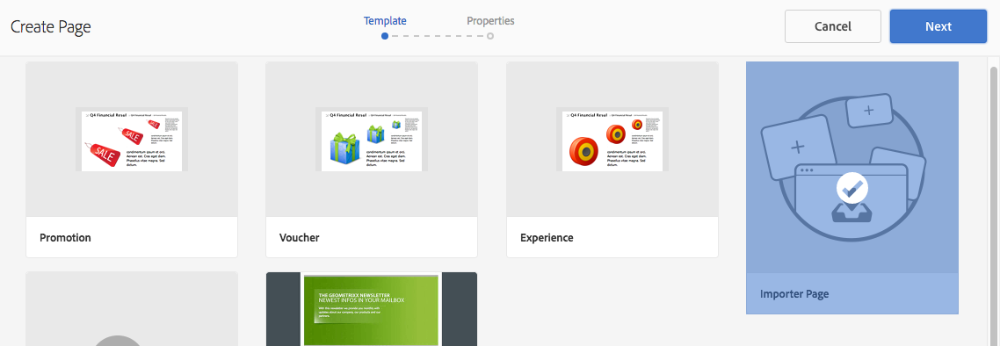

   Se muestra la nueva página del importador.

### Preparación de HTML para su importación {#preparing-the-html-for-import}

Antes de importar el paquete de diseño, es necesario preparar HTML. Consulte [Ampliación y configuración de la importación de diseño](/help/sites-administering/extending-the-design-importer-for-landingpages.md) para obtener más información.

### Importación del paquete de diseño {#importing-the-design-package}

Después de crear una página de importador, puede importar un paquete de diseño en ella. Los detalles sobre la creación del paquete de diseño y su estructura recomendada se explican en [Ampliación y configuración de la importación de diseño](/help/sites-administering/extending-the-design-importer-for-landingpages.md).

Si tiene preparado el paquete de diseño, los pasos siguientes describen cómo importarlo en una página de importador.

1. Abra la página del importador que [creó anteriormente](#creatingablankcanvaspage).

   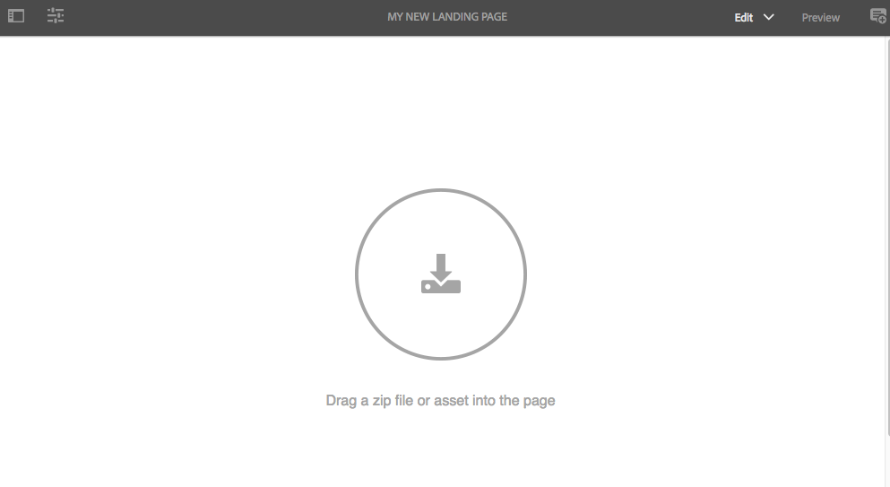

1. Arrastre y suelte el paquete de diseño en el cuadro desplegable. Observe que la flecha cambia de dirección cuando se arrastra un paquete sobre ella.
1. Al arrastrar y soltar, verá la página de aterrizaje en lugar de la página del importador. La página de aterrizaje de HTML se ha importado correctamente.

   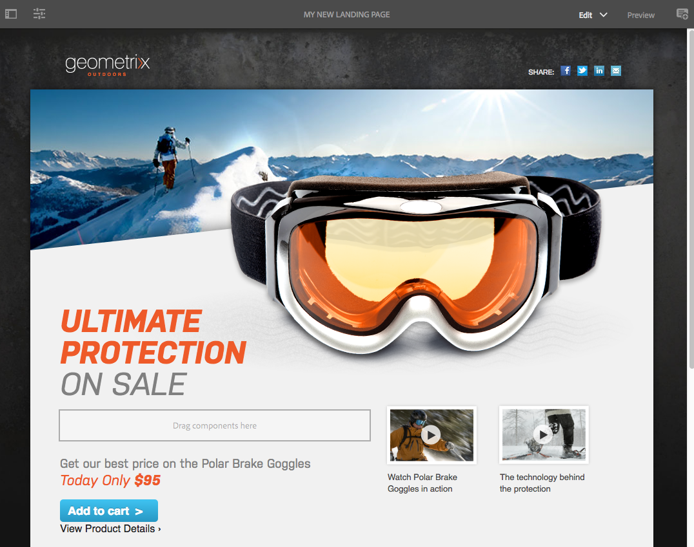

>[!NOTE]
>
>Al importar, el marcado se sanea por motivos de seguridad y para evitar la importación y publicación de marcado no válido. Esto supone que solo hay marcado de HTML y que se filtrarán todas las demás formas de elementos, como SVG en línea o componentes web.

>[!NOTE]
>
>Si tiene problemas al importar el paquete de diseño, consulte [Solución de problemas](/help/sites-administering/extending-the-design-importer-for-landingpages.md#troubleshooting).

## Uso de páginas de destino {#working-with-landing-pages}

El diseño y los activos de una página de aterrizaje suelen ser creados por un diseñador, posiblemente en una agencia, con herramientas a las que están acostumbrados, como Adobe Photoshop o Adobe Dreamweaver. Cuando se completa el diseño, el diseñador envía un archivo zip con todos los recursos a marketing. A continuación, el contacto de marketing es responsable de soltar el archivo zip en AEM y publicar el contenido.

Además, es posible que el diseñador tenga que realizar modificaciones en la página de aterrizaje después de importarla editando o eliminando contenido y configurando los componentes de call-to-action. Por último, el experto en marketing debe obtener una vista previa de la página de aterrizaje y, a continuación, activar la campaña para asegurarse de que se publique la página de aterrizaje.

En esta sección se describe cómo realizar las siguientes acciones:

* Eliminación de una página de aterrizaje
* Descargar el paquete de diseño
* Ver información de importación
* Restablecer una página de aterrizaje
* [Configuración de los componentes de CTA y adición de contenido a la página](#call-to-action-cta)
* Previsualización de la página de aterrizaje
* Activar/publicar una página de aterrizaje

Al importar el paquete de diseño, **Borrar diseño** y **Descargar archivo comprimido importado** están disponibles en el menú de configuración de la página:

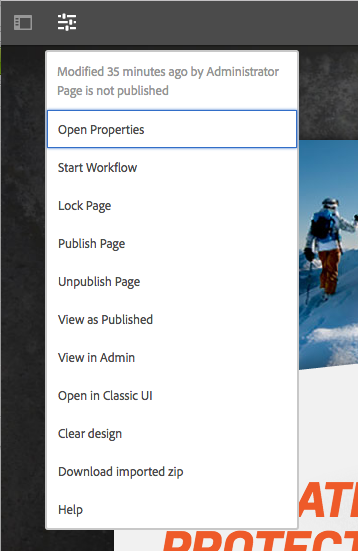

### Descarga del paquete de diseño importado {#downloading-the-imported-design-package}

La descarga del archivo zip permite registrar qué zip se importó con una página de aterrizaje en particular. Los cambios realizados en una página no se añaden al zip.

Para descargar el paquete de diseño importado, haga clic en **Descargar archivo zip** en la barra de herramientas de la página de aterrizaje.

### Visualización de información de importación {#viewing-import-information}

En cualquier momento, puede ver información sobre la última importación haciendo clic en el signo de exclamación azul en la parte superior de la página de aterrizaje en la interfaz de usuario clásica.

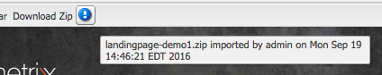

En caso de que el paquete de diseño importado tenga algunos problemas, por ejemplo, si hace referencia a imágenes/scripts que no existen dentro del paquete, etc., el importador de diseños muestra estos problemas en forma de lista. Para ver la lista de problemas, en la interfaz de usuario clásica, haga clic en el vínculo Problemas en la barra de herramientas de la página de aterrizaje. En la siguiente imagen, al hacer clic en el vínculo **Problemas**, se abre la ventana Importar problemas.

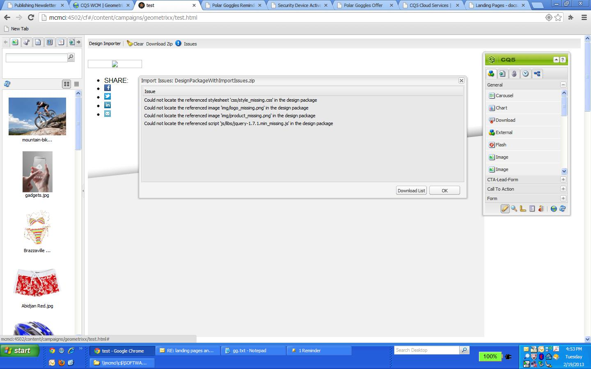

### Restablecimiento de una página de aterrizaje {#resetting-a-landing-page}

Si desea volver a importar el paquete de diseño de la página de aterrizaje después de realizar algunos cambios, puede &quot;borrar&quot; la página de aterrizaje haciendo clic en **Borrar** en la parte superior de la página de aterrizaje en la interfaz de usuario clásica o haciendo clic en Borrar en el menú de configuración de la interfaz de usuario táctil optimizada. Al hacerlo, se elimina la página de aterrizaje importada y se crea una página de importador en blanco.

Al borrar la página de aterrizaje, puede quitar los cambios de contenido. Si hace clic en **No**, se conservarán los cambios de contenido; es decir, se conservará la estructura de `jcr:content/importer` y solo se quitarán el componente de página del importador y los recursos de `etc/design`. Mientras que, si hace clic en **Sí**, `jcr:content/importer` también se elimina.

>[!NOTE]
>
>Si decide quitar los cambios de contenido, al hacer clic en **Borrar** se perderán todos los cambios realizados en la página de aterrizaje importada y en todas las propiedades de la página.

### Modificación y adición de componentes en una página de aterrizaje {#modifying-and-adding-components-on-a-landing-page}

Para modificar componentes en la página de aterrizaje, haga doble clic en ellos para abrirlos y editarlos como lo haría con cualquier otro componente.

Para agregar componentes a la página de aterrizaje, arrastre y suelte los componentes en la página de aterrizaje, ya sea desde la barra de tareas de la interfaz de usuario clásica o desde el panel Componentes de la interfaz de usuario táctil optimizada, y edítelos según corresponda.

>[!NOTE]
>
>Si un componente de la página de aterrizaje no se puede editar, deberá volver a importar el archivo zip después de [modificar el archivo HTML.](/help/sites-administering/extending-the-design-importer-for-landingpages.md) Esto significa que durante la importación, las partes no editables no se convirtieron en componentes de AEM.

### Eliminación de una página de aterrizaje {#deleting-a-landing-page}

Eliminar una página de aterrizaje es como eliminar una página de AEM normal.

La única excepción es que, al eliminar una página de aterrizaje de escritorio, también se elimina la página de aterrizaje móvil correspondiente (si está presente), pero no a la inversa.

### Publicación de una página de aterrizaje {#publishing-a-landing-page}

Puede publicar la página de aterrizaje y todas sus dependencias, igual que publicar una página normal.

>[!NOTE]
>
>La publicación de la página de aterrizaje de escritorio también publica su versión móvil correspondiente (si la hay). Pero la publicación de una página de aterrizaje móvil no publica la versión de escritorio de.
