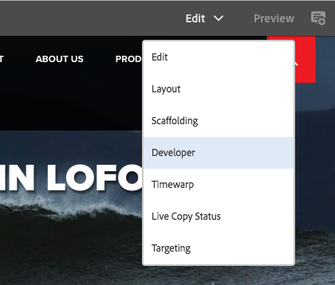
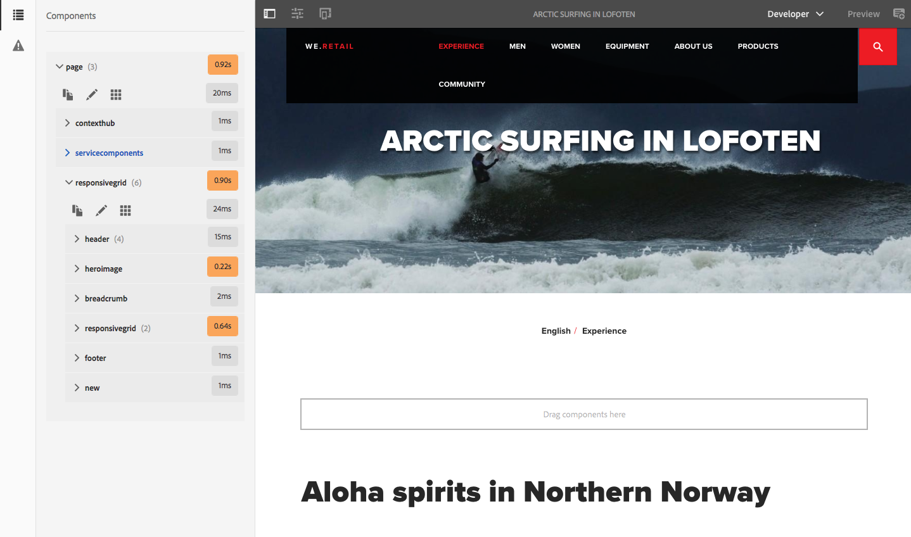
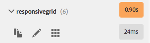
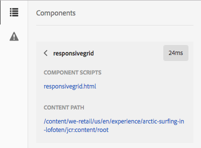
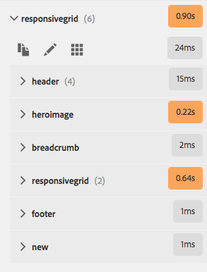
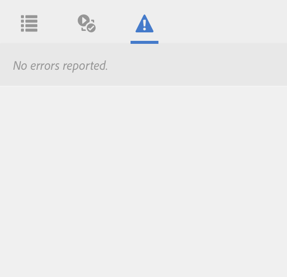
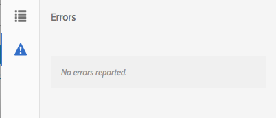

# Modo de desarrollador{#developer-mode}

Al editar páginas en Adobe Experience Manager (AEM), hay disponibles varios [modos](/help/sites-authoring/author-environment-tools.md#modestouchoptimizedui), incluido el modo de desarrollador. Se abrirá un panel lateral con varias pestañas que proporcionan al desarrollador información sobre la página actual. Las tres pestañas son:

* **[Componentes](#components)** para ver información de estructura y rendimiento.
* **[Pruebas](#tests)** para ejecutar pruebas y analizar los resultados.
* **[Errores](#errors)** para ver los problemas que se producen.

Esto ayuda a un desarrollador a lo siguiente:

* Descubrir: de qué páginas se componen.
* Depuración: qué ocurre dónde y cuándo, lo que a su vez ayuda a resolver problemas.
* Prueba: ¿la aplicación se comporta según lo esperado?

>[!CAUTION]
>
>Modo de desarrollador:
>
>* Solo está disponible en la IU táctil (al editar páginas).
>* No está disponible en dispositivos móviles ni en ventanas pequeñas en equipos de escritorio (debido a restricciones de espacio).
>
>   * Esto ocurre cuando la anchura es inferior a 1024 píxeles.
>* Solo está disponible para los usuarios que sean miembros del grupo `administrators`.

>[!CAUTION]
>
>El modo de desarrollador solo está disponible en una instancia de autor estándar que no utilice el modo de ejecución nosamplecontent.
>
>Si es necesario, se puede configurar para su uso:
>
>* en una instancia de autor mediante el modo de ejecución nosamplecontent
>* una instancia de publicación
>
>Debe volver a desactivarse después de su uso.

>[!NOTE]
>
>Consulte:
>
>* Artículo de la base de conocimiento, [Solución de problemas de la IU táctil de AEM](https://experienceleague.adobe.com/es/docs/experience-cloud-kcs/kbarticles/ka-16935), para obtener más sugerencias y herramientas.
>* Sesión de AEM Gems sobre [AEM 6.0 Developer Mode](https://experienceleague.adobe.com/docs/events/experience-manager-gems-recordings/gems2014/aem-developer-mode.html?lang=es).
>

## Abriendo modo de desarrollador {#opening-developer-mode}

El modo de desarrollador se implementa como panel lateral en el editor de páginas. Para abrir el panel, seleccione **Desarrollador** en el selector de modo de la barra de herramientas del editor de páginas:

El panel se divide en dos pestañas:

* **[Componentes](/help/sites-developing/developer-mode.md#components)**: muestra un árbol de componentes, similar al [árbol de contenido](/help/sites-authoring/author-environment-tools.md#content-tree) para autores

* **[Errores](/help/sites-developing/developer-mode.md#errors)**: cuando se producen problemas, se muestran los detalles de cada componente.

### Componentes {#components}

Muestra un árbol de componentes que:

* Describe la cadena de componentes y plantillas procesados en la página (SLY, JSP, etc.). El árbol se puede expandir para mostrar el contexto dentro de la jerarquía.
* Muestra el tiempo de cálculo del lado del servidor para procesar el componente.
* Permite expandir el árbol y seleccionar componentes específicos dentro de él. La selección proporciona acceso a los detalles del componente, como:

  * Ruta del repositorio
  * Vínculos a scripts (a los que se accede en CRXDE Lite)

* Los componentes seleccionados (en el flujo de contenido, indicados por un borde azul) se resaltarán en el árbol de contenido (y a la inversa).

Esto puede ayudar a:

* Determine y compare el tiempo de renderización por componente.
* Ver y comprender la jerarquía.
* Comprenda y, a continuación, mejore el tiempo de carga de la página buscando componentes lentos.

Cada entrada de componente puede mostrar (por ejemplo):

* **Ver detalles**: un vínculo a una lista que muestra:

  * todos los scripts de componente utilizados para procesar el componente.
  * la ruta de contenido del repositorio para este componente específico.

  

* **Editar script**: un vínculo que:

  * abre el script del componente en CRXDE Lite.

* Al expandir una entrada de componente (cabeza de flecha), también se puede mostrar:

  * La jerarquía dentro del componente seleccionado.
  * Tiempos de procesamiento para el componente seleccionado de forma aislada, cualquier componente individual anidado en él y el total combinado.

  

>[!CAUTION]
>
>Algunos vínculos apuntan a scripts bajo `/libs`. Sin embargo, solo son para referencia, **no debe** editar nada debajo de `/libs`, ya que cualquier cambio que realice podría perderse. Esto se debe a que esta rama puede sufrir cambios cada vez que actualice o aplique una revisión o un paquete de funciones. Realice los cambios que necesite en `/apps`. Ver [Superposiciones y invalidaciones](/help/sites-developing/overlays.md).

### Errores {#errors}

Esperamos que la ficha **Errores** siempre esté vacía (como se ha indicado anteriormente), pero cuando se producen problemas, se muestran los siguientes detalles para cada componente:

* Una advertencia si el componente escribe una entrada en el registro de errores, junto con detalles del error y vínculos directos al código adecuado en CRXDE Lite.
* Advertencia si el componente abre una sesión de administración.

Por ejemplo, en una situación en la que se llama a un método indefinido, el error resultante se muestra en la ficha **Errores**:

La entrada del componente en el árbol de la pestaña Componentes también se marca con un indicador cuando se produce un error.

### Pruebas {#tests}

>[!CAUTION]
>
>En AEM 6.2, las funciones de prueba del modo de desarrollador se volvieron a implementar como una aplicación de herramientas independiente.
>
>Para obtener información detallada, consulta [Probar la interfaz de usuario](/help/sites-developing/hobbes.md).
