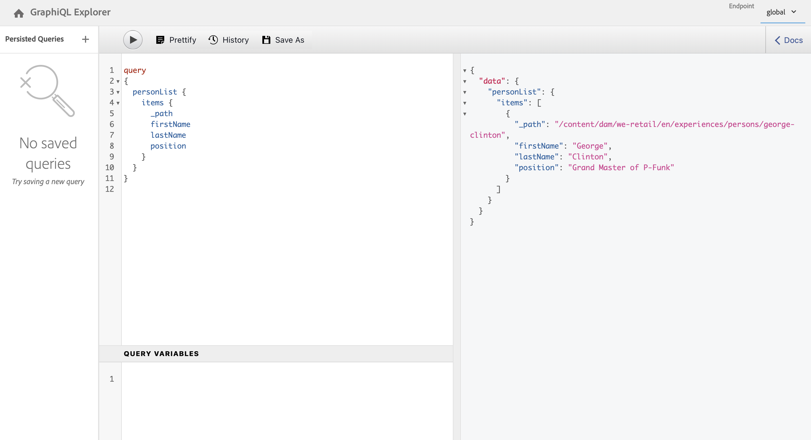

# Acceso y entrega de fragmentos de contenido Guía de inicio rápido sin encabezado {#accessing-delivering-content-fragments}

Aprenda a utilizar la API de REST de AEM Assets para administrar fragmentos de contenido y la API de GraphQL para la entrega sin encabezado de contenido de fragmentos de contenido.

## ¿Qué son las API de REST de GraphQL y Assets? {#what-are-the-apis}

[Ahora que ha creado algunos fragmentos de contenido,](create-content-fragment.md) puede utilizar las API de AEM para entregarlas sin problemas.

* [La API de GraphQL](/help/sites-developing/headless/graphql-api/graphql-api-content-fragments.md) permite crear solicitudes para acceder a fragmentos de contenido y enviarlos.
  * Para usar esto, [los extremos deben definirse y habilitarse en AEM](/help/sites-developing/headless/graphql-api/graphql-endpoint.md#enabling-graphql-endpoint) y, si es necesario, la [interfaz de GraphiQL debe instalarse](/help/sites-developing/headless/graphql-api/graphql-api-content-fragments.md#installing-graphiql-interface).
* [La API de REST de Assets](/help/assets/assets-api-content-fragments.md) le permite crear y modificar fragmentos de contenido (y otros recursos).

El resto de esta guía se centra en el acceso a GraphQL y la entrega de fragmentos de contenido.

## Cómo entregar un fragmento de contenido mediante GraphQL {#how-to-deliver-a-content-fragment}

Los arquitectos de la información deben diseñar consultas para sus extremos de canal para entregar contenido. Considere estas consultas solo una vez por extremo, por modelo. Para esta guía de introducción, cree solo una.

1. Inicie sesión en AEM y acceda a la [interfaz de GraphiQL](/help/sites-developing/headless/graphql-api/graphiql-ide.md):
   * Por ejemplo: `http://<host>:<port>/aem/graphiql.html`.

1. GraphiQL es un editor de consultas en el explorador para GraphQL. Puede utilizarlo para generar consultas, recuperar fragmentos de contenido y entregarlos sin problemas como JSON.
   * El panel izquierdo le permite generar la consulta.
   * El panel derecho muestra los resultados.
   * El editor de consultas incluye la finalización del código y teclas de función para ejecutar fácilmente la consulta.
     

1. Suponiendo que el modelo que hemos creado se llamara `person` con campos `firstName`, `lastName` y `position`, podemos generar una consulta sencilla para recuperar el contenido de nuestro fragmento de contenido.

   ```text
   query 
   {
     personList {
       items {
         _path
         firstName
         lastName
         position
       }
     }
   }
   ```

1. Introduzca la consulta en el panel izquierdo.
<!--
   
-->

1. Haga clic en el icono **Ejecutar consulta** (flecha derecha) o use la tecla de acceso directo `Ctrl-Enter` y los resultados se mostrarán como JSON en el panel derecho.
   

1. Haga clic:
   * **Documentos** en la parte superior derecha de la página para mostrar la documentación en contexto que le ayudará a crear consultas que se adapten a sus propios modelos.
   * **Historial** en la barra de herramientas superior para mostrar consultas anteriores.
   * **Guardar como** y **Guardar** para guardar sus consultas, después de lo cual podrá enumerarlas y recuperarlas desde el panel **Consultas persistentes** y **Publicar**.
     

GraphQL permite consultas estructuradas que pueden dirigirse no solo a conjuntos de datos específicos u objetos de datos individuales, sino que también pueden proporcionar elementos específicos de los objetos, resultados anidados, compatibilidad con variables de consulta y mucho más.

GraphQL puede evitar las solicitudes de API iterativas y el exceso de entrega. En su lugar, permite la entrega masiva de exactamente lo que se necesita para procesar como respuesta a una sola consulta de API. El JSON resultante se puede utilizar para entregar datos en otros sitios o aplicaciones.

## Siguientes pasos {#next-steps}

¡Eso es todo! Ahora tiene una comprensión básica de la administración de contenido sin encabezado en AEM. Hay muchos más recursos en los que puede profundizar para comprender las funciones disponibles.

* **[Explorador de configuración](create-configuration.md)**: para obtener detalles acerca del Explorador de configuración de AEM
* **[Fragmentos de contenido](/help/assets/content-fragments/content-fragments.md)**: para obtener más información acerca de la creación y administración de fragmentos de contenido
* **[IDE de GraphiQL](/help/sites-developing/headless/graphql-api/graphiql-ide.md)** para obtener más información sobre el uso del IDE de GraphiQL
* **[Consultas persistentes](/help/sites-developing/headless/graphql-api/persisted-queries.md)** para obtener más información sobre las Consultas persistentes
* **[Compatibilidad con fragmentos de contenido en la API HTTP de AEM Assets](/help/assets/assets-api-content-fragments.md)**: para obtener más información sobre el acceso al contenido de AEM directamente a través de la API HTTP, mediante las operaciones CRUD (Crear, Leer, Actualizar, Eliminar)
* **[API de GraphQL](/help/sites-developing/headless/graphql-api/graphql-api-content-fragments.md)**: para obtener más información sobre cómo enviar fragmentos de contenido sin encabezado
