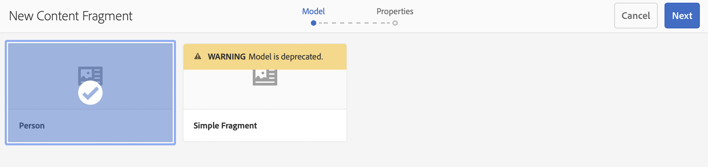
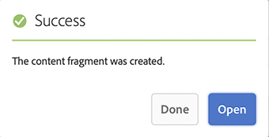

# Guía de inicio rápido Creación de fragmentos de contenido sin encabezado {#creating-content-fragments}

Aprenda a utilizar fragmentos de contenido de AEM para diseñar, crear, depurar y utilizar contenido independiente de las páginas para una entrega sin encabezado.

## ¿Qué son los fragmentos de contenido? {#what-are-content-fragments}

[Ahora que ha creado una carpeta de recursos](create-assets-folder.md) donde puede almacenar los fragmentos de contenido, puede crear los fragmentos.

Los fragmentos de contenido permiten diseñar, crear, depurar y publicar contenido independiente de cualquier página. Permiten preparar contenido listo para su uso en varias ubicaciones y en varios canales.

Los fragmentos de contenido contienen contenido estructurado y se pueden entregar en formato JSON.

## Cómo crear un fragmento de contenido {#how-to-create-a-content-fragment}

Los autores de contenido generarán el número de fragmentos de contenido que corresponda para representar el contenido que crean. Esta será su tarea principal en AEM. Para los fines de esta guía de introducción, solo necesitamos crear uno.

1. Inicie sesión en AEM y, en el menú principal, seleccione **Navegación > Assets**.
1. Vaya a la [carpeta que creó anteriormente.](create-assets-folder.md)
1. Haga clic en **Crear > Fragmento de contenido**.
1. La creación de un fragmento de contenido se presenta como un asistente en dos pasos. Seleccione primero qué modelo desea utilizar para crear el fragmento de contenido y haga clic en **Siguiente**.
   * Los modelos disponibles dependen de la [**Configuración de nube** que definió para la carpeta de recursos](create-assets-folder.md) en el que está creando el fragmento de contenido.
   * Si recibe el mensaje `We could not find any models`, compruebe la configuración de la carpeta de recursos.

   
1. Proporcione un **Título**, **Descripción** y **Etiquetas** según sea necesario y haga clic en **Crear**.

   
1. Haga clic en **Abrir** en la ventana de confirmación.

   
1. Proporcione los detalles del fragmento de contenido en el Editor de fragmentos de contenido.

   
1. Haz clic en **Guardar** o en **Guardar y cerrar**.

Los fragmentos de contenido pueden hacer referencia a otros fragmentos de contenido, lo que permite anidar una estructura de contenido si es necesario.

Los fragmentos de contenido también pueden hacer referencia a otros recursos en AEM. [Estos recursos deben almacenarse en AEM](/help/assets/manage-assets.md) antes de crear una referencia a un fragmento de contenido.

## Siguientes pasos {#next-steps}

Ahora que ha creado un fragmento de contenido, puede pasar a la parte final de la guía de introducción y [crear solicitudes de API para acceder y entregar fragmentos de contenido.](create-api-request.md)

>[!TIP]
>
>Para obtener información detallada acerca de la administración de fragmentos de contenido, consulte la [Documentación de fragmentos de contenido](/help/assets/content-fragments/content-fragments.md)
