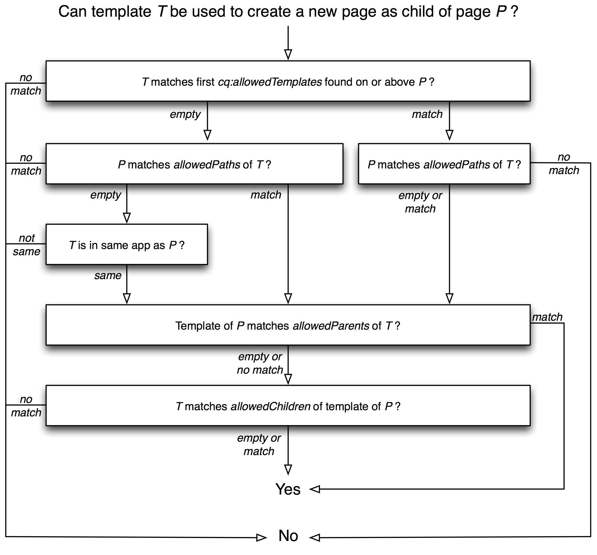

# Plantillas{#templates}

Las plantillas se utilizan en distintos puntos de AEM:

* [Cuando crea una página, selecciona una plantilla](#templates-pages). Esta plantilla se utiliza como base para la nueva página. La plantilla define la estructura de la página, cualquier contenido inicial y los [componentes](/help/sites-authoring/default-components.md) que se pueden usar (propiedades de diseño).

* [Cuando crea un fragmento de contenido, también selecciona una plantilla](#templates-content-fragments). Esta plantilla define la estructura, los elementos iniciales y las variaciones.

Las siguientes plantillas se tratan en detalle:

* [Plantillas de página: editables](/help/sites-developing/page-templates-editable.md)
* [Plantillas de página: estáticas](/help/sites-developing/page-templates-static.md)
* [Lanzamiento de fragmentos de contenido](/help/sites-developing/content-fragment-templates.md)
* [Renderizado de plantilla adaptable](/help/sites-developing/templates-adaptive-rendering.md)

## Plantillas - Páginas {#templates-pages}

AEM ahora ofrece dos tipos básicos de plantillas para crear páginas:

>[!NOTE]
>
>Al usar una plantilla para [crear una página](/help/sites-authoring/managing-pages.md#creating-a-new-page), no hay ninguna diferencia visible (para el autor de la página) ni ninguna indicación del tipo de plantilla que se está usando.

### Plantillas editables {#editable-templates}

Las plantillas editables ahora se consideran prácticas recomendadas para el desarrollo con AEM.

Las ventajas de las plantillas editables:

* Sus autores pueden [crear](/help/sites-authoring/templates.md#creating-a-new-template-template-author) y [editar](/help/sites-authoring/templates.md#editing-a-template-structure-template-author).

* Se han introducido para permitirle definir lo siguiente para cualquier página creada con la plantilla:

  * la estructura
  * el contenido inicial
  * políticas de contenido

* Una vez creada la nueva página, se mantiene una conexión dinámica entre la página y la plantilla. Esta conexión significa que los cambios en la estructura de la plantilla se reflejan en cualquier página creada con esa plantilla; los cambios en el contenido inicial no se reflejan.
* Utiliza directivas de contenido (editadas desde el editor de plantillas) para mantener las propiedades de diseño (no utiliza el modo Diseño en el editor de páginas).
* Se almacenan en `/conf`
* Consulte [Plantillas editables](/help/sites-developing/page-templates-editable.md) para obtener más información.

>[!NOTE]
>
>Vea [Uso de plantillas de página editables para desarrollar un sitio Experience Manager](https://experienceleague.adobe.com/docs/experience-manager-learn/sites/page-authoring/template-editor-feature-video-use.html?lang=es).

### Plantillas estáticas {#static-templates}

Plantillas estáticas:

* Los desarrolladores deben definirlo y configurarlo.
* El sistema de creación de plantillas original de AEM que ha estado disponible para muchas versiones.
* Una plantilla estática es una jerarquía de nodos que tiene la misma estructura que la página que se va a crear, pero sin contenido real.
* Se copian para crear la página, no existe ninguna conexión dinámica posteriormente.
* Utiliza [Modo de diseño](/help/sites-authoring/default-components-designmode.md) para mantener las propiedades de diseño.
* Se almacenan en `/apps`
* Consulte [Plantillas estáticas](/help/sites-developing/page-templates-static.md) para obtener más información.

>[!NOTE]
>
>A partir de la versión 6.5 de AEM, el uso de plantillas estáticas no se considera una práctica recomendada. En su lugar, utilice Plantillas editables.
>
>Las herramientas de [modernización de AEM](modernization-tools.md) pueden ayudarle a migrar de plantillas estáticas a editables.

### Disponibilidad de la plantilla {#template-availability}

>[!CAUTION]
>
>AEM ofrece varias propiedades para controlar las plantillas permitidas en **Sitios**. Sin embargo, combinarlas puede dar lugar a reglas complejas difíciles de rastrear y administrar.
>
>Por lo tanto, Adobe recomienda empezar de forma sencilla definiendo:
>
>* solo la propiedad `cq:allowedTemplates`
>
>* solo en la raíz del sitio
>
>Para ver un ejemplo, vea We.Retail: `/content/we-retail/jcr:content`
>
>Las propiedades `allowedPaths`, `allowedParents` y `allowedChildren` también se pueden colocar en las plantillas para definir reglas más sofisticadas. Sin embargo, cuando es posible, es *mucho* más fácil definir más propiedades de `cq:allowedTemplates` en subsecciones del sitio si es necesario restringir aún más las plantillas permitidas.
>
>Una ventaja adicional es que un autor puede actualizar las propiedades de `cq:allowedTemplates` en la ficha **Avanzadas** de **Propiedades de página**. Las demás propiedades de la plantilla no se pueden actualizar mediante la interfaz de usuario (estándar), por lo que se necesitaría un desarrollador para mantener las reglas y una implementación de código para cada cambio.

Al crear una página en la interfaz de administración del sitio, la lista de plantillas disponibles depende de la ubicación de la nueva página y de las restricciones de colocación especificadas en cada plantilla.

Las siguientes propiedades determinan si se utiliza una plantilla `T` para colocar una nueva página como secundaria de la página `P`. Cada una de estas propiedades es una cadena de varios valores que contiene cero o más expresiones regulares que se utilizan para la coincidencia con rutas:

* La propiedad `cq:allowedTemplates` del subnodo `jcr:content` de `P` o un antecesor de `P`.

* La propiedad `allowedPaths` de `T`.

* La propiedad `allowedParents` de `T`.

* La propiedad `allowedChildren` de la plantilla de `P`.

La evaluación funciona de la siguiente manera:

* Se comparó la primera propiedad `cq:allowedTemplates` que no está vacía al ascender la jerarquía de páginas que comienza por `P` con la ruta de acceso de `T`. Si ninguno de los valores coincide, `T` se rechaza.

* Si `T` tiene una propiedad `allowedPaths` que no está vacía, pero ninguno de los valores coincide con la ruta de acceso de `P`, se rechaza `T`.

* Si ambas propiedades están vacías o no existen, se rechaza `T` a menos que pertenezca a la misma aplicación que `P`. `T` pertenece a la misma aplicación que `P` solo si el nombre del segundo nivel de la ruta de acceso de `T` es el mismo que el nombre del segundo nivel de la ruta de acceso de `P`. Por ejemplo, la plantilla `/apps/geometrixx/templates/foo` pertenece a la misma aplicación que la página `/content/geometrixx`.

* Si `T` tiene una propiedad `allowedParents` que no está vacía, pero ninguno de los valores coincide con la ruta de acceso de `P`, se rechaza `T`.

* Si la plantilla de `P` tiene una propiedad `allowedChildren` que no está vacía, pero ninguno de los valores coincide con la ruta de acceso de `T`, se rechaza `T`.

* En todos los demás casos, se permite `T`.

El diagrama siguiente muestra el proceso de evaluación de la plantilla:

#### Limitación de plantillas utilizadas en páginas secundarias {#limiting-templates-used-in-child-pages}

Para limitar qué plantillas se pueden usar para crear páginas secundarias en una página determinada, use la propiedad `cq:allowedTemplates` del nodo `jcr:content` de la página para especificar la lista de plantillas que se permitirán como secundarias. Cada valor de la lista debe ser una ruta absoluta a una plantilla para una página secundaria permitida, por ejemplo, `/apps/geometrixx/templates/contentpage`.

Puede usar la propiedad `cq:allowedTemplates` en el nodo `jcr:content` de la plantilla para aplicar esta configuración a todas las páginas recién creadas que usen esta plantilla.

Si desea agregar más restricciones, por ejemplo, con respecto a la jerarquía de plantillas, puede utilizar las propiedades `allowedParents/allowedChildren` en la plantilla. A continuación, puede especificar explícitamente que las páginas creadas a partir de una plantilla T tengan que ser páginas principales o secundarias de páginas creadas a partir de una plantilla T.

## Plantillas: fragmentos de contenido {#templates-content-fragments}

Ver [Plantillas de fragmentos de contenido](/help/sites-developing/content-fragment-templates.md).
