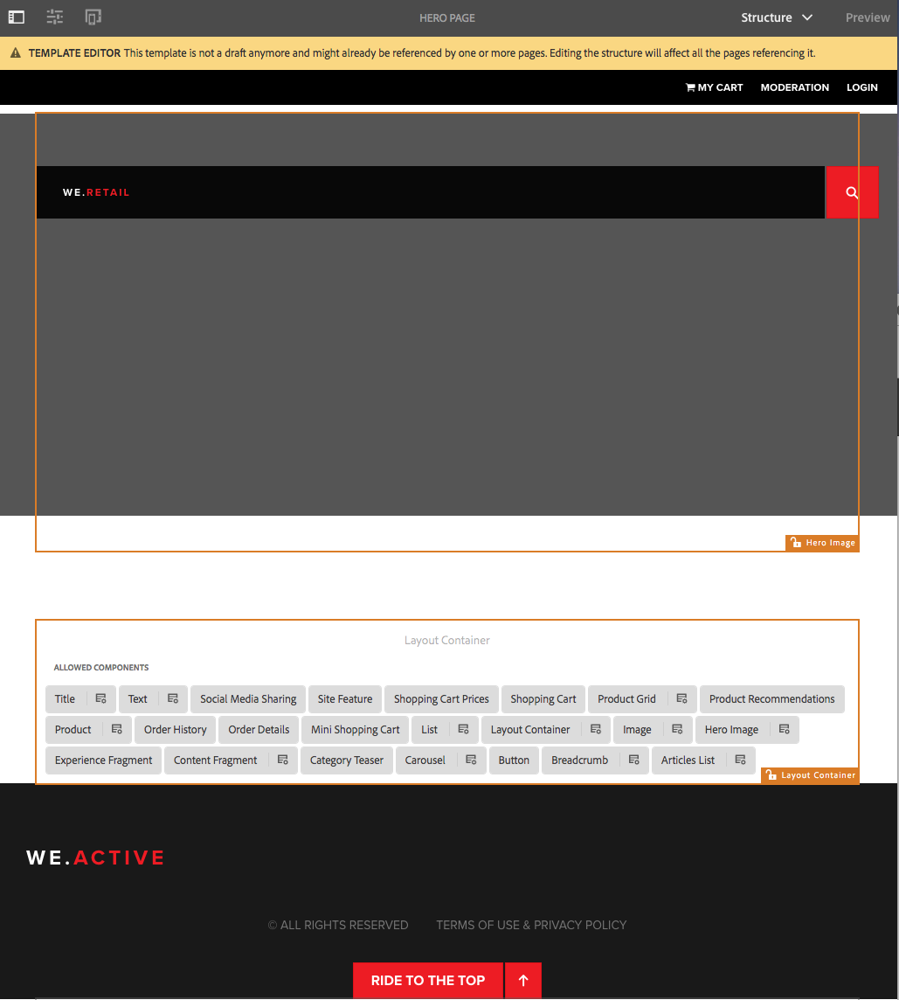
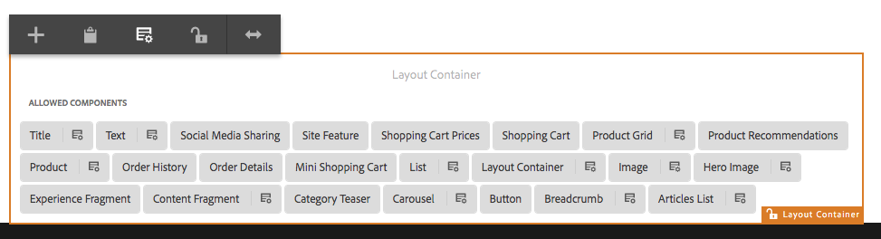
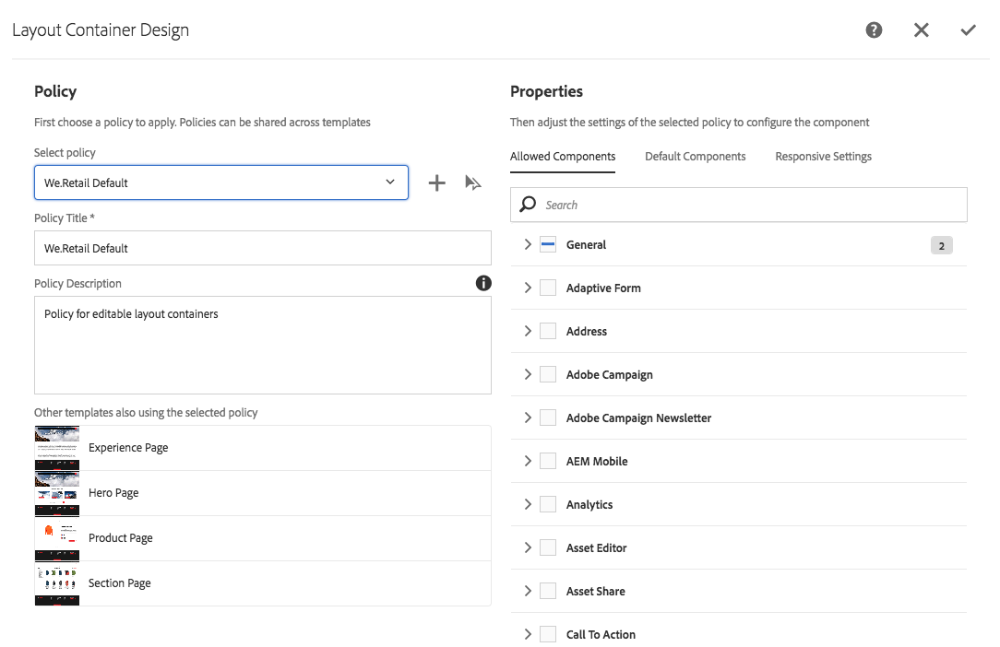
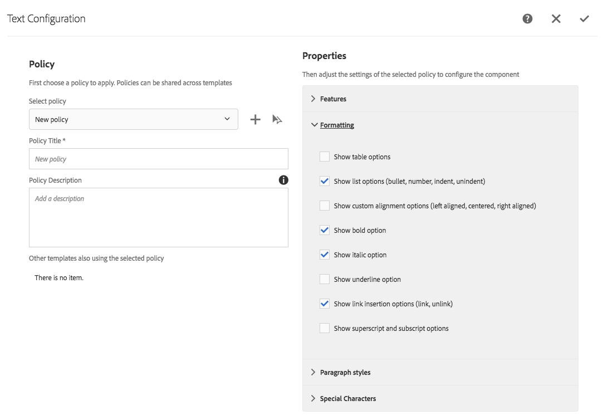

# Prueba de plantillas editables en We.Retail{#trying-out-editable-templates-in-we-retail}

Con las plantillas editables, la creación y el mantenimiento de plantillas ya no es una tarea exclusiva para desarrolladores. Un tipo de usuario avanzado, que se denomina autor de plantillas, ahora puede crear plantillas. Los desarrolladores siguen necesitando configurar el entorno, crear bibliotecas de clientes y crear los componentes que se van a utilizar, pero una vez que estos conceptos básicos están establecidos, el autor de la plantilla tiene la flexibilidad de crear y configurar plantillas sin un proyecto de desarrollo.

Todas las páginas de We.Retail se basan en plantillas editables, lo que permite a los usuarios que no son desarrolladores adaptar y personalizar las plantillas.

## Probando a cabo {#trying-it-out}

1. Edite la página Equipamiento de la rama maestra de idioma.

   http://localhost:4502/editor.html/content/we-retail/language-masters/en/equipment.html

1. El selector de modo ya no ofrece el modo Diseño. Todas las páginas de We.Retail se basan en plantillas editables y, para modificar el diseño de las plantillas editables, deben editarse en el editor de plantillas.
1. En el menú **Información de página**, seleccione **Editar plantilla**.
1. Ahora está editando la plantilla Página principal.

   El modo de estructura de la página permite modificar la estructura de la plantilla. Esto incluye, por ejemplo, los componentes permitidos en el contenedor de diseño.

   

1. Configure las directivas del contenedor de diseño para definir qué componentes se permiten en el contenedor.

   Las directivas son el equivalente de las configuraciones de diseño.

   

1. En el cuadro de diálogo de diseño del contenedor de diseño, puede

   * Seleccione una política existente o cree una política para el contenedor
   * Seleccione los componentes permitidos en el contenedor
   * Defina los componentes predeterminados que se colocarán cuando se arrastre un recurso al contenedor

   

1. En el editor de plantillas, puede editar la directiva del componente de texto dentro del contenedor de diseño.

   Esto le permite:

   * Seleccione una política existente o cree una política para el contenedor
   * Defina las funciones disponibles para el autor de la página al utilizar este componente, como

     * Fuentes de pegado permitidas
     * Opciones de formato
     * Estilos de párrafo permitidos
     * Caracteres especiales permitidos

   Muchos componentes basados en los componentes principales permiten la configuración de opciones en el nivel de componente a través de las plantillas editables, lo que elimina la necesidad de que los desarrolladores los personalicen.

   

1. En el editor de plantillas, puede usar el selector de modo para cambiar al modo **Contenido inicial** y definir qué contenido se requiere en la página.

   El modo **Diseño** se puede usar tal cual en una página normal para definir el diseño de la plantilla.

## Más información {#more-information}

Para obtener más información, consulte el documento de creación [Creación de plantillas de página](/help/sites-authoring/templates.md) o el documento para desarrolladores Página [Plantillas: editables](/help/sites-developing/page-templates-editable.md) para obtener detalles técnicos completos sobre plantillas editables.

Quizá también desee investigar [componentes principales](/help/sites-developing/we-retail-core-components.md). Consulte el documento de creación [Componentes principales](https://experienceleague.adobe.com/docs/experience-manager-core-components/using/introduction.html?lang=es) para obtener una descripción general de las capacidades de los componentes principales y el documento para desarrolladores [Desarrollo de componentes principales](https://helpx.adobe.com/experience-manager/core-components/using/developing.html) para obtener una descripción general técnica.
